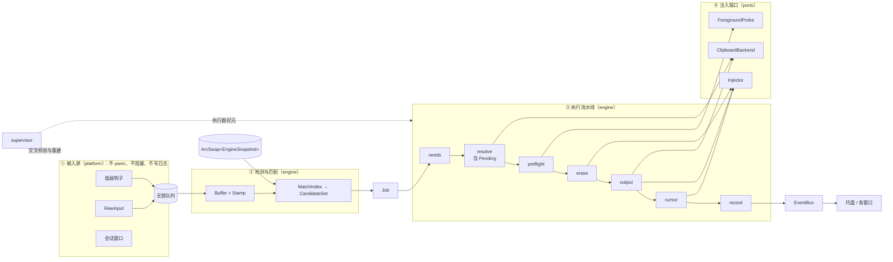
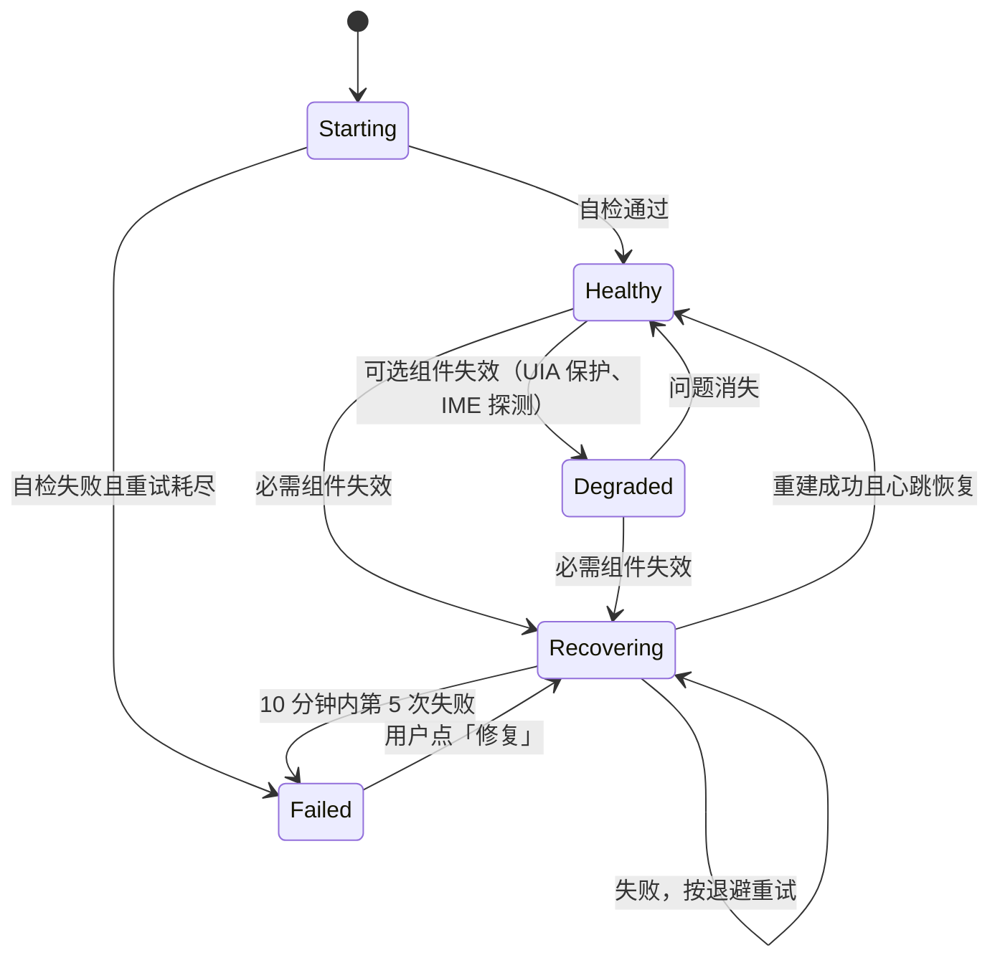
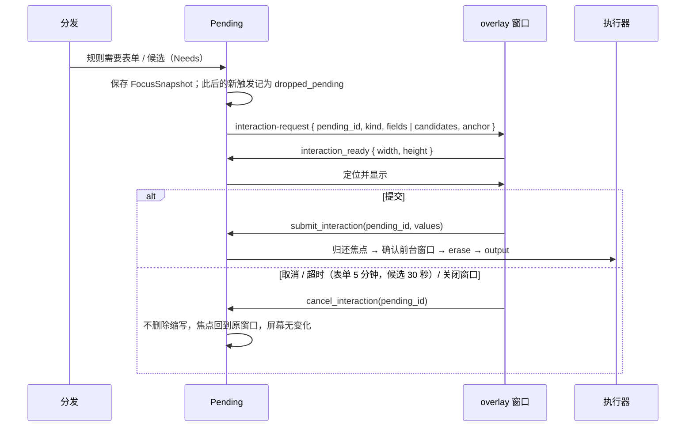
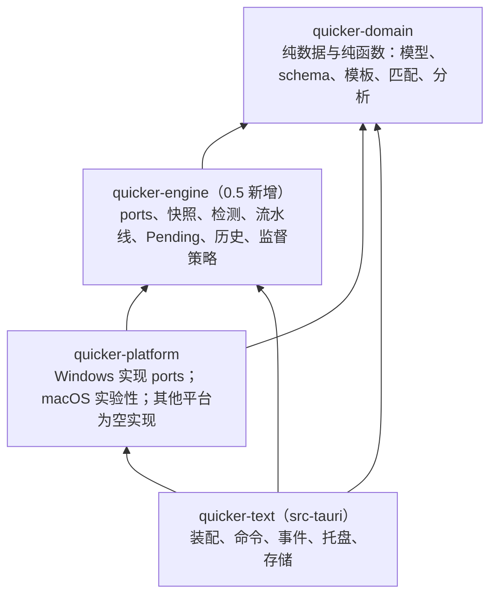
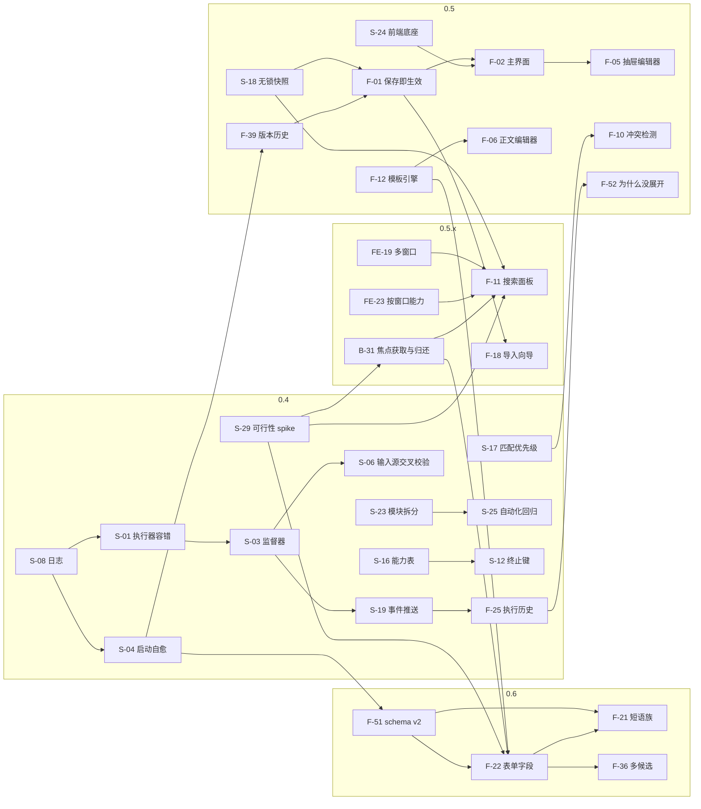

# Quicker Text 开发计划与展望

> - 文档版本：v1.1（审查修订：准确性、完整性、可行性三方审查共 104 条意见逐条核实后修订，裁决记录见附录 D）
> - 撰写日期：2026-10-22
> - 基线版本：0.3.1（`package.json`、`src-tauri/tauri.conf.json:4`）
> - 状态：计划，尚未开始实施
> - 本文由路线图、界面设计、后端方案、前端方案四份设计稿合并而成：去重，统一术语和编号，并逐项裁决各稿之间的矛盾。
> - 设计稿不随仓库发布，所以本文正文已收录全部必要内容，不依赖任何外部草稿。

## 目录

- [0. 文档信息](#s0)
  - [0.1 标记与编号](#s0-1) · [0.2 优先级](#s0-2) · [0.3 用户画像【推断】](#s0-3) · [0.4 术语表](#s0-4)
- [1. 摘要](#s1)
  - [1.1 一句话现状](#s1-1) · [1.2 三条主线](#s1-2) · [1.3 里程碑](#s1-3) · [1.4 六项关键决策](#s1-4) · [1.5 超越 Quicker 的实用功能](#s1-5)
- [2. 现状评估](#s2)
  - [2.1 已有能力](#s2-1) · [2.2 已确认问题](#s2-2) · [2.3 工程现状](#s2-3)
- [3. 对标分析](#s3)
  - [3.1 Quicker 文本指令功能矩阵](#s3-1) · [3.2 espanso 稳定性对标](#s3-2) · [3.3 功能路径简化：8 个任务](#s3-3) · [3.4 其他同类工具](#s3-4)
- [4. 设计原则](#s4)
- [5. 功能规划](#s5)
  - [5.1 总目录](#s5-1) · [5.2 P0 详细卡片](#s5-2) · [5.3 P1 / P2 条目](#s5-3) · [5.4 不做与推迟](#s5-4) · [5.5 不得倒退清单](#s5-5)
- [6. 界面改版](#s6)
  - [6.1 设计 token](#s6-1) · [6.2 信息架构](#s6-2) · [6.3 线框图](#s6-3) · [6.4 关键流程](#s6-4) · [6.5 人性化细节](#s6-5) · [6.6 与 Quicker 界面对照](#s6-6)
- [7. 后端开发方案](#s7)
  - [7.1 目标架构](#s7-1) · [7.2 稳定性工程](#s7-2) · [7.3 功能后端](#s7-3) · [7.4 Tauri 命令与事件](#s7-4) · [7.5 代码组织与依赖](#s7-5)
- [8. 前端呈现方案](#s8)
  - [8.1 技术选型](#s8-1) · [8.2 目录与组件](#s8-2) · [8.3 状态与数据流](#s8-3) · [8.4 多窗口](#s8-4) · [8.5 主题、多语言与无障碍](#s8-5) · [8.6 迁移步骤](#s8-6)
- [9. 数据模型演进与迁移](#s9)
- [10. 里程碑与路线图](#s10)
- [11. 质量保障与验收](#s11)
- [12. 风险与对策](#s12)
- [13. 展望（1.0 之后）](#s13)
- [附录 A：编号索引](#sa)
- [附录 B：参考资料](#sb)
- [附录 C：待用户确认的问题](#sc)
- [附录 D：决策记录](#sd)

<a id="s0"></a>
## 0. 文档信息

| 项目 | 内容 |
|---|---|
| 目标 | 回答四个问题：还要加什么功能；界面怎么改；后端怎么开发；前端怎么呈现 |
| 对标对象 | 稳定性和功能路径的简洁程度对标开源项目 espanso；功能和界面对标 Quicker 文本指令（<https://getquicker.net/KC/Manual/Doc/textcommand>），并在其基础上结合日常工作做得更实用 |
| 范围 | 0.4 → 1.0 的开发计划，以及 1.0 之后的展望 |
| 读者 | 项目所有者（产品取舍、附录 C 中的确认问题）、后端开发、前端开发、测试与验收人员 |
| 不包含 | 代码实现。本文发布时不修改任何源码 |
| 许可 | 【现状】组合程序按 GPL-3.0-or-later 分发（`README.md:57`、`THIRD_PARTY_NOTICES.md`），Cargo 也声明 GPL-3.0-or-later（`Cargo.toml:8`、`crates/domain/Cargo.toml:5`）；根目录 `LICENSE` 原为 MIT 文本，2026-10-22 经用户确认已换成 GPL-3.0 全文，`README.md` 与 `THIRD_PARTY_NOTICES.md` 同步改为「整个项目按 GPL-3.0-or-later 授权」。【计划】安装包、关于页的声明在 0.4 由 S-28 收尾（§5.2），见 §12 R-09 |

<a id="s0-1"></a>
### 0.1 标记与编号

**标记**

| 标记 | 含义 | 使用规则 |
|---|---|---|
| 【现状】 | 可在本仓库中核实的代码事实 | 必须附相对路径，尽量附行号 |
| 【计划】 | 本文提出、尚未实现的内容 | 第 5–13 章中凡未标注的设计描述，均属【计划】 |
| 【推断】 | 根据现象推理得出，没有直接证据 | 不能当作事实引用 |
| 【待核实】 | 需要实测或联网查证 | 核实前每项都给出兜底做法 |

**编号体系**

| 前缀 | 含义 | 范围 | 说明 |
|---|---|---|---|
| `S-xx` | 稳定性与工程需求 | S-01 ~ S-29 | 需求层，验收以用户可感知结果为准 |
| `F-xx` | 功能与界面需求 | F-01 ~ F-55 | 需求层；F-52 ~ F-55 由各设计稿的补充建议新增（附录 D.1） |
| `U-xx` | 界面设计条目 | U-01 ~ U-35 | 实现层，挂靠 S/F，不单独验收 |
| `B-xx` | 后端实现条目 | B-01 ~ B-54 | 实现层，挂靠 S/F |
| `FE-xx` | 前端实现条目 | FE-01 ~ FE-53 | 实现层，挂靠 S/F/U |
| `T1–T8` | 路径简化任务 | 8 个 | §3.3 |
| `G1–G15` | 与 espanso 的稳定性差距 | 15 个 | §3.2 |
| `ADR-a ~ f` | 架构决策 | 6 项 | §1.4 表内 |
| `R-09` 等 | 风险 | R-01 ~ R-15 | §12；与 Quicker 矩阵中的「R-xx 规则字段」不同，矩阵编号只在 §3.1 出现 |

- 一条需求（S/F）可能由多个实现条目（U/B/FE）完成。§10 按里程碑列出全部编号，附录 A 给出完整索引。
- Quicker 矩阵编号（G-xx 全局、R-xx 规则字段、A-xx 操作类型、V-xx 变量、M-xx 匹配、L-xx 管理、D-xx 数据、V2-xx Quicker 2.0、P-xx 用户痛点、I-xx 界面问题）只用于 §3.1 的追溯。

<a id="s0-2"></a>
### 0.2 优先级

| 优先级 | 含义 |
|---|---|
| P0 | 里程碑必须交付；未完成则不发布 |
| P1 | 应交付；可顺延一个里程碑，并在发布说明中写明。**被同里程碑 P0 依赖的 P1 自动升为 P0**（§5.1 表中已按此规则调整） |
| P2 | 可选；时间不够时整体推迟 |

<a id="s0-3"></a>
### 0.3 用户画像【推断】

- **依据**：用户提供的截图中，分组名为 Fiona；缩写形如 `vapncn`/`vapnen`/`vapnjp`、`vactcn`/`vacten`/`vactjp`、`vbales`/`vbalor`/`vbalph`；正文是繁体中文、英文、日文三种语言的旅游 eSIM/SIM 客服话术，约 30 余条。
- **推断**：主要用户是多语言客服，一天内频繁在聊天窗口和网页后台之间插入固定话术。同一话题通常有 3 种语言版本。
- 本文中凡以这一画像为前提的设计（短语族、语言 chip、表单字段、剪贴板提取、繁简检查等），都在出现处标注【推断】，并在附录 C 中请用户确认。

<a id="s0-4"></a>
### 0.4 术语表

**统一用词**（界面与文档都遵守；内部字段名不变）

| 统一用词 | 不再使用 | 说明 |
|---|---|---|
| 短语 | 指令、话术条目 | 界面中的主名词：短语库、新建短语、短语族 |
| 规则 | — | 只用于代码、数据和本文的技术章节；与「短语」指同一对象 |
| 缩写 | 触发词、关键词、缩写词 | 用户输入后触发展开的字符串 |
| 正文 | 内容 | 展开后输出的文本或模板 |
| 即时触发 | 直接、立即、None | 输完缩写立即展开，不需要终止键 |
| 按空格 / 按分号 / 自定义字符 | — | 统称「触发方式」；技术章节称「终止键」 |
| 自动 / 粘贴 / 键入 | — | 输出方式 |
| 短语族 | 变体组 | 同一话题的多个语言版本（F-21） |
| 暂停 / 恢复 | 禁用监听、启用监听 | 全局暂停 |
| 停用 / 启用 | 禁用 | 单条短语 |
| 排除程序 | 黑名单 | 内部字段仍叫 `blacklist` |
| 版本 | 修订、revision | 每次保存生成一个版本（F-39） |

**技术术语**

| 术语 | 含义 |
|---|---|
| RawInput | Windows 原始输入 API；本项目用它只识别硬件按键（`known_source != 0`）。原生检测与注入代码 vendored 自 espanso v2.4.1：`vendor/espanso-win32/{detect,inject}/native.{cpp,h}`，含本地补丁（去掉 `RIDEV_NOLEGACY`、注入事件加标记、返回发送计数，清单见 `THIRD_PARTY_NOTICES.md`）；Rust 侧桥接 `crates/platform/src/windows_espanso.rs` 为自研 |
| 低级钩子 | `WH_KEYBOARD_LL`/`WH_MOUSE_LL`；回调超时（`LowLevelHooksTimeout`）后会被系统静默摘除 |
| SendInput | 注入按键的 API；本项目注入的事件带标记 `0x51545854` |
| UIPI | 用户界面特权隔离：普通进程不能向管理员进程注入输入 |
| UIA | UI Automation，用于读取选区、插入点位置 |
| IME | 输入法 |
| `catch_unwind` | Rust 捕获 panic 的机制。Rust 1.81 起，panic 穿过 `extern "system"` 回调会直接终止进程 |
| ArcSwap | 原子替换的共享指针；用于无锁发布引擎快照 |
| fail-stop | 出错即停止输出，宁可不展开也不输出错误内容 |
| ARM | Tab/Enter 终止键实验方案：低级钩子线程用自己的轻量缓冲同步判断「缓冲尾部恰好匹配」，只在匹配时拦截该键，否则不拦截（F-32、B-23） |
| schema v1 / v2 | 配置数据格式版本：v1 为现状，v2 在 0.6 引入（§9） |
| 词分隔符 | 用于判断「词首」的字符集合（空格、标点等） |
| Mica | Windows 11 的窗口背景材质 |
| LKG | last known good，最近一次确认能正常运行的配置版本 |

<a id="s1"></a>
## 1. 摘要

<a id="s1-1"></a>
### 1.1 一句话现状

【现状】0.3.1 的单次注入安全性已经比 espanso 更严格（剪贴板多格式租约、注入结果校验、粘贴失败不降级为键入），但长时间运行的生存能力很弱（执行线程、钩子没有容错，配置损坏就无法启动，没有日志）。新建一条短语要 8–9 步，主要卡在「保存 → 应用设置 → 恢复监听」。

<a id="s1-2"></a>
### 1.2 三条主线

| 主线 | 对标 | 目标 | 主要编号 |
|---|---|---|---|
| ① 稳定性 | espanso | 「任何单点故障都不会让展开静默失效」：出错自动恢复，恢复不了就明确告诉用户；配置损坏也能启动；所有失败都有记录 | S-01 ~ S-09、S-18 ~ S-21、S-23、S-25、S-27 ~ S-29 |
| ② 路径简化 | espanso | 常用任务步数降到 espanso 水平或更少：新建 3–4 步，忘了缩写时 3 步插入，误展开 1 步撤销 | F-01、F-05、F-11、F-15 ~ F-20（§3.3） |
| ③ 功能与界面 | Quicker 文本指令 | 保留 Quicker 用户熟悉的心智模型；在多语言话术、模板填写、搜索插入、撤销与版本、诊断上超越 | F-02 ~ F-14、F-21 ~ F-30、U-01 ~ U-35 |

<a id="s1-3"></a>
### 1.3 里程碑

时间以范围交付为准，本文不设固定日期。

| 里程碑 | 主题 | P0 / P1 / P2 条数 | 核心交付 | 退出标准摘要 |
|---|---|---|---|---|
| 0.4 | 稳定性底座 | 16 / 3 / 0 | 执行器与钩子容错、输入源存活检测与重挂、监督器自愈、启动自愈与安全模式、日志与诊断包、剪贴板句柄格式修复、终止键与平台能力诚实化、匹配优先级、事件推送、后端模块拆分、许可统一、可行性 spike、执行历史；旧界面低成本修补；前端底座一期（`CommandError`、ESLint、Vitest） | 已交付条目对应的故障注入全部通过；2 小时浸泡；日志隐私测试；0.3.1 数据无损加载；不得倒退清单（§5.5）全部保持 |
| 0.5 | 界面重做：保存模型与编辑 | 12 / 10 / 3 | 保存即生效 + 撤销 + 版本历史、新主窗口与列表、抽屉编辑器、CodeMirror 正文、冲突检测、模板引擎重写、`{cursor}`、IME 策略、暂停热键 | T1、T2、T6 达到目标步数；`src/` 中没有原生对话框；axe 无 serious/critical 问题 |
| 0.5.x | 界面重做：效率入口 | 2 / 4 / 0 | 全局搜索插入面板、导入向导、Backspace 撤销、在当前程序停用与窗口拾取器、从选中新建、首次运行引导；多窗口（FE-19 ~ FE-23）与焦点归还（B-31） | T4、T5、T7、T8 达到目标步数；搜索面板 p95 < 300ms；新用户引导测试 |
| 0.6 | 模板交互与多语言 | 2 / 10 / 15 | schema v2、表单字段、短语族、动态变量、剪贴板提取、常量与片段、统计、查找替换、别名、自定义触发字符 | T3 为 3–4 步；短语族迁移后输出逐字节一致；指定程序中焦点正确归还 |
| 1.0 | 实机验收与打磨 | 1 / 0 / 2 | `docs/acceptance.md` T01–T20 实机验收、24 小时浸泡、界面多语言、示例短语包；F-42 无障碍复审 | 所有 P0/P1 完成或在发布说明中推迟；无 P0 缺陷；p95 < 100ms 实测 |

- 条数按 §5.1 两张总表的「优先级」「里程碑」列逐条统计，每个编号只计入它的完成里程碑一次（S-24 计入 0.5，S-23 计入 0.4，F-42 计入 0.5）。合计 S 29 条、F 55 条。
- **1.0 功能冻结**：F-44、F-45、F-46、F-48 移到 1.x（1.0 之后，按 §13 的启动条件再立项），共 4 条 P2 不计入上表。1.0 只做验收、打磨和已承诺条目的收尾。
- **0.5.x 的由来**：原 0.5 范围（调整前 13 / 16 / 3；S-06 移入 0.4、S-11 升为 P0 后为 14 / 14 / 3）在一个里程碑内同时包含保存模型重做、多窗口和焦点归还三类高风险工作。拆分后 0.5 先交付「保存与编辑」闭环，0.5.x 再交付依赖多窗口与焦点归还的效率入口；两者之间可以单独发布。

<a id="s1-4"></a>
### 1.4 六项关键决策

| 决策 | 结论 | 理由 |
|---|---|---|
| ADR-a 保存模型 | 保存即生效；配合撤销 toast、会话内多级撤销和版本历史；**不提供草稿模式**。0.5 首次启动时若数据目录中仍有旧版留下的 `draft.json`，只显示一次横幅「上一版本有未应用的改动：对比并应用 / 丢弃」，处理后删除该文件。设置自动保存（防抖 500ms），10 秒内的连续设置改动合并为一个版本。并发冲突按单条规则检测（§7.3） | 「保存 → 应用设置」是现状最大的路径负担（I-04）；有撤销和版本兜底，立即生效不会增加风险。草稿模式会让「保存」出现两种语义，并要求保留 `discard_draft` 等整套旧命令，收益不抵复杂度 |
| ADR-b 崩溃隔离 | 0.4–1.0 采用进程内监督器（catch_unwind + 线程重建 + 退避熔断）；独立执行进程只在 1.0 之后、确有需要时再评估 | 独立进程要重做 IPC、托盘和生命周期，还会带来两个进程间剪贴板和焦点一致性的新问题 |
| ADR-c Tab/Enter 终止键 | 0.4 诚实灰显（S-12）；0.6 提供实验性 ARM 方案：全局默认关，且只对用户逐条勾选「以 Tab/Enter 结束」的规则生效，不靠程序排除名单（用户确认任何程序都可能用到，包括 Excel 公式，附录 C.1 #2）（F-32）；不做无条件拦截 | 根因是 RawInput 只能观察、不能拦截按键；`README.md:13` 已说明 Tab/Enter 不可用 |
| ADR-d 程序范围 | 不做规则级程序范围和「场景」；只做排除侧工具：全局排除程序、托盘一键停用、全屏暂停（按程序的默认语言软偏好推迟到 1.x）。从 Quicker 导入的进程绑定不生效，但原值保留在规则的 `extra` 中作为迁移元数据（【现状】`crates/domain/src/package.rs:333-334, 428-429`），导入报告逐条列出（F-18） | 用户在 0.3.1 明确要求移除程序范围；与路径简化原则冲突。保留原值是为了用户日后改变主意时不必重新导入。只有用户再次明确提出时才重新评估 |
| ADR-e 变量语法 | 统一为 `{名称}` / `{名称:参数}`，表单字段用 `[[字段]]`；转义只在 v2 语法中提供；不做条件、循环和公式 | 一种写法好记；静态可分析（编辑器能提示、搜索面板能预判是否需要弹表单） |
| ADR-f 平台定位 | Windows 为主平台；macOS 为实验性（【现状】`crates/platform/src/macos.rs` 2165 行），CI 中只做编译检查；Linux 不支持 | 用户只在 Windows 上工作；macOS 代码保留以免架构绑死 Windows，但不承诺功能对等 |

<a id="s1-5"></a>
### 1.5 超越 Quicker 的实用功能

以下功能在 Quicker 文本指令中没有，或明显更弱，是本项目「根据日常工作实际」重点投入的部分。

| 场景 | 功能 | 编号 | 里程碑 |
|---|---|---|---|
| 忘了缩写 | 全局搜索插入面板：按缩写、说明、正文、拼音首字母搜索，Enter 插入到原窗口 | F-11 | 0.5.x |
| 误展开 | 展开后立即按 Backspace 恢复原缩写 | F-15 | 0.5.x |
| 改坏了 | 每次改动可撤销；版本历史可对比、可恢复任意版本 | F-01、F-39 | 0.5 |
| 「为什么没展开」 | 执行历史 + 一键解释最近一次未展开的原因 | F-25、F-52 | 0.4 / 0.5 |
| 同一话题三种语言【推断】 | 短语族：并排编辑、语言 chip、缺失与「待同步」提示、族缩写弹出语言候选 | F-21、F-36 | 0.6 |
| 话术里要填客户名、单号 | 表单字段 `[[客户名]]`；从剪贴板里自动提取 ICCID、订单号【推断】 | F-22、F-23 | 0.6 |
| 公司网址、签名统一修改 | 常量与片段复用；批量查找替换；链接检查 | F-26、F-27 | 0.6 |
| 「预计 3 个工作日后」 | 日期偏移、工作日、时段问候语 | F-14 | 0.6 |
| 繁体话术混进简体字【推断】 | 繁简与标点一致性检查 | F-43 | 0.6 |
| 整理几十条短语 | 智能视图（有问题、未使用、已停用）、冲突与误触检测、批量修改、使用统计 | F-02、F-08、F-10、F-24 | 0.5 / 0.6 |

<a id="s2"></a>
## 2. 现状评估

本章全部为【现状】，证据路径均相对于仓库根目录。

<a id="s2-1"></a>
### 2.1 已有能力

| 领域 | 现状 | 证据 |
|---|---|---|
| 检测 | RawInput 只认硬件按键（`known_source != 0`）。原生检测代码 vendored 自 espanso v2.4.1（commit `a87d1723f47a59e38d370e2f0c636d66d568b8f6`）：`vendor/espanso-win32/detect/native.{cpp,h}`，含本地补丁（去掉 `RIDEV_NOLEGACY` 等）；Rust 桥接 `windows_espanso.rs` 为自研 | `crates/platform/src/windows_espanso.rs:155-157`；`THIRD_PARTY_NOTICES.md` |
| 注入 | SendInput 注入，事件的 `dwExtraInfo` 带标记 `MARK = 0x51545854`；键盘钩子、鼠标钩子见到该标记直接放行，自身注入不会再次触发。其他程序的模拟输入（`LLKHF_INJECTED` 且无标记）会让匹配失效 | 定义 `crates/platform/src/windows.rs:22`；写入 `:816, :932`；键盘钩子放行 `:432-434`；鼠标钩子放行 `:500`；外部模拟输入失效 `:438-442` |
| 触发方式 | 即时、按空格、按分号；忽略大小写；正则（编译时自动以 `$` 锚定）。即时模式只接受字面缩写，正则只能用于终止键模式（编译时报 `immediate_regex`）。左边界检查只在终止键模式下生效 | `crates/domain/src/matching.rs:120-148, 230-236, 249-250` |
| 缓冲重置 | 鼠标点击和滚轮、焦点变化、插入点移动、键盘布局变化、配置版本变化、按键序号不连续时清空输入缓冲；单独按住 Ctrl 或 Alt、或按住 Win 时的按键，以及 Tab、Enter、Esc、方向键等一律视为重置 | 鼠标 `crates/platform/src/windows.rs:540-545`；`Buffer::push` 按 Stamp（焦点、插入点、布局、版本）与序号判断 `crates/platform/src/windows_espanso.rs:83-89, 120-135`；按键分类 `:109-119, 190-191` |
| 操作类型 | 12 种：不执行、键入纯文本、粘贴纯文本、粘贴带格式、按快捷键、文字与按键组合、多步骤（21 条命令，可中途停止）、重放键鼠（11 个 opcode）、打开、常用电脑操作（14 项）、执行另一条、保留的 Quicker 动作 | `src/model.ts:7`；`src/ActionEditor.tsx:37` |
| 变量 | 正文中：`{cliptext}`、`{selection}`、`{param:名称}`、`{0:格式}` 日期、`FILE:` 外部文件。`{$N}` 不是正文变量，只用于参数来源 `ParameterSource::CaptureTemplate`，代入时对捕获值做 URL 编码 | `crates/domain/src/content.rs:112-156, 271`；`crates/domain/src/matching.rs:30-93`（编码在 `:73-90`）；`src/ActionEditor.tsx:32` |
| 停止热键 | 键盘钩子中识别 Ctrl+Shift+Esc，设置取消标志并吞掉该键。该组合同时是系统「任务管理器」快捷键，实机行为【待核实】；【计划】改为可配置、默认 Ctrl+Alt+Pause（§6.4） | `crates/platform/src/windows.rs:454-460` |
| 剪贴板保护 | 粘贴前租用剪贴板，保存多种格式，粘贴后恢复 | `crates/platform/src/windows.rs:1714-1843` |
| 自身窗口 | 本程序窗口中不触发展开 | `README.md:14`；`crates/platform/src/windows_espanso.rs:258-262` |
| 存储 | 草稿 → 生效两段式；每次发布写一个 revision；原子写入；外部修改时按哈希拒绝覆盖；可回退一级 | `src-tauri/src/main.rs:139-248, 278-310` |
| 导入 | Quicker JSON：类型 0/2/3/6/7 可用，其余导入后停用；冲突只按 id 判断 | `README.md:45`；`crates/domain/src/package.rs`；`src-tauri/src/main.rs:532-623` |
| 导出 | 已有 espanso 子集导出函数，但未暴露为命令 | `crates/domain/src/package.rs:541` |
| 自启 | 登录自启写入 HKCU Run 键，带 `--background` | `src-tauri/src/main.rs:769` |
| 验收模式 | `QUICKER_TEXT_TEST_INPUT=1`、`--acceptance-test-input`、`QUICKER_TEXT_DATA_DIR` | `crates/platform/src/lib.rs:9-25`；`docs/windows-acceptance-mode.md` |
| 测试 | `cargo test --workspace` 共 131 个（`crates/domain/tests` 97 个 + 文件内 34 个）：130 通过、1 忽略；前端没有测试、lint、格式化脚本 | `package.json`；`crates/domain/tests/` |

<a id="s2-2"></a>
### 2.2 已确认问题

**稳定性**

| # | 问题 | 证据 | 后果 | 处理 |
|---|---|---|---|---|
| 1 | 执行线程没有 `catch_unwind`；busy 标志只在末尾复位 | `crates/platform/src/windows.rs:211-228, 652-717` | 一次 panic 后，所有短语静默失效，直到重启 | S-01 |
| 2 | 鼠标钩子中使用阻塞的 `lock().unwrap()` | `crates/platform/src/windows.rs:497-545` | 钩子超时被系统摘除；或 panic 终止进程 | S-02 |
| 3 | RawInput 循环退出后只设置 READY=false / paused=true，不重建 | `crates/platform/src/windows_espanso.rs:356-358` | 监听永久停止，托盘仍可能显示正常 | S-03 |
| 4 | 配置损坏时无法启动：`Store::load` 中任一文件读取或编译失败都用 `?` 向上返回，经 `setup` 传到 `run()` 末尾唯一的 `.expect("Quicker Text startup failed")`，进程 panic 退出 | `src-tauri/src/main.rs:67-90, 853, 1017` | 程序打不开，用户以为话术丢了 | S-04 |
| 5 | 没有日志；release 配置 `strip = true` | `Cargo.toml:10-13` | 出问题无从排查 | S-08 |
| 6 | 剪贴板中只要有基于句柄的 GDI / owner-display 格式（CF_BITMAP 2、CF_METAFILEPICT 3、CF_PALETTE 9、CF_ENHMETAFILE 14、私有显示格式 0x80–0x8F）就整体拒绝备份并保留缩写；大小为 0 或超过 32MB 的格式同样拒绝 | `crates/platform/src/windows.rs:1746-1755` | 【推断】截图或从 Office 复制之后剪贴板常含 CF_BITMAP 或 CF_ENHMETAFILE，粘贴类短语会失败 | S-07 |
| 7 | 物理按键状态是 `Mutex<BTreeSet>`；锁竞争时 `physical()` 返回 true | `crates/platform/src/windows.rs:337-341, 445-452` | 「卡住的 Ctrl」导致一直拒绝展开 | S-05 |
| 8 | 引擎总是以暂停状态启动 | `crates/platform/src/lib.rs:88` | 开机后要手动点「开始监听」 | S-09 |

**一致性与功能**

| # | 问题 | 证据 | 处理 |
|---|---|---|---|
| 9 | Windows 运行时只认空格和分号，但默认值和界面包含 Tab/回车 | `crates/platform/src/windows_espanso.rs:231-240`；`crates/domain/src/model.rs:12-19`；`src/model.ts:5` | S-12、S-16 |
| 10 | 输入法删除方式默认 escape，但 Windows 后端一律用退格 | `crates/domain/src/model.rs:54` | S-16 |
| 11 | 匹配优先级只看长度，再看顺序；普通缩写可能被宽泛的正则抢走 | `crates/domain/src/matching.rs:177` | S-17 |
| 12 | 即时触发不检查左边界，而新规则默认即时触发 | `crates/domain/src/matching.rs:143-148`（左边界只在 `:144` 对终止键模式检查）；`src/model.ts:6` | F-10 |
| 13 | 新规则默认「键入」输出。【推断】在按 Enter 即发送的聊天程序中，多行话术会被提前发出 | `src/model.ts:6` | F-13、S-10 |
| 14 | 自动路径的执行状态总是 `unknown`；因忙碌被丢弃的触发没有任何记录 | `crates/platform/src/windows.rs:1448-1457` | S-19、F-25 |
| 15 | 选区通过 PowerShell UIA 获取，超时 5 秒；拾取窗口和捕获选区固定等待 3 秒 | `crates/platform/src/windows.rs:239-289`；`src-tauri/src/main.rs:451, 484, 735` | S-22、F-17 |
| 16 | 发布配置使用两把锁；有动作正在执行时，发布会先置暂停与取消标志（正在执行的动作因此被中止），再返回错误「An action is still running; cancel it and apply again」，本次发布失败，需要再点一次「应用设置」 | `src-tauri/src/main.rs:154-160, 202-203` | S-18、F-01 |
| 17 | `revisions/` 无限增长，且只能回退一级 | `src-tauri/src/main.rs:245-248` | F-39 |
| 18 | 中文输入法开着时没有策略，只有事后的风险提示 | `crates/platform/src/windows.rs:354-365`；`crates/platform/src/windows_espanso.rs:286, 393-395` | S-11 |
| 19 | 目标是管理员窗口时，只能在注入后发现失败 | `crates/platform/src/windows.rs:771-785` | S-20 |

**界面**

| # | 问题 | 证据 | 处理 |
|---|---|---|---|
| 20 | 两套保存语义：「保存」只写草稿，还要「应用设置」才生效（「应用设置」出现 6 次） | `src/App.tsx:21, 29, 40, 43-45` | F-01 |
| 21 | 7 处原生对话框（4 个 `confirm(`、3 个 `prompt(`），导入冲突策略要手打英文 `merge`/`keep_both`/`replace` | `src/App.tsx:32, 39, 40, 42, 44` | F-03、F-18 |
| 22 | 前端每 2 秒轮询 `load_state`；后端发出的 `engine-status` 没人订阅；托盘提示文字每 250ms 轮询 | `src/App.tsx:22`；`src-tauri/src/main.rs:858-911, 966` | S-19 |
| 23 | `src/App.tsx` 共 50 行、最长一行约 6451 字符、15 处 `useState` 调用；`src/ActionEditor.tsx` 共 51 行、最长约 7358 字符、16 处 `useState` 调用 | 同左 | S-24 |
| 24 | 十六进制颜色 79 处（去重 72 种），只有 `--blue`、`--border` 两个变量；13 种字号，最小 9px；多处对比度不达标（主按钮 3.90、次要文字 3.41、焦点环 2.42、开关轨道 2.06）；850px 断点在最小窗宽 900 下永远不会生效 | `src/style.css`；`src-tauri/tauri.conf.json:7` | F-04（低成本修补）、U-02、U-03 |
| 25 | 一组已确认的小缺陷，统一由 F-04 修复（下表） | 见下表 | F-04 |

> 色值计数的说明：路线图稿记为 77 处，界面稿和前端稿复核为 79 处（去重 72 种）。本文采用 79 处，理由是两份独立复核结果一致。

**F-04 修复清单**（0.4 在旧界面中修复）

标 ★ 的 5 项是 F-04 的 P0 子集，0.4 必须修复：它们会导致数据丢失、误导用户或与后端能力不一致。其余各项尽力在 0.4 修复；未完成的不阻塞 0.4 发布，由 0.5 的新界面（F-02、F-03、F-05）重写时一并解决。

| 缺陷 | 证据 |
|---|---|
| ★ 空分组 `""` 显示为「默认」，但按「默认」筛选不到 | `src/App.tsx:26-28` |
| 非动作字段的校验错误不在编辑框内显示 | `src/App.tsx:33, 44` |
| ★ 多行文本框吞掉末尾换行，无法逐行追加 | `src/App.tsx:41` |
| ★ Esc 直接关闭编辑框，不检查改动 | `src/App.tsx:9` |
| 删除后选中集合不清空 | `src/App.tsx:39` |
| ★ Windows 上仍显示 Tab/回车终止键，且默认勾选 | `src/model.ts:5` |
| `lock_screen` 有中文名，但不在下拉选项中 | `src/ActionEditor.tsx:37` |
| ★ `save_draft` 不做校验 | `src-tauri/src/main.rs:220, 317` |
| 运行状态页硬编码「Windows 0.3.0」 | `src/RuntimeStatus.tsx:29` |
| 专家模式不回填现有步骤 | `src/ActionEditor.tsx:23` |
| 多步骤中 html/open/common/reusable 步骤没有表单 | `src/ActionEditor.tsx:11, 39-41` |
| 摘要列把快捷键、无操作、空文本显示为「0 个步骤」 | `src/App.tsx:40` |
| 「退出全部」没有确认 | `src/App.tsx:42` |
| 列表筛选不覆盖正文 | `src/App.tsx:26-28` |
| 取消导出被当作错误；文件对话框没有扩展名过滤 | `src-tauri/src/main.rs:496-520` |
| 每个按键选择控件都渲染 `id="keynames"` 的 datalist，id 重复 | `src/ActionEditor.tsx:16` |
| 状态文字不清空、没有 `aria-live`；加载完成前闪现空状态 | `src/App.tsx:40, 43` |
| 后端支持 `overwrite` 导入策略，界面没有提供 | `src/App.tsx:32`；`src-tauri/src/main.rs:604` |
| 术语混用：徽标写「直接」，列中写「即时」 | `src/App.tsx:40` |
| 列表项用数组下标作 `key`。【推断】增删步骤时输入框状态可能错位 | `src/ActionEditor.tsx:17, 31, 38, 41` |

**验收**

| # | 问题 | 证据 | 处理 |
|---|---|---|---|
| 26 | 实机验收不足：T01–T20 大多未做；触发到输出的 p95 未测量 | `docs/acceptance.md:61-96`；`docs/windows-0.3.1-notes.md` | S-25、S-27 |
| 27 | React Doctor 全量评分：0.2.2、0.2.3 为 86/100；0.3.0 改动前后均为 55/100（新增扫描到参考仓库的 Dockerfile 告警）；0.3.1 仍为 55/100 | `docs/windows-0.2.2-fix-notes.md:16`；`docs/windows-0.2.3-fix-notes.md:15`；`docs/windows-0.3.0-refactor.md:44`；`docs/windows-0.3.1-notes.md:21` | FE-49 |

<a id="s2-3"></a>
### 2.3 工程现状

| 方面 | 现状 | 证据 |
|---|---|---|
| 代码规模 | `src-tauri/src/main.rs` 1304 行；`crates/platform/src/windows.rs` 2100 行；`windows_espanso.rs` 797 行；`macos.rs` 2165 行；`crates/platform/src/lib.rs` 166 行；`crates/domain` 合计 3617 行 | 各文件 |
| 命令 | 23 个 Tauri 命令：17 个返回 `Result<T, String>`；6 个返回裸值（`validate_config` → `Validation`、`parse_source` → `Value`、`cancel_execution` → `bool`、`choose_file` → `Option<Vec<String>>`、`get_cursor` → `Value`、`exit_app` → `()`）。5 个命令的签名含 `serde_json::Value`（`test_rule`、`parse_source`、`import_config`、`get_cursor`、`capture_selection`）；另有 `AppState.engine_detail` 字段为 `Value` | `src-tauri/src/main.rs:991-1015`；签名 `:378, 411, 536, 725, 729`；字段 `:36` |
| unwrap/expect（非测试代码） | `main.rs` 19 个 unwrap + 2 个 expect（213 为序列化已校验配置，1017 为启动失败时的唯一出口，见 §2.2 #4）；`windows.rs` 14；`windows_espanso.rs` 7；`macos.rs` 28 | 各文件 |
| 全局状态 | OnceLock 全局变量，引擎只能启动一次（「Engine already started」） | `crates/platform/src/windows.rs:165-166, 198, 643-645`；`windows_espanso.rs:40-45` |
| 剪贴板租约 | 定义了三份 | `crates/domain/src/transaction.rs:303`；`crates/platform/src/windows.rs:1565`；`crates/platform/src/macos.rs:1550` |
| 零引用模块 | domain 中导出但没有被引用的状态机模块 | `crates/domain/src/lib.rs:3, 4, 9, 11, 12, 17` |
| 平台能力 | `capabilities()` 返回的 10 项共用一个布尔值；Enter/Tab 被禁用 | `crates/platform/src/lib.rs:111-133, 127` |
| 配置读取 | Config、GlobalSettings、Rule 使用 `deny_unknown_fields`，旧版本读不了新字段；`read_config` 不去除 BOM（导入路径会去除） | `crates/domain/src/model.rs:20-21, 40-41, 76-77`；`src-tauri/src/main.rs:266`；`crates/domain/src/package.rs:71` |
| 数据格式 | `SCHEMA_VERSION = 1`；Action 有 11 个变体 | `crates/domain/src/model.rs:3, 241-286` |
| 依赖 | `windows-sys` 同时存在 0.45 / 0.59 / 0.60 / 0.61 四个版本 | `Cargo.lock` |
| 前端依赖 | 运行依赖只有 react、react-dom、@tauri-apps/api；脚本只有 dev/build/preview/tauri | `package.json` |
| 前端类型 | `Data = Record<string, any>`；`bridge.ts` 在 Tauri 之外直接抛错 | `src/model.ts:1-4`；`src/bridge.ts` |
| 窗口与安全 | 主窗口 1240×840，最小 900×650；CSP 为 `default-src 'self'` 等；没有 `src-tauri/capabilities/` 目录；插件只有 `tauri-plugin-notification`、`tauri-plugin-single-instance`；托盘用 `tauri` 的 `tray-icon` feature；文件对话框用 `rfd` 0.17，而不是对话框插件 | `src-tauri/tauri.conf.json`；`src-tauri/Cargo.toml`；`src-tauri/gen/schemas/capabilities.json` |
| 仓库 | 没有 `.github/`、`deny.toml`、`clippy.toml`、`rustfmt.toml` | 仓库根目录 |
| 许可 | 根 `LICENSE` 是 MIT 文本；README 写明组合程序按 GPL-3.0-or-later 分发、自研文件保留 MIT 声明；Cargo 的 workspace 与各 crate 声明 GPL-3.0-or-later；vendored espanso 代码为 GPL-3.0-or-later | `LICENSE`；`README.md:57`；`Cargo.toml:8`、`crates/domain/Cargo.toml:5`；`THIRD_PARTY_NOTICES.md` |

<a id="s3"></a>
## 3. 对标分析

<a id="s3-1"></a>
### 3.1 Quicker 文本指令功能矩阵

- 「现状」列为【现状】；「结论」列为【计划】。
- 结论有三种：**对齐**（达到 Quicker 的同等能力，含已具备的）、**超越**（做得更好，或 Quicker 没有）、**不做**（附理由，见 §5.4）。
- 「去向」列只列本文的需求编号；优先级与里程碑一律以 §5.1 总目录为准（唯一来源），本节不重复；`—` 表示无需新增工作。
- 矩阵编号（G-xx、R-xx 等）只在本节使用，与 §12 的风险编号无关。

**3.1.1 全局设置（G-xx）**

| 编号 | 功能 | Quicker | 现状 | 结论 | 去向 |
|---|---|---|---|---|---|
| G-01 | 总开关 | 管理页第一行开关 | 有「启用文本指令」（`src/App.tsx`） | 对齐：总开关、托盘、状态栏统一按 §7.2 的 Health 映射表显示（启动中 / 监听中 / 降级 / 暂停 / 执行中 / 恢复中 / 故障） | S-03、F-16 |
| G-02 | 帮助 | 右上角 `?` | 无帮助入口 | 对齐：设置项旁说明，关于页放链接 | F-38 |
| G-03 | 默认触发字符 | 空格、Tab、回车、`;` 多选 | 运行时只认空格和分号，界面却给 4 个复选框（§2.2 #9） | 对齐（诚实化）：0.4 默认空格 + 分号，Tab/回车灰显；0.6 实验选项 | S-12、S-16、F-32 |
| G-04 | 自定义触发字符 | 单个字符，如 `/` | 只有 4 个固定键（`src/model.ts:13-14`） | 对齐：任意可见字符和小键盘键 | F-31 |
| G-05 | 黑名单 + 选择窗口 | 输入框 + 「选择窗口」 | 有；拾取时隐藏主窗口 3 秒，结果是原始 JSON | 超越：一键「在当前程序停用」可撤销；倒计时拾取器 | F-17 |
| G-06 | 触发后切英文 | 只有全局开关 | 无 | 超越：设置「输出」页的全局默认 + 单条短语覆盖（继承 / 开 / 关）；导入时把 Quicker 的全局开关映射为全局默认 | F-34 |
| G-07 | 「应用设置」按钮 | 有 | 草稿要「应用设置」才发布 | 超越：保存即生效 + 撤销 + 版本历史 | F-01、F-39 |
| G-08 | 禁用所有模拟按键 | 在扩展热键页，入口难找 | 自注入带标记放行；RawInput 只认硬件；远程控制场景【待核实】 | 对齐：先实测 ToDesk、向日葵、RDP，必要时在设置「触发」页加开关，默认关 | S-26 |
| G-09 | 免费版限 10 条 | 专业版功能 | 无授权分级 | 不做：开源项目不设分级 | — |
| G-10 | 功能级白名单 | 2.0 新增 | 无；0.3.1 已移除程序范围 | 不做：ADR-d | — |
| G-11 | 全屏时禁用 | 2.0 新增 | 无 | 对齐 | F-37 |
| G-12 | 词分隔符 | 无 | 本项目独有；前后端默认值不一致：前端含空格、Tab、换行（`src/model.ts:5`），Rust 另含回车（`crates/domain/src/model.rs:17-19`） | 超越：保留，改为可见字符 chip 编辑器 | F-04、S-16 |
| G-13 | 全局 IME 删除方式 | 无（Quicker 是单条选项） | 默认 escape，Windows 后端不执行（§2.2 #10） | 对齐（诚实化）：按平台能力隐藏或改默认值；新增 IME 策略 | S-16、S-11 |
| G-14 | 托盘、后台、自启 | 有 | 有登录自启，但引擎以暂停状态启动（`crates/platform/src/lib.rs:88`） | 超越：自启后自检再自动监听；托盘状态按 Health 映射表显示、定时暂停 | S-09、F-16 |

**3.1.2 规则字段（R-xx）**

| 编号 | 功能 | 现状 | 结论 | 去向 |
|---|---|---|---|---|
| R-01 | 缩写 | 已实现，长度上限 8192 字节（UTF-8 编码后计，`crates/domain/src/matching.rs:222`） | 超越：冲突检测、别名 | F-10、F-29 |
| R-02 / R-03 / R-05 | 启用、忽略大小写、取第一个正则组 | 已实现 | 对齐 | — |
| R-04 | 正则匹配 | 已实现，自动 `$` 锚定（`matching.rs:249-250`）；只能用于终止键模式，即时模式配正则编译报错（`matching.rs:230-236`） | 超越：编辑器内正则试运行；即时触发与正则互斥，在编辑器中直接说明（§6.3 ③ 展开态说明） | F-06 |
| R-06 | 参数模板 `{$1}` | 已实现：只用于参数来源 `ParameterSource::CaptureTemplate`，代入时对捕获值做 URL 编码（`crates/domain/src/matching.rs:30-93`） | 对齐：保留为参数来源，迁移后行为不变（F-12 验收） | F-12 |
| R-07 | 输入法开启时用退格 | 字段保留，Windows 一律退格 | 对齐（诚实化）：Windows 隐藏该项 | S-16、S-11 |
| R-08 | CapsLock 时用退格 | 不适用 | 不适用：Windows 统一按长度退格 | — |
| R-09 | 说明 | 已实现 | 对齐：作为搜索面板标题 | F-11 |
| R-10 | 分组（一层下拉） | 已实现；空分组语义不一致 | 超越：侧栏分组、颜色、智能视图 | F-02 |
| R-11 | 绑定进程 | 0.3.1 已按用户要求移除；Quicker 导入时原值只作迁移元数据保留（`crates/domain/src/package.rs:333-334`） | 不做：ADR-d；导入向导按原绑定进程提示同缩写冲突（F-18） | F-18 |
| R-12 | 单条触发字符（Quicker 另支持左 Shift 引导键、Alt / Ctrl / Shift 修饰键触发） | 部分：可覆盖 4 个键 | 对齐：任意可见字符；修饰键触发与引导键不做（§5.4） | F-31 |
| R-13 | 立即触发 | 已实现；新规则默认即时；不查左边界 | 超越：「仅在词首触发」（默认开）+ 误触提示 | F-10 |
| R-14 | 相同缩写、不同触发键 | 部分：不查重，取最长 | 对齐：视为合法并标注 | F-10 |
| R-15 | 操作类型（下拉 11 种） | 普通下拉 | 超越：按意图分组的图标选择器，默认只显示缩写和正文 | F-05 |
| R-16 | 文本内容 | 纯 textarea | 超越：CodeMirror、变量补全、实时预览 | F-06 |
| R-17 | `FILE:` 外部文件 | 已实现，可指定编码 | 对齐 | — |
| R-18 | 触发后提示 | 系统通知 | 超越：不抢焦点的 toast，附撤销 | F-15、F-16 |
| R-19 | 保存 / 取消 | Esc 直接关闭不检查改动 | 超越：Ctrl+S、未保存提示、上一条 / 下一条 | F-04、F-05 |
| R-20 | 动作参数 | 部分：五种参数来源 | 对齐：保留参数来源；Quicker 动作本身不执行 | — |

**3.1.3 操作类型（A-xx）与语法**

| 编号 | 功能 | 现状 | 结论 | 去向 |
|---|---|---|---|---|
| A-00 / A-10 / A-11 | 无、键鼠控制、（历史）发送文本 | 已实现或导入映射 | 对齐；键鼠控制在编辑器提示「依赖分辨率和窗口位置」 | — |
| A-01 | 发送快捷键 | 已实现 | 对齐：按键录制控件 | F-05 |
| A-02 | 键入内容（模拟按键 B 语法） | 已实现 | 对齐：语法高亮；B 语法逐键对照测试 | F-06、S-25 |
| A-03 / A-04 | 键入 / 粘贴纯文本 | 已实现，粘贴带多格式剪贴板保护 | 超越：修复句柄格式误拒、临时内容不进剪贴板历史（S-07）；新增「自动」方式（S-10） | S-07、S-10 |
| A-05 | 粘贴 HTML | 已实现 | 对齐；富文本编辑推迟到 1.x（1.0 功能冻结） | F-45 |
| A-06 | 多步骤输入 | 21 条命令，可中途停止（Quicker 不能停） | 超越（已具备）；修复专家模式不回填 | F-04 |
| A-07 | 常用功能 | 部分，14 项；缺媒体「停止」、浏览「刷新」、输入法、窗口、亮度；`lock_screen` 不在下拉 | 对齐：补齐；保留本项目独有的复制 / 粘贴 / 撤销等 | F-33；F-04 |
| A-08 | 运行 Quicker 动作 | 不执行，只保留原信息 | 不做：Quicker 私有运行时 | — |
| A-09 | 打开或运行 | `ShellExecuteW`（`crates/platform/src/windows.rs:962`）；环境变量展开【待核实】 | 对齐：环境变量和备用路径 | F-50 |
| A-12 | 执行另一条 | 本项目独有（`reusable`） | 超越：并入片段复用 | F-26 |

**3.1.4 变量（V-xx）**

| 编号 | 功能 | 现状 | 结论 | 去向 |
|---|---|---|---|---|
| V-01 | `{cliptext}` | 已实现 | 对齐：纳入统一语法，加别名 `{clipboard}` | F-12 |
| V-02 | `{selection}` | 已实现，PowerShell UIA，最长等 5 秒 | 超越：编辑器静态提示可用性；常驻 UIA | F-12、S-22 |
| V-03 | `{0:格式}` 日期 | .NET 格式子集 | 超越：日期偏移、工作日、问候语 | F-14 |
| V-04 / V-05 / V-07 | `FILE:`、`{$n}`、默认传缩写 | 已实现；`{$n}` 只用于参数来源，见 R-06 | 对齐 | — |
| V-06 | `*NULL*` | 已语义化为「不传入内容」 | 超越（已具备） | — |
| V-08 / V-09 | Quicker 动作内部变量 | 不适用 | 不做 | — |
| V-10 | 触发字符作为参数 | 未实现 | 推迟：需求弱，增加概念 | §5.4 |

**3.1.5 匹配与运行时（M-xx）**

| 编号 | 功能 | 现状 | 结论 | 去向 |
|---|---|---|---|---|
| M-01 / M-02 | 只认物理按键；不支持中文缩写 | 同样限制 | 不做（平台限制）；搜索面板兜底，支持拼音首字母 | F-11 |
| M-03 / M-04 | 点击、特殊键后重新匹配 | 已实现（`crates/platform/src/windows.rs:540-545`；`windows_espanso.rs:109-121`） | 对齐（已具备） | — |
| M-05 | 触发后重置检测 | 【待核实】 | 对齐：加入回归用例 | S-25 |
| M-06 / M-12 | 模拟按键不触发；密码框与只读控件 | 已实现 | 超越（已具备） | — |
| M-07 | 在自身窗口可用 | 相反：本程序窗口拒绝触发 | 超越：真实窗口仍排除，改在「试一试」中安全模拟 | F-06 |
| M-08 | 修改后立即生效 | 需要「应用设置」 | 对齐 | F-01 |
| M-09 | 普通优先于正则 | 按实际匹配文本长度降序，再按规则顺序；没有「普通优先于正则」（`crates/domain/src/matching.rs:177`） | 对齐（与 Quicker 2.3.1 相同）：普通优先于正则；同类中按配置的缩写长度降序，正则按表达式长度降序；仍相同按列表顺序 | S-17 |
| M-10 | 切换窗口不丢缓冲 | 焦点变化即作废（`windows_espanso.rs:123-135`） | 不做：跨窗口拼接易误触 | — |
| M-11 | 表单 Esc 被误关 | 不适用 | 不适用；新表单 Esc 行为见 F-22 | — |
| M-13 / M-14 / M-15 | 粘贴后清除剪贴板；不清除缩写；只提示不替换 | 未实现 | 对齐：触发选项 | F-35 |
| M-16 | 按窗口标题生效 | 未实现 | 不做：ADR-d | — |
| M-17 | 同名缩写弹出选择 | 未实现 | 超越：多候选浮层 + 语言选择 | F-36、F-21 |
| M-18 | 计算或公式 | 未实现 | 不做：规则会变成编程语言 | — |
| M-19 | 小键盘键触发 | 未实现 | 对齐 | F-31 |
| M-20 | 执行结果反馈 | 本项目独有，但自动路径状态总是 `unknown` | 超越：执行历史 + 结果推送 | F-25、S-19 |

**3.1.6 列表与管理（L-xx）**

| 编号 | 功能 | 现状 | 结论 | 去向 |
|---|---|---|---|---|
| L-01 | 筛选框 | 不支持拼音、正文、多关键词 | 超越 | F-28 |
| L-02 / L-14 | 隐藏摘要；摘要列 | 已实现；hotkey 等显示为「0 个步骤」 | 超越：列显隐；按类型生成可读摘要 | F-07 |
| L-03 | 添加 | 已实现 | 超越：从选中文字或剪贴板新建，全局热键 | F-19 |
| L-04 / L-06 / L-23 / L-24 | 云上传、下载、私有云分享、分享网站 | 不做 | 不做：无账号、无云；用共享文件夹订阅替代 | F-46 |
| L-05 | 打开文件夹 | 未实现 | 对齐 | F-38 |
| L-07 / L-09 | Ctrl/Shift 多选；右键菜单 | 部分 / 无 | 对齐 | F-07、F-08 |
| L-08 / L-10 / L-21 | 双击编辑；批量启停；导出导入 | 已实现 | 对齐 | — |
| L-11 | 批量删除 | 删除前 `confirm` | 超越：可撤销 toast 代替确认框 | F-03、F-01 |
| L-12 | 底部分组 tab | 无「未分组」 | 超越：侧栏分组 + 智能视图 | F-02 |
| L-13 | 状态标记 | 已实现 | 超越：冲突、未使用、错误徽标 | F-07、F-10、F-24 |
| L-15 | 生效进程列 | 已移除 | 不做：ADR-d | — |
| L-16 | 排序 | 部分 | 对齐：按使用次数、最近使用（0.6 随统计启用） | F-07、F-24 |
| L-17 | 查重 | 未实现 | 超越：冲突与遮挡检测 | F-10 |
| L-18 | 复制、另存为 | 未实现 | 对齐 | F-09 |
| L-19 | 分组共享进程或触发键 | 未实现 | 推迟：进程部分见 ADR-d；触发键用批量修改替代 | §5.4 |
| L-20 | 列表性能 | 无虚拟滚动 | 对齐：虚拟化 + 性能用例 | F-02、S-25 |
| L-22 | 导入窗口 | 策略要在 `prompt` 中输入英文 | 超越：导入向导，逐条处理冲突 | F-18 |
| L-25 / L-26 | 搜索框插件；文本片段搜索 | 未实现 | 超越：独立的全局搜索插入面板，无缩写的片段也能插入 | F-11 |
| L-27 | 使用统计 | 未实现 | 超越 | F-24 |
| L-28 | 版本历史 | 本项目独有，只能回退一级 | 超越 | F-39 |

**3.1.7 数据（D-xx）与 Quicker 2.0（V2-xx）**

| 编号 | 功能 | 现状 | 结论 | 去向 |
|---|---|---|---|---|
| D-01 | 存储位置 | 本地 draft / active / revisions | 超越（保留）：「打开数据目录」 | F-38 |
| D-02 | 同步 | 无云同步 | 不做：共享文件夹订阅替代 | F-46 |
| D-03 | 2.0 存储格式 | — | 不适用 | — |
| D-04 | 外部修改冲突 | 本项目独有：哈希不一致拒绝覆盖 | 超越：文件监听 + 提示重载 | S-13 |
| D-05 | 迁移元数据 | 本项目独有 | 超越：升级到 schema v2 | F-51 |
| D-06 | 隐私 | 运行状态页不显示正文 | 超越：敏感标记；日志与诊断包不含正文 | F-40、S-08 |
| V2-01 / V2-02 | 场景、继承与屏蔽 | 未实现 | 不做：ADR-d | — |
| V2-03 | 普通优先于正则 | 部分 | 对齐 | S-17 |
| V2-04 / V2-05 | 批量复制；批量修改 | 未实现 | 对齐（进程字段除外） | F-09、F-08 |
| V2-06 / V2-12 | 功能级黑白名单；全屏禁用 | 黑名单已实现 | 黑名单超越，白名单不做 | F-17、F-37 |
| V2-07 | 当前场景诊断 | 部分：状态页显示观察方式和拒绝原因 | 超越：状态栏「当前程序：xxx，已排除 / 正常」；「刚才为什么没展开」 | F-17、F-52、S-03 |
| V2-08 | 触发记录 | 只有最近一次 | 对齐 | F-25 |
| V2-09 | 快捷键占用查询 | 不适用 | 不适用 | — |
| V2-10 | 卡片式操作类型选择器 | 普通下拉 | 对齐 | F-05 |
| V2-11 | AI 助手配置规则 | 未实现 | 推迟 | §5.4 |
| V2-13 | 从 1.x 升级 | 可导入 Quicker JSON | 对齐，纳入导入向导 | F-18 |

**3.1.8 Quicker 痛点（P-xx）与界面问题（I-xx）的去向**

| 编号 | 问题 | 去向 |
|---|---|---|
| P-01 | 语音、粘贴输入不触发；不支持中文缩写 | 平台限制，不做；F-11 兜底 |
| P-02 / P-03 | IME 兼容要用户自己判断；切英文只能全局 | S-11、S-16；F-34 |
| P-04 | 依赖云，离线不能保存 | 已本地优先；团队共享用 F-46 |
| P-05 / P-06 | `*NULL*` 反直觉；`{selection}` 不可用无提示 | F-05 解释参数来源；F-12 静态提示、S-22 |
| P-07 / P-11 | 批量修改字段少；不能复制规则 | F-08；F-09（分组共享设置推迟） |
| P-08 / P-12 | 黑名单只有全局；不能按窗口标题生效 | 保持全局（ADR-d）；误触用 F-10、F-17 |
| P-09 / P-10 | 不同进程同缩写无法导入；冲突只能全部取消 | F-18：导入向导标出「原绑定进程」，同缩写多进程的一组可选合并为候选 / 合并为短语族 / 只保留一条 / 全部导入但停用；其余冲突逐条选择（§6.3 ⑩） |
| P-13 | 动作参数拿不到触发键 | 推迟（V-10） |
| P-14 / P-15 / P-19 | 不清除缩写；只提示；粘贴后清剪贴板 | F-35 |
| P-16 / P-17 | 同名不能弹选择；排序查重难 | F-36、F-21；F-07、F-10 |
| P-18 | 「禁用所有模拟按键」难找 | S-26 |
| P-20 / P-25 | 不能计算；免费版限 10 条 | 不做 |
| P-21 / P-22 / P-23 | 小键盘触发；隐私；列表卡顿 | F-31；F-40、S-08；F-02、S-25 |
| P-24 / P-26 / P-27 | 打开无备用路径；inputscript 不能停；键鼠录制依赖坐标 | F-50；计划中：多步骤已可中途停止，停止热键改为可配置、默认 Ctrl+Alt+Pause，由 S-02 保证钩子可靠（§6.4）；只做提示 |
| I-01 / I-03 / I-11 | 列多、摘要截断、显示 GUID；工具栏图标无文字 | F-02、F-06、F-07；图标加文字 |
| I-02 | 多语言变体分散为多条，改一个话题要改 3–4 条【推断】 | F-21 |
| I-04 / I-05 / I-06 | 两套保存语义；入口深；高级选项平铺 | F-01；F-11；F-05 |
| I-07 / I-08 / I-09 / I-10 | 正文无补全预览；分组一层无颜色；无统计；无撤销 | F-06、F-12、F-13；F-02；F-24；F-01、F-39、F-15 |
| I-12 / I-13 | 「生效进程」列；触发字符下拉显示英文 `None` | 已移除；F-05 统一中文「即时触发 / 按空格 / 按分号」 |

**小结**：「不做 / 不适用 / 推迟」集中在三类：云服务与账号、Quicker 私有运行时、规则级程序范围（ADR-d）。其余全部对齐或超越。超越项集中在三处：保存与撤销（F-01、F-39、F-15）、搜索插入（F-11）、多语言话术（F-21、F-22、F-36）。

<a id="s3-2"></a>
### 3.2 espanso 稳定性对标（G1–G15）

espanso 一侧的做法来自对其公开源码与文档的调研；带【待核实】的项尚未逐条查证。

| 机制 | espanso 做法 | 本项目现状 | 计划 |
|---|---|---|---|
| G1 执行线程容错 | worker 进程以退出码 51 退出时 daemon 重启 worker；其他任何退出码都让 daemon 整体退出（fail-stop） | 执行线程没有 `catch_unwind`，busy 只在末尾复位（`crates/platform/src/windows.rs:211-228, 652-717`） | S-01：`catch_unwind` 包住循环体；RAII `BusyGuard`；`parking_lot` 锁；panic 写日志并上报 Health |
| G2 钩子零 panic 零阻塞 | 钩子在 C++ 侧，无 panic 穿越问题 | RawInput 回调有 `catch_unwind`（`crates/platform/src/windows_espanso.rs:194-212`）；低级钩子没有，鼠标钩子用阻塞锁 | S-02：所有钩子入口 `catch_unwind`；只用原子操作；CI 检查 |
| G3 自愈与真实就绪 | daemon 监控 worker 退出码 | RawInput 循环退出后只置暂停，托盘可能假显示「监听中」 | S-03：进程内监督器、心跳、退避重启、熔断；Health 状态机；「修复」按钮 |
| G4 配置损坏容错 | 先校验再重启 worker；失败保留旧 worker 并弹出排障窗口 | 任一文件损坏即启动失败：加载错误经 `?` 传到 `run()` 末尾唯一的 `.expect`（`src-tauri/src/main.rs:67-90, 853, 1017`） | S-04：`load_or_fallback` 永不返回错误；坏文件隔离；横幅说明恢复来源 |
| G5 修饰键状态 | 30 秒过期 | `Mutex<BTreeSet>`，争用时丢更新，无过期、无重同步 | S-05：原子位图；30 秒过期；会话事件后重同步 |
| G6 输入源静默丢失 | 无专门的存活检测【待核实】 | 无存活检测。tao 0.37.1 只在创建事件循环时和 `set_device_event_filter` 中注册 RawInput；本项目未调用后者 | S-06（0.4）：低级钩子与 RawInput 交叉校验——RawInput 收到硬件按键而低级钩子在 N 毫秒内没有对应事件，即判定钩子被摘除并重装；禁止调用 `set_device_event_filter`；espanso 检测线程启动后再注册一次 RawInput，确保注册归本项目窗口 |
| G7 剪贴板备份 | 只备份文本，从不拒绝，但丢图片和富文本 | 多格式租约更强，但剪贴板中只要有基于句柄的 GDI / owner-display 格式（CF_BITMAP、CF_ENHMETAFILE 等）就整体拒绝，超大格式也拒绝 | S-07：可由系统从 CF_DIB 合成的 CF_BITMAP 跳过；CF_ENHMETAFILE 用 `CopyEnhMetaFile` 复制；其余句柄格式跳过并记日志；Full / BestEffort / TextOnly 三档 |
| G8 可观测性 | 文件日志、panic 落盘、`espanso log` | 无日志；`strip = true` | S-08：tracing 滚动日志、`crash-*.txt`、诊断包 |
| G9 开机自启 | 启动即工作 | 总以暂停启动 | S-09：自检后自动监听 |
| G10 注入策略 | 自动：超过 100 字符改用剪贴板；粘贴键可配；恢复前等 300ms | 每个操作二选一；固定 Ctrl+V 和 150ms | S-10：「自动」方式；按程序的粘贴键与延迟（剪贴板历史排除归 S-07） |
| G11 IME | 无专门处理 | 只做风险判断（`crates/platform/src/windows_espanso.rs:286`） | S-11（0.5 P0）：探测 IME 状态，组字期间不处理终止键，默认本地模式跳过并提示 |
| G12 Tab/Enter | 作为词分隔符，不吞键 | 配置提供，运行时不认 | S-12 诚实化；F-32 实验性 ARM（ADR-c） |
| G13 撤销、开关键、热加载、CLI | `undo_backspace`、toggle_key、文件监听、`espanso cmd` | 都没有 | F-15、F-16、S-13、F-49 |
| G14 修饰键等待 | 等 3 秒，超时照常注入 | 等 1 秒后拒绝 | S-14：保留「超时拒绝」，时长可配，提示「请松开 Ctrl/Shift」 |
| G15 路径复杂度 | 中间件链，一个关注点一个模块 | `transaction.rs`、`input_session.rs`、`erasure.rs` 的状态机未被运行时引用 | S-15：接入或删除，只保留一条执行路径 |

**结论**：单次注入的安全性本项目已领先（剪贴板租约、注入校验、粘贴失败不降级为键入），这些优势列入「不得倒退清单」（§5.5）；长时间运行的生存能力全面落后，G1–G9 都排在 0.4 的 P0/P1（G6 对应的 S-06 已升为 0.4 P0，因为 0.4 的故障注入要求钩子被摘除后能自动恢复）。

<a id="s3-3"></a>
### 3.3 功能路径简化：8 个任务（T1–T8）

| 任务 | 现状步数 | espanso | Quicker | 目标 | 实现手段 |
|---|---|---|---|---|---|
| T1 新建一条短语 | 8–9：打开主窗口 → 添加 → 缩写 → 触发方式 → 操作 → 正文 → 保存到草稿 → 应用设置 → 首次还要恢复监听 | 3（改 YAML，保存后自动重载） | 约 6 | 3–4 | F-01 保存即生效；F-05 默认只有缩写和正文；F-19 从选中新建；F-20、S-09 引导后自动监听 |
| T2 带日期的短语 | 约 10（日期按钮插在正文末尾，不在光标处） | 约 5 | 文档未说明 | 约 5 | 输入 `{` 弹出变量补全，在光标处插入，实时预览（F-06、F-12、F-14） |
| T3 临时填写字段的模板 | 不支持 | 3–5（`[[字段]]`） | 文档未说明 | 3–4 | 正文写 `[[客户]]` 即识别为字段，使用时在光标旁弹出表单（F-22） |
| T4 在某程序中停用 | 4–5 | 4 | 3–4 | 2 | 托盘或搜索面板「在 <程序> 中停用」，立即生效、可撤销（F-17、F-01） |
| T5 忘记缩写时插入 | 5 步以上且不能插入 | 3 | 5 步以上且不能插入 | 3 | 全局热键 → 输入（拼音首字母、模糊）→ Enter（F-11） |
| T6 临时停用全部 | 1–2 | 1–2 | 2–3 | 1 | 托盘单击或 Ctrl+Alt+Q；可定时恢复（F-16） |
| T7 导入别人的一套 | 4–5 | 1 | 5 | 2–3 | 导入向导：来源 → 冲突 → 完成，立即生效可撤销（F-18）；示例包（F-47） |
| T8 撤销一次误展开 | 不支持 | 1（Backspace） | 不支持 | 1 | 展开后立即按 Backspace 恢复缩写（F-15） |

- T1 的现状、espanso、Quicker 步数来自逐步走查；T2 现状按 `src/ActionEditor.tsx:32` 现有按钮行为估算。
- 从选中新建（F-19）：有全局热键时 4 步，无热键时 7 步。
- 0.5 退出标准要求 T1、T2、T6 达标；T4、T5、T7、T8 依赖的 F-11、F-15、F-17、F-18 在 0.5.x 交付，这四项在 0.5.x 达标；T3 在 0.6 达标。
- 附加目标（不计入 T1–T8）：把 3 条同话题的现有短语合并为一个短语族 ≤ 3 步（F-21 迁移建议，0.6）。

<a id="s3-4"></a>
### 3.4 其他同类工具（F1–F19 映射）

调研覆盖了 Text Blaze、TextExpander、PhraseExpress、Beeftext、aText / Typinator、Raycast、Alfred、AutoHotkey 热字串、Lintalist、Magical 和 Zendesk / Freshdesk / LiveChat 的快捷回复，整理出 19 项候选功能（F1–F19）。下表给出每项在本计划中的去向。「竞品依据」列的能力描述来自调研时查阅的官方页面，以各官网当前版本为准；以用户画像为前提的项标【推断】。版本列便于阅读，以 §5.1 为准。

| 编号 | 功能 | 竞品依据（工具与官方页面） | 本计划编号 | 结论 | 理由 | 版本 |
|---|---|---|---|---|---|---|
| F1 | 全局搜索插入面板（含置顶、最近使用） | TextExpander Inline Search <https://textexpander.com/learn/using/searching-snippets/inline-search>；Lintalist <https://lintalist.github.io/>；Raycast <https://manual.raycast.com/snippets> | F-11（置顶与最近使用放在空查询视图） | 超越 | 加拼音首字母、插入回原窗口、无缩写的片段也能插入 | 0.5.x |
| F2 | 短语族（同一话题的多语言变体）【推断】 | Zendesk Dynamic Content <https://developer.zendesk.com/api-reference/ticketing/ticket-management/dynamic_content/> | F-21、F-36；现有数据的迁移建议见 F-21 | 超越 | 用户数据就是「话题 × 语言」结构，改一处容易漏改其他语言 | 0.6 |
| F3 | 缩写体检与冲突检测 | Raycast「Expand within Words」<https://manual.raycast.com/snippets>；AutoHotkey `?` 选项 <https://www.autohotkey.com/docs/v2/Hotstrings.htm>；Alfred 前缀建议 <https://www.alfredapp.com/help/features/snippets/> | F-10；改缩写时可把旧缩写保留为别名（F-29）。缩写后缀只是口令，不做「统一后缀」（附录 C.1 #1） | 超越 | 即时触发没有左边界，短缩写会吞掉长缩写 | 0.5 / 0.6 |
| F4 | 多行安全插入与 `{cursor}` | espanso <https://espanso.org/docs/matches/basics/>、<https://espanso.org/docs/configuration/options/>；Raycast <https://manual.raycast.com/dynamic-placeholders>；Beeftext <https://github.com/xmichelo/Beeftext/wiki/Variables> | F-13、S-10 | 对齐 | 多行文本在按 Enter 即发送的程序中会被提前发出【推断】 | 0.5 |
| F5 | 填空与选择；从剪贴板提取单号【推断】 | espanso forms <https://espanso.org/docs/matches/forms/>；TextExpander fill-ins <https://textexpander.com/learn/using/snippets/advanced-snippet-elements/advanced-fill-ins>；Text Blaze <https://blaze.today/guides/forms/> | F-22、F-23（命名提取器，不开放任意正则） | 超越 | 客户名、ICCID、订单号每次不同 | 0.6 |
| F6 | 日期偏移、工作日、问候语、随机 | Text Blaze <https://blaze.today/commands/>；Alfred <https://www.alfredapp.com/help/workflows/advanced/placeholders/> | F-14 | 对齐 | 「3 个工作日内」一类话术常见 | 0.6 |
| F7 | 常量与片段嵌套、查找替换、链接检查 | Beeftext <https://github.com/xmichelo/Beeftext/wiki/Variables>；Raycast <https://manual.raycast.com/dynamic-placeholders> | F-26、F-27 | 对齐 | 网址、签名在多条短语中重复 | 0.6 |
| F8 | 使用统计、清理建议、省时估算 | TextExpander <https://textexpander.com/blog/how-textexpander-calculates-your-time-savings>；PhraseExpress <https://www.phraseexpress.com/doc/features/time-savings/> | F-24（含节省字数与省时公式） | 对齐 | 找出从不使用和最常用的短语；只计数，不记正文 | 0.6 |
| F9 | 展开后按 Backspace 撤销 | espanso `undo_backspace` <https://espanso.org/docs/configuration/options/> | F-15 | 对齐 | 误展开一步恢复 | 0.5.x |
| F10 | 从选中文字新建 | TextExpander Suggested Snippets <https://textexpander.com/learn/using/snippets/create/suggested-snippets>；AutoHotkey Hotstring Helper | F-19 | 对齐 | 把刚写好的回复直接变成短语 | 0.5.x |
| F11 | 别名（一条短语多个缩写） | espanso `triggers` <https://espanso.org/docs/matches/basics/>；LiveChat <https://www.livechat.com/help/set-canned-responses/> | F-29 | 对齐 | 新旧缩写并存 | 0.6 |
| F12 | 导入导出增强：CSV、espanso；TextExpander 导入与 CSV 批量翻译 | Raycast 导入 <https://manual.raycast.com/snippets>；Zendesk Dynamic Content（CSV 批量翻译） | CSV 与 espanso 互通为 F-30；TextExpander 导入、CSV 批量翻译推迟到 1.x | 部分对齐 | 批量翻译要按列写入短语族，须等 F-21 经用户确认（附录 C.1 #1）；TextExpander 导出格式未核实 | 0.6 / 1.x |
| F13 | 图片与富文本编辑 | Text Blaze <https://blaze.today/commands/>；aText <https://www.trankynam.com/atext/> | F-45 | 推迟 | 1.0 功能冻结；现有 HTML 动作已能输出富文本 | 1.x |
| F14 | 按程序的默认语言（软偏好） | Text Blaze site selector <https://blaze.today/guides/site-selector/>；PhraseExpress <https://www.phraseexpress.com/features/> | F-44 | 推迟 | 依赖短语族；与 ADR-d 的边界需用户确认 | 1.x |
| F15 | 团队共享文件夹、逐条版本历史 | PhraseExpress <https://www.phraseexpress.com/features/>；aText <https://www.trankynam.com/atext/> | F-39（本地整库版本历史）；F-46（只读订阅） | 部分对齐 | 共享需求未确认（附录 C.1 #3）；版本历史先满足个人使用 | 0.5 / 1.x |
| F16 | 剪贴板历史 | PhraseExpress <https://www.phraseexpress.com/doc/features/clipboard-manager/> | 不自建；首次运行引导介绍 Win+V（F-20）；F-22 表单字段提供「最近剪贴板」候选（只在表单打开时读取当前剪贴板，不常驻监听） | 不做（自建） | 系统已有 Win+V；常驻监听剪贴板有隐私成本 | 0.6 |
| F17 | 拼写、标点、繁简一致性检查【推断】 | PhraseExpress <https://www.phraseexpress.com/features/> | F-43 | 超越 | 繁体话术里混入简体字 | 0.6 |
| F18 | AI 辅助起草 | Text Blaze <https://blaze.today/faq/>；PhraseExpress <https://www.phraseexpress.com/features/> | §13 | 推迟 | 需用户确认可接受，并选定本地模型或自备 key（附录 C.1 #5） | 1.0 之后 |
| F19 | 「下一句」推荐 | Zendesk Suggested macros | §13 | 推迟 | 需要 F-24 的统计数据积累 | 1.0 之后 |

- 总体取舍：不做云账号、任意脚本和条件公式（与「概念少」冲突，§4 原则 3、6）；脚本型工具的注入默认不触发展开（S-26）。

<a id="s4"></a>
## 4. 设计原则

需求冲突时按以下 8 条取舍，第 5–9 章的决策都可追溯到它们。

| # | 原则 | 含义 | 典型落点 |
|---|---|---|---|
| 1 | 安全优先、失败可见 | 宁可不展开，也不删错字、发错内容；每次没展开都能在状态栏、toast 或执行历史中看到原因 | S-01、S-03、F-25、F-52 |
| 2 | 保存即生效、一切可撤销 | 改动立即生效，总能一步回到改动之前；少数不可撤销的操作只列在 §6.5 的确认与撤销总表中 | F-01、F-15、F-39 |
| 3 | 概念少、渐进披露 | 默认只出现「缩写」和「正文」；新功能不能增加新用户必须理解的概念 | F-05、ADR-e |
| 4 | 先解析、再删除 | 表单、选区、剪贴板、候选等需要等待或交互的内容，都在删除缩写之前完成；用户取消时屏幕内容保持原样 | F-22、F-36、B-30 |
| 5 | 诚实呈现平台能力 | 只提供当前系统真正能做到的选项。本平台永久做不到的选项直接隐藏；暂时不可用（如条件未满足）或处于实验阶段的选项灰显，并在旁边写明原因 | S-12、S-16 |
| 6 | 本地优先、隐私默认 | 数据只存本机；日志、统计、诊断包不记录正文；联网必须用户显式触发 | S-08、F-24、F-40 |
| 7 | 不为对标而倒退 | 用户已做出的产品决定（如 0.3.1 移除程序范围）优先于竞品功能清单 | ADR-d |
| 8 | 键盘优先、处处可达 | 高频操作都有键盘路径；满足对比度、读屏、高 DPI 要求 | F-11、F-42、U-33 |

<a id="s5"></a>
## 5. 功能规划

本章回答「具体还要添加什么功能」。全部为【计划】，现状证据只在「现状」栏引用 §2。

<a id="s5-1"></a>
### 5.1 总目录

- 「依赖」只列硬依赖：依赖项未完成时，本条无法通过验收。
- U/B/FE 三列给出实现条目，详见第 6、7、8 章；`—` 表示该层没有专门条目。
- 名称后标【推断】的条目，其必要性建立在 §0.3 的用户画像之上。

**稳定性、工程与平台（S）**

| 编号 | 名称 | 优先级 | 里程碑 | 依赖 | 界面 U | 后端 B | 前端 FE |
|---|---|---|---|---|---|---|---|
| S-01 | 执行线程容错 | P0 | 0.4 | — | — | B-01 | — |
| S-02 | 钩子零 panic、零阻塞 | P0 | 0.4 | — | — | B-02、B-07 | — |
| S-03 | 引擎监督器与真实健康状态 | P0 | 0.4 | S-01、S-08 | U-01、U-06、U-17、U-18、U-19 | B-03 | 0.4 在旧界面内（FE-13 一期、FE-24 部分、FE-35）；FE-13、FE-24 其余部分在 0.5 |
| S-04 | 启动自愈与安全模式 | P0 | 0.4 | S-08 | U-01、U-18 | B-04、B-43 | FE-13、FE-17、FE-24、FE-35 |
| S-05 | 无锁按键状态与会话重同步 | P1 | 0.4 | — | — | B-05 | — |
| S-06 | 输入源存活检测与自动重挂 | P0 | 0.4 | S-03 | — | B-06 | — |
| S-07 | 剪贴板句柄格式与恢复策略 | P0 | 0.4 | — | — | B-08 | — |
| S-08 | 日志、崩溃记录与诊断包 | P0 | 0.4 | — | U-01、U-17 | B-09 | FE-17、FE-35 |
| S-09 | 开机自启后自检并自动监听 | P1 | 0.4 | S-03 | — | B-10 | FE-38 |
| S-10 | 输出策略与注入配置 | P1 | 0.5 | S-07 | U-16 | B-08、B-15 | FE-34 |
| S-11 | IME 模式探测与策略 | P0 | 0.5 | S-16 | U-16 | B-16 | FE-32、FE-35 |
| S-12 | 终止键一致性 | P0 | 0.4 | S-16 | U-01、U-16 | B-12 | FE-12、FE-34 |
| S-13 | 外部修改监听与重新加载 | P2 | 0.6 | F-01 | — | B-11 | FE-15 |
| S-14 | 修饰键等待可配置与提示 | P2 | 0.6 | S-05 | U-23 | B-05 | FE-32、FE-34 |
| S-15 | 清理零引用的领域状态机 | P2 | 0.5 | S-23 | — | B-50 | — |
| S-16 | 平台能力驱动设置 | P0 | 0.4 | — | U-01、U-16 | B-13 | FE-28、FE-34 |
| S-17 | 匹配优先级与 Quicker 对齐 | P0 | 0.4 | — | — | B-20 | — |
| S-18 | 匹配快照无锁化与性能 | P0 | 0.5 | — | — | B-14；B-21 视基线数据决定是否做 | — |
| S-19 | 事件推送替代轮询、忙碌丢弃可见化 | P0 | 0.4 | S-03 | U-01、U-06 | B-03、B-35、B-44 | 0.4 由旧界面直接 `listen` 订阅事件（FE-13 一期）；FE-02、FE-08、FE-13 其余部分、FE-23 在 0.5 接入 |
| S-20 | 管理员权限窗口检测与提示 | P1 | 0.5 | S-03、S-29 | U-17、U-23 | B-17 | FE-19、FE-32、FE-35 |
| S-21 | 结构化错误码与中文化 | P1 | 0.5 | S-08、S-24 | U-23、U-32 | B-45 | FE-17、FE-45 |
| S-22 | 选区获取改造 | P2 | 0.6 | S-23 | — | B-18 | — |
| S-23 | 后端模块拆分与平台抽象 | P0 | 0.4 | — | — | B-47、B-48（0.4）；B-49（0.5） | — |
| S-24 | 前端工程底座 | P0 | 0.5（0.4 先做一期） | — | U-02、U-03 | B-46 | 0.4：`CommandError`（纯 serde）、ESLint、Vitest、mock 后端（FE-09 部分、FE-18、FE-48、FE-53 部分）；0.5：FE-01 ~ FE-12 其余部分、FE-23（main）、FE-42、FE-49 ~ FE-52 |
| S-25 | 自动化回归与 0.4 验收集 | P0 | 0.4 | — | — | B-52、B-53 | FE-18、FE-50、FE-53 |
| S-26 | 远程控制与模拟输入兼容 | P2 | 0.6 | S-25 | — | B-07、B-19 | FE-34 |
| S-27 | 1.0 发布验收 | P0 | 1.0 | 0.4–0.6（含 0.5.x）全部 P0 | — | B-53 | — |
| S-28 | 许可证一致性 | P0 | 0.4 | — | U-16（关于页） | B-51 | — |
| S-29 | 可行性 spike：焦点归还、UIPI 检测、Backspace 补偿 | P0 | 0.4 | — | — | B-17、B-31、B-34 的原型 | — |

**功能与界面（F）**

| 编号 | 名称 | 优先级 | 里程碑 | 依赖 | 界面 U | 后端 B | 前端 FE |
|---|---|---|---|---|---|---|---|
| F-01 | 保存即生效 | P0 | 0.5 | S-04、S-18、F-39 | U-16、U-23 | B-14、B-24 | FE-02、FE-14、FE-15、FE-16、FE-36 |
| F-02 | 新主界面信息架构 | P0 | 0.5 | S-24、S-04（分组数据，B-43） | U-04 ~ U-07、U-30 | B-43 | FE-24、FE-25、FE-41、FE-43、FE-51、FE-52 |
| F-03 | 应用内对话框替换原生对话框 | P0 | 0.5 | S-24 | U-23、U-24 | — | FE-11、FE-16、FE-26、FE-37、FE-46、FE-48、FE-50 |
| F-04 | 已确认界面缺陷修复 | P0 | 0.4 | — | U-01 | B-42 | FE-11、FE-12、FE-18、FE-28、FE-37、FE-50 |
| F-05 | 抽屉编辑器与渐进披露 | P0 | 0.5 | S-24、F-02 | U-11、U-12 | — | FE-14、FE-27、FE-28、FE-38 |
| F-06 | 正文编辑器、实时预览与试一试 | P0 | 0.5 | S-24、F-12 | U-13、U-14 | B-26 | FE-05、FE-29、FE-38、FE-52 |
| F-07 | 列表交互增强 | P1 | 0.5 | F-02 | U-05、U-07、U-10、U-30 | — | FE-04、FE-25、FE-26 |
| F-08 | 批量修改字段 | P1 | 0.5 | F-07、F-01 | U-10 | B-24 | FE-16、FE-26 |
| F-09 | 复制短语与另存为 | P1 | 0.5 | F-05 | U-11 | B-24 | FE-26、FE-27 |
| F-10 | 缩写冲突与误触检测 | P0 | 0.5 | S-17 | U-09 | B-22、B-33 | FE-25、FE-27 |
| F-11 | 全局搜索插入面板 | P0 | 0.5.x | F-12、S-18、S-29 | U-20 | B-07、B-31、B-32 | FE-19 ~ FE-22、FE-23、FE-30、FE-41、FE-46、FE-47、FE-52；另需 global-shortcut 插件 |
| F-12 | 统一变量语法与模板引擎 | P0 | 0.5 | — | U-13 | B-26 | FE-05、FE-29 |
| F-13 | `{cursor}` 与多行安全插入 | P0 | 0.5 | F-12 | U-11、U-13 | B-15、B-27 | FE-27、FE-29 |
| F-14 | 动态内容扩展 | P1 | 0.6 | F-12 | U-13 | B-28 | FE-29 |
| F-15 | Backspace 撤销展开 | P1 | 0.5.x | S-01、S-02、F-25、S-29 | U-23 | B-34 | FE-19、FE-32 |
| F-16 | 暂停热键与托盘改进 | P1 | 0.5 | S-03 | U-06、U-16、U-19 | B-37 | FE-13、FE-20、FE-22、FE-24、FE-34、FE-41、FE-45 |
| F-17 | 一键在当前程序停用与窗口拾取器 | P1 | 0.5.x | F-01、F-16 | U-06、U-16、U-19、U-28 | B-37 | FE-19、FE-20、FE-24、FE-30、FE-33、FE-41 |
| F-18 | 导入向导 | P0 | 0.5.x | F-03、F-01 | U-25 | B-39 | FE-16、FE-37 |
| F-19 | 从选中文字或剪贴板快速新建 | P1 | 0.5.x | F-05、F-11 | U-20、U-29 | B-18、B-31、B-32 | FE-20、FE-30 |
| F-20 | 首次运行引导 | P1 | 0.5.x | S-09、F-05 | U-26 | B-10 | FE-38 |
| F-21 | 短语族与语言变体【推断】 | P1 | 0.6 | F-51、F-22 | U-08、U-15、U-20、U-22 | B-38 | FE-19、FE-25、FE-31、FE-39、FE-44 |
| F-22 | 表单与交互变量 | P0 | 0.6 | F-12、F-51、S-29 | U-13、U-21 | B-07、B-30、B-31 | FE-19、FE-21、FE-29、FE-31、FE-46、FE-47 |
| F-23 | 剪贴板提取器【推断】 | P1 | 0.6 | F-12 | U-13、U-21 | B-28 | FE-29、FE-31 |
| F-24 | 使用统计与清理建议 | P1 | 0.6 | S-19 | U-07 | B-36 | FE-34、FE-40 |
| F-25 | 执行历史 | P1 | 0.4 | S-19、S-08 | U-01、U-17 | B-35 | FE-13、FE-34、FE-35 |
| F-26 | 片段复用与全局常量 | P1 | 0.6 | F-12、F-51 | U-13 | B-29 | FE-29、FE-40 |
| F-27 | 批量查找替换与链接检查 | P1 | 0.6 | F-01 | U-10 | B-24 | FE-16、FE-40 |
| F-28 | 列表搜索增强 | P1 | 0.5 | F-02 | U-07、U-31 | B-32 | FE-12、FE-25、FE-30 |
| F-29 | 别名 | P1 | 0.6 | F-51、F-10 | U-09 | B-22、B-33 | FE-39 |
| F-30 | CSV / espanso 格式互通 | P1 | 0.6 | F-18 | U-25 | B-39 | FE-37 |
| F-31 | 自定义触发字符 | P1 | 0.6 | S-12 | U-16 | B-22 | FE-34 |
| F-32 | Tab/Enter 实验性终止键（ARM） | P2 | 0.6 | S-12、S-02 | U-16 | B-23 | FE-34 |
| F-33 | 常用操作补齐 | P2 | 0.6 | — | — | B-40 | FE-28 |
| F-34 | 触发后切换到英文 | P2 | 0.6 | S-11 | U-16 | B-16 | FE-27、FE-28 |
| F-35 | 触发选项扩展 | P2 | 0.6 | F-05 | U-11 | B-40 | FE-27、FE-28、FE-32 |
| F-36 | 同缩写多候选选择浮层 | P1 | 0.6 | F-22 | U-22 | B-30、B-31 | FE-19、FE-21、FE-31 |
| F-37 | 全屏时暂停 | P2 | 0.6 | S-03 | — | B-37 | FE-24、FE-34 |
| F-38 | 打开数据目录、帮助与关于 | P2 | 0.5 | — | U-16 | B-09 | FE-34 |
| F-39 | 版本历史与保留策略 | P0 | 0.5 | S-04 | U-27 | B-25 | FE-14、FE-36 |
| F-40 | 敏感内容标记与隐私 | P2 | 0.6 | F-51 | — | B-43 | FE-25、FE-29、FE-30、FE-40 |
| F-41 | 界面多语言 | P2 | 1.0 | S-24 | U-35 | — | FE-07、FE-44、FE-45 |
| F-42 | 无障碍与高 DPI | P1 | 0.5（1.0 复审） | S-24 | U-02、U-03、U-33、U-34 | — | FE-01、FE-21、FE-42 ~ FE-47、FE-51 |
| F-43 | 繁简与标点一致性检查【推断】 | P2 | 0.6 | F-21 | U-08、U-15 | B-33 | FE-39、FE-44 |
| F-44 | 按程序的默认语言（软偏好） | P2 | 1.x | F-21 | — | B-38、B-54 | FE-39 |
| F-45 | 富文本与图片正文 | P2 | 1.x | S-07 | — | B-54 | 届时单独 spike |
| F-46 | 共享文件夹订阅与单条历史 | P2 | 1.x | S-13、F-39 | — | B-54 | FE-36 |
| F-47 | 示例短语包 | P2 | 1.0 | F-18 | U-26 | B-39 | FE-37、FE-38 |
| F-48 | 单条短语热键与 `{key:}` | P2 | 1.x | F-12 | — | B-54 | FE-20 |
| F-49 | 命令行控制 | P2 | 0.6 | S-23 | — | B-11；经 single-instance 插件转发给已运行实例（B-41 取消） | FE-22 |
| F-50 | 打开 / 运行增强 | P2 | 0.6 | — | — | B-40 | FE-28 |
| F-51 | 规则时间戳与 schema v2 迁移 | P0 | 0.6 | S-04 | — | B-43 | FE-39 |
| F-52 | 「刚才为什么没展开」 | P1 | 0.5 | F-25、S-19 | U-17 | B-35 | FE-35 |
| F-53 | 版本清理回收站 | P2 | 0.5 | F-39 | U-27 | B-25 | FE-36 |
| F-54 | `active.schema.json` | P2 | 0.6 | F-51 | — | B-43 | FE-08 |
| F-55 | 导出为 0.5 可读格式 | P2 | 0.6 | F-51、F-18 | U-25 | B-39、B-43 | FE-37 |

- 里程碑「0.5.x」指 0.5 之后、0.6 之前的小版本；「1.x」指 1.0 之后按 §13 启动条件再立项的条目，不计入 §1.3 的条数。
- 调整说明：S-06、S-19、S-23 从 P1 升为 P0 并移入 0.4，因为它们是监督器自愈与模块拆分的前提；S-11 升为 P0，因为中文 IME 下误触发直接影响主要用户；F-21 从 P0 降为 P1（附录 C.1 #1 已确认：缩写后缀只是口令、不表示语言，短语族只能由用户手动建立，价值低于原先推断）；S-28、S-29 为新增条目。

<a id="s5-2"></a>
### 5.2 P0 详细卡片

**稳定性 P0（S）**

| 编号 | 用户价值（客服场景【推断】） | 可测试的验收标准 |
|---|---|---|
| S-01 | 某条短语执行出错后，其余短语照常展开，不会一整天静默失效 | 在执行线程人为 panic 一次，随后连续 10 次触发全部正常；日志中有 `executor.panic` 事件；健康状态从「恢复中」回到「正常」 |
| S-02 | 打字不卡顿，系统不会悄悄摘掉钩子 | 低级钩子和 RawInput 回调中没有 `unwrap`/`expect`/阻塞锁（CI 脚本检查）；1 万次按键压测中回调 p99 < 1ms；在钩子中注入 panic 不会导致进程 abort |
| S-03 | 托盘上的「监听中」可信；出故障时自动恢复，或明确告诉用户 | 向 RawInput 窗口发送 `WM_CLOSE` 后 5 秒内自动重建并恢复触发；10 分钟内失败 5 次即熔断为「故障」并发通知；0.4 验收托盘图标、托盘提示文字与旧界面运行状态区三处一致；0.5 起状态栏和健康页纳入同一检查（状态映射只在 §7.2 的 Health 映射表定义） |
| S-04 | 配置文件损坏也能打开程序，短语不丢 | 5 种损坏样例（截断 JSON、非法 UTF-8、字段类型错误、正则无法编译、某个版本文件损坏）下都能启动；坏文件改名为 `*.corrupt-<时间>.json`；横幅说明从哪个版本恢复；全程无崩溃 |
| S-06 | 长时间运行后，系统悄悄摘掉钩子或 RawInput 注册被覆盖时能自动修复 | 用交叉验证判断存活：RawInput 收到硬件按键（`known_source != 0`）后，若 LL 钩子在 N ms 内没有看到对应事件（N 由 0.4 基线确定），判定钩子已被系统摘除并重新挂钩；反过来校验 RawInput 注册目标是否被覆盖。不用 WM_TIMER 心跳判断钩子存活，因为系统因 `LowLevelHooksTimeout` 摘除钩子后，线程的定时器照常到达。故障注入 `hook_unhook`、`rawinput_unregister` 后 10 秒内（或 50 次硬件按键内）恢复触发；日志中有 `input.reattach` 事件 |
| S-07 | 截图或从 Word 复制之后，粘贴类短语仍能正常发出 | 剪贴板含位图时仍能展开，恢复后 CF_DIB 内容与触发前逐字节一致；剪贴板依次为截图位图、Word 富文本（含 CF_ENHMETAFILE）、文件列表时，粘贴类短语都执行成功，恢复后可再次粘贴；CF_PALETTE 与 0x80–0x8F 显示格式被跳过并写入执行结果；单个格式超过 32MB（【现状】上限见 `crates/platform/src/windows.rs:1749-1755`）时按恢复策略跳过该格式或保留缩写；展开写入的临时内容不进入 Win+V 剪贴板历史（本项只在 S-07 / B-08 交付，S-10 不再重复） |
| S-08 | 出问题时一键导出给开发者，且不泄露客户信息 | 日志按天滚动、保留 7 天；panic 后生成 `crash-*.txt`；诊断包导出 < 5 秒；正文含哨兵字符串的短语执行 100 次后，日志和诊断包中都搜不到该字符串 |
| S-11 | 中文输入法开着时，不会删错字、打出拼音，也不比 Quicker 难用【推断】 | 能探测到组字状态时（探测可靠性见 R-03、附录 C.2 #5），组字期间不把终止键当作触发、也不改动缓冲；IME 策略三选一：「跳过并提示」「Esc 取消组字后输出」「直接输出」，默认值在微软拼音、搜狗、微信输入法实机测试后确定；中文 IME 下设置页推荐「立即触发」；英文模式下正常展开；结果写入执行历史；§11 IME 矩阵（含注音、仓颉、日文、韩文）逐格有记录 |
| S-12 | 设置里看到的就是实际可用的 | 新安装默认终止键为空格 + 分号；Windows 上 Tab/回车灰显并附说明；0.3.1 中含 tab/enter 的配置加载后只给警告，行为不变 |
| S-16 | 只看到当前系统真正支持的选项 | 后端提供能力表；前端按 §4 原则 5 处理：本平台永久不支持的选项隐藏，暂时不可用或实验性的选项灰显并附原因；Windows 上不再出现运行时未接入的「按 Esc 关闭选字框」（0.5 由 S-11 的 IME 策略重新提供经过实测的同类选项）；macOS 显示「实验性」标签 |
| S-17 | 普通缩写不会被宽泛的正则抢走 | 普通与正则都能匹配同一输入时，普通胜出；同类中普通缩写按配置的缩写长度排序，正则按表达式长度排序（与 Quicker V2 2.3.1 一致）；再相同时取列表中靠前的一条，并在健康页记录这组冲突；单元测试覆盖三层顺序。0.6 起平局改为弹出候选浮层（F-36） |
| S-18 | 上千条短语、正在执行时保存，也不卡顿、不打断 | 配置与编译结果放在同一个 `ArcSwap<EngineSnapshot>` 中一次性替换；执行中保存不取消当前动作，也不返回「仍在执行」错误（对照【现状】§2.2 #16）；1000 条规则匹配 p99 < 1ms。匹配索引（B-21）只在 0.4 基线数据显示匹配耗时超标时才做 |
| S-19 | 界面状态实时准确；因上一条还在执行而没展开时，能看到原因 | 0.4 提供最小事件集（`engine-health`、`engine-state`、`execution-result`、`startup-problem`，§7.4）并由旧界面订阅，前端不再用 `setInterval` 轮询；状态变化 200ms 内反映到托盘和旧界面；忙碌丢弃写入执行历史并计数；S-03 的状态一致性检查依赖本项 |
| S-23 | 无直接用户价值；0.4 的稳定性改动和 mock 测试都建立在它上面 | 0.4：`main.rs` 拆为 store、commands、tray、diagnostics 等模块（watcher 在 0.6 随 B-11 加入）；平台层引入 `Injector`、`ClipboardBackend`、`ForegroundProbe`、`Clock` 等 trait；用 mock 后端在 `crates/platform` 中跑通「匹配 → 删除 → 输出」流水线测试。0.5：流水线随 B-49 移入 `crates/engine` |
| S-24 | 无直接用户价值；为新界面提供组件、类型和测试基础 | 0.4 一期：`CommandError` 用纯 serde 定义（不派生 `specta::Type`）；`npm run lint`（ESLint）、`npm test`（Vitest）存在且在 CI 中通过。0.5：设计 token、组件库、TanStack Query、tauri-specta 类型自动生成（B-46）、Playwright 就位；`src/App.tsx` 按功能拆分到目录 |
| S-25 | 改动之后，已经好用的短语不会被改坏 | CI（GitHub 托管 Windows runner）运行：domain 单元测试、B 语法逐键对照、匹配性能基准、基于 mock ports 的 L1/L2 注入流水线测试、`cargo deny check` 和依赖方向检查。需要真实钩子和真实前台窗口的注入测试（基于 `crates/platform/examples/native_input_fixture.rs`）在自托管 Windows runner 上运行；没有自托管 runner 时，按发布前手工清单执行并把结果存档。实机最小集（记事本、Chrome、微信 PC 版，各配合微软拼音）有书面记录；§5.5 不得倒退清单的回归用例全部通过 |
| S-27 | 稳定可用的正式版 | `docs/acceptance.md` 的 T01–T20 全部实机验收；24 小时浸泡无静默失效、内存增长 < 20MB；触发延迟 p95 < 100ms 有实测数据；发布说明写明平台定位（ADR-f） |
| S-28 | 拿到的安装包许可证声明清楚、一致，可以放心分发 | 用户已确认整个项目改为 GPL-3.0-or-later（附录 C.1 #23）。【现状】已于 2026-10-22 完成第一步：根目录 `LICENSE` 换成 GPL-3.0 全文，`README.md` 与 `THIRD_PARTY_NOTICES.md` 去掉「自研文件保留 MIT」的说法，`package.json` 增加 `license` 字段；剩余工作是安装包、关于页统一写「GPL-3.0-or-later」。为已发布的 0.3.1 补发许可证说明和源码获取方式；`cargo deny`（B-51）检查依赖许可证与 GPL-3.0-or-later 兼容；发布清单中有许可证核对项 |
| S-29 | 无直接用户价值；在投入 0.5.x / 0.6 之前确认三项关键技术可行 | 0.4 末完成三个原型并写入结论：① 浮层与搜索面板弹出时能否拿到焦点、关闭后能否归还（B-31；合成 Alt 后 `SetForegroundWindow`，或 `AttachThreadInput`；拿不到焦点时的非激活浮层降级）；② 管理员窗口在前台时 RawInput 与 LL 钩子各能收到什么，前台切换时用令牌完整性级别检测是否可行（B-17）；③ Backspace 撤销的补偿删除数在记事本、Word、Chrome 中是否正确（B-34）。每项给出「可行 / 降级方案 / 不可行」结论，不可行时对应条目按 §10 调整范围 |

**功能 P0（F）**

以下每张卡片的「现状」引用 §2 的问题编号；「方案要点」是本文对设计稿方案的合并结论；「验收」中标注「（吸收）」的项来自设计稿的补充建议，见 附录 D.1。

#### F-01 保存即生效（0.5）

| 项 | 内容 |
|---|---|
| 用户价值 | 改完一句话术马上就能用，不用再找「应用设置」 |
| 现状 | §2.2 #20 两套保存语义；#16 有动作执行时发布会中止该动作并返回错误，本次发布失败 |
| 方案要点 | ① 每次保存是一个 ChangeSet（改动 + 来源 + 摘要），生成一个版本，批量操作也只生成一个版本（B-24）；② 并发检测按条目进行：编辑器提交时携带被编辑规则的 `expected_rule_version`（0.5 为规则内容 hash，0.6 起为 `updated_at`），只与这条规则的当前版本比较；全局 revision 只用于「以文件替换全部」和恢复版本这类全量操作，因此设置自动保存、在列表中切换启用都不会让正在打开的编辑器误报冲突；③ 新快照经 `ArcSwap` 原子替换，不取消执行中的动作（B-14）；④ 撤销 toast 显示 8 秒，会话内支持多级撤销（Ctrl+Z），撤销语义只在 §7.3 定义；⑤ 设置自动保存，10 秒内的连续设置改动合并为一个版本；⑥ 不提供草稿模式。0.5 首次启动时显示一次性横幅说明保存方式已改变；若存在 0.3.1 遗留的未应用草稿（`draft.json`），横幅提供「查看差异 / 作为一次修改应用 / 丢弃」，处理后不再出现（§9） |
| 验收 | 2000 条规则时，保存后 300ms 内新规则可以触发；界面中没有「应用设置」按钮；撤销后完全恢复原状态；执行中保存不打断当前动作；连续撤销可逐步回到本次会话开始时的状态（吸收）；同一条规则在别处已被修改时返回冲突并提示（文案见 §6.5），不覆盖他处的改动；编辑器打开期间修改设置或切换其他规则的启用状态，保存时不报冲突 |
| 实现 | U-16、U-23；B-14、B-24；FE-02、FE-14、FE-15、FE-16、FE-36 |

#### F-02 新主界面信息架构（0.5）

| 项 | 内容 |
|---|---|
| 用户价值 | 几十条多语言话术按分组、状态一目了然【推断】 |
| 现状 | §2.2 #23、#24：单文件巨型组件；无侧栏分组，无智能视图 |
| 方案要点 | 侧栏（智能视图 + 带颜色和计数的分组）+ 列表 + 右侧抽屉 + 底部状态栏；状态栏显示监听状态、当前程序以及是否被排除；最小窗口 880×440，高度低于 720 时内容区滚动，断点只在 §6.1 定义；分组从 0.5 起是独立实体（`groups: [{id, name, color_index, order}]`，§9），空分组、颜色和顺序都能持久化 |
| 验收 | 侧栏包含智能视图「全部 / 未分组 / 有问题 / 已停用」，「未使用」在 0.6 随 F-24 出现（理由见本节末）；分组可设颜色，新建的空分组、分组颜色和顺序在重启后保持；2000 条规则滚动帧率 ≥ 50fps；工具栏图标都带文字；窗口宽 880 时无截断（含 1366×768、150% 缩放） |
| 实现 | U-04 ~ U-07、U-30；B-43（分组表）；FE-24、FE-25、FE-41、FE-43、FE-51、FE-52 |

#### F-03 应用内对话框替换原生对话框（0.5）

| 项 | 内容 |
|---|---|
| 用户价值 | 不用再在弹框里手打英文单词 |
| 现状 | §2.2 #21：7 处原生对话框，导入策略要手打 `merge`/`keep_both`/`replace` |
| 方案要点 | 每个操作是否确认、能否撤销，只以 §6.5 的确认与撤销总表为准。原则：可撤销的操作（删除、移组、批量修改、以文件替换全部）一律「直接执行 + 撤销 toast」，不先确认；不可撤销的操作（退出全部、清空执行历史）使用应用内对话框，主按钮写明动作（如「清空 37 条记录」） |
| 验收 | `src/` 中搜不到 `prompt(`、`confirm(`、`alert(`，并由 ESLint 规则禁止；删除改为可撤销 toast；移组改为下拉选择 |
| 实现 | U-23、U-24；FE-11、FE-16、FE-26、FE-37、FE-46、FE-48、FE-50 |

#### F-04 已确认界面缺陷修复（0.4，旧界面内）

| 项 | 内容 |
|---|---|
| 用户价值 | 现有界面里的小毛病不再坑人 |
| 现状 | §2.2「F-04 修复清单」20 项；#24 对比度不达标 |
| 方案要点 | ① 在旧界面内逐项修复清单；② 低成本对比度修补（只改 CSS 变量）：`--blue` 改为 `#0F6CBD`，最小字号 12px，焦点环改为深色双圈，开关轨道加 `#8A8A8A` 描边；③ 后端相关缺陷（`save_draft` 不校验、取消导出被当作错误、文件对话框无扩展名过滤）由 B-42 处理 |
| 验收 | P0 只要求清单中标 ★ 的 5 项（空分组筛选、末尾换行、Esc 检查改动、Tab/回车显示、`save_draft` 校验）全部修复并有记录；其余项尽力修复，未完成的不阻塞 0.4，由 0.5 重写解决；手工记录在 S-24 一期完成后转为 Vitest 用例；主按钮与次要文字对比度 ≥ 4.5:1，焦点环与开关轨道 ≥ 3:1（吸收） |
| 实现 | U-01；B-42；FE-11、FE-12、FE-18、FE-28、FE-37、FE-50 |

#### F-05 抽屉编辑器与渐进披露（0.5）

| 项 | 内容 |
|---|---|
| 用户价值 | 新建一条话术只需填缩写和正文 |
| 现状 | §3.1.2 R-15、R-19：11 种类型平铺下拉，高级选项平铺；Esc 直接关闭 |
| 方案要点 | ① 默认只显示「缩写」「正文」；其余收进 5 个折叠区：触发、输出、说明与分组、触发后、高级；② 类型选择器按意图分组、带图标和一句说明；「文字」只有一种类型，输出方式（自动 / 粘贴 / 键入）放在「输出」折叠区，不再拆成「键入纯文本」「粘贴纯文本」两种类型；③ 互斥选项联动禁用 |
| 验收 | 新建时默认只显示两个字段；Ctrl+S 保存；有改动时按 Esc 提示；Alt+↑/↓ 切换上一条 / 下一条；T1 实测不超过 4 步；输入法组字期间 Enter、Esc、Tab 不触发界面动作（吸收）；从托盘、搜索面板或全局热键打开编辑器时，保存后焦点回到原程序（吸收） |
| 实现 | U-11、U-12；FE-14、FE-27、FE-28、FE-38 |

「文字」合并为一种类型、导入数据保留原输出方式；取舍记录见附录 D.2。

#### F-06 正文编辑器、实时预览与试一试（0.5）

| 项 | 内容 |
|---|---|
| 用户价值 | 写话术时就能看到最终效果，不用切到聊天窗口去试 |
| 现状 | 纯 textarea；日期按钮插在正文末尾而非光标处（`src/ActionEditor.tsx:32`） |
| 方案要点 | ① CodeMirror 6 按需加载，语法高亮覆盖 `{变量}`、`[[字段]]`、B 语法；② 输入 `{` 弹出补全，清单来自后端 `list_variable_specs`；③ 预览调用 `preview_render`（后端目标 < 20ms，前端防抖 150ms），剪贴板与选区默认显示占位，用户主动选择后才显示真实内容；④「试一试」调用 `simulate_input`，返回是否匹配、哪条胜出、未展开原因（`why_not`），不发出任何系统按键 |
| 验收 | 输入 `{` 弹出变量补全并在光标处插入；预览 200ms 内刷新，日期等动态值显示示例；「试一试」能模拟展开且不发出系统按键；正则规则显示测试输入的匹配结果和各分组 |
| 实现 | U-13、U-14；B-26；FE-05、FE-29、FE-38、FE-52 |

#### F-10 缩写冲突与误触检测（0.5）

| 项 | 内容 |
|---|---|
| 用户价值 | 避免 `vapn` 与 `vapncn` 互相遮挡，也避免短缩写在正常打字时误触发【推断】 |
| 现状 | §2.2 #12：即时触发不检查左边界，新规则又默认即时触发 |
| 方案要点 | ① 静态分析命令 `analyze_config` 给出 Error / Warning / Info 三级问题（B-33）；②「仅在词首触发」由词分隔符判定（B-22），新建短语默认开，已有短语保持原行为；③ 0.6 起问题可以「忽略」，记录在 v2 字段 `ignored_issues` 中；④ 与 F-36 的关系：0.5 中「同缩写、同触发方式」为错误；0.6 起降级为 Info「触发时将弹出候选」——否则 0.6 的候选功能会被 0.5 的冲突检测判为错误，两条验收互相矛盾 |
| 验收 | 保存时检测：同缩写且同终止键报错（0.5）；即时触发规则是另一规则的前缀时警告；常见英文单词或拼音音节用作即时缩写时提示风险；「有问题」视图列出全部问题；0.6 起忽略过的问题不再提示 |
| 实现 | U-09；B-22、B-33；FE-25、FE-27 |

#### F-11 全局搜索插入面板（0.5.x）

| 项 | 内容 |
|---|---|
| 用户价值 | 忘了缩写时，按热键打几个字母就能把话术插入聊天框 |
| 现状 | 无；Quicker 只能通过其搜索框插件（§3.1.6 L-25） |
| 方案要点 | ① 独立的 `quick-search` 窗口，预创建、隐藏常驻，出现在屏幕上方约 20% 处；② 搜索后端用 `nucleo-matcher` 模糊匹配 + 拼音首字母（B-32）；③ Enter 插入到唤起前的窗口（B-31 负责焦点归还），Alt+1..9 直接选择；④ `>` 进入命令模式（暂停、新建、从剪贴板新建、在当前程序停用）；⑤ 插入失败时自动复制到剪贴板并提示；Ctrl+C 复制渲染后的结果；⑥ 0.6 起族内按 Tab 切换语言，`@语言` 前缀筛选（随 F-21）；⑦ 只显示目标程序名，不显示窗口标题（标题可能含客户信息） |
| 验收 | 默认热键 Ctrl+Alt+Space（可修改，检测冲突）；按住 Ctrl/Alt/Win 时的空格不会让缓冲中的缩写展开（B-22 的修饰键规则）；空查询时显示置顶和最近使用的短语；按缩写、说明、正文、拼音首字母模糊搜索；Enter 插入到原窗口；Alt+1..9 可用；`>` 命令模式可用；从按下热键到可以输入 p95 < 300ms；输入法组字期间 Enter/Esc 不触发插入或关闭（吸收）；插入失败时内容已在剪贴板并有提示（吸收） |
| 依赖 | F-12、S-18；多窗口 FE-19 与按窗口 label 分派 CloseRequested（§7.4）、窗口能力文件 FE-23；焦点归还 B-31（S-29 的 spike 结论）；`tauri-plugin-global-shortcut`（新增依赖，§7.5） |
| 实现 | U-20；B-07、B-31、B-32；FE-19 ~ FE-23、FE-30、FE-41、FE-46、FE-47、FE-52 |

#### F-12 统一变量语法与模板引擎（0.5）

| 项 | 内容 |
|---|---|
| 用户价值 | 日期、剪贴板、字段等都用同一种写法，好记、不易写错 |
| 现状 | 正文变量 `{cliptext}`、`{selection}`、`{0:格式}`、`{param:x}` 各自解析（`crates/domain/src/content.rs:112-156`）；`{$N}` 不是正文变量，只用于参数来源 `capture_template`，代入时对捕获值做 URL 编码（`crates/domain/src/matching.rs:30-93`） |
| 方案要点 | 新模块 `crates/domain/src/template/`（lexer、ast、vars、needs、resolve、render、migrate_v1）；v1 语法保持现有行为并增加 `{clipboard}`、`{date:fmt}`、`{cursor}`；v2 语法（0.6 随 schema v2 启用）增加转义 `{{`/`}}`/`{lit:…}`、`[[字段]]` 等；静态分析得到 `Needs`（是否需要剪贴板、选区、字段、光标……）；**先解析、再删除**：解析失败返回 `Skipped{reason}`，缩写保持原样 |
| 验收 | 支持 `{name}`、`{name:arg}`；旧写法继续有效；未知占位符原样输出，编辑器给出拼写建议；所有变量在删除缩写之前解析完毕，失败时不删除缩写；编辑器对当前操作类型下不可用的变量给出警告；v1 迁移后 capture_template 中的 {$N} 仍按 URL 编码代入；正文中的捕获引用如需支持，另行定义且默认不编码 |
| 实现 | U-13；B-26；FE-05、FE-29 |

#### F-13 `{cursor}` 与多行安全插入（0.5）

| 项 | 内容 |
|---|---|
| 用户价值 | 插入问候模板后，光标停在要填写的位置；多行话术不会被回车提前发送【推断】 |
| 现状 | §2.2 #13：新规则默认键入输出 |
| 方案要点 | ① 每段正文最多一个 `{cursor}`；输出后按 Left 键回退 N 个字素簇；输出与回退之间等待 `cursor_delay_ms`（默认 50ms）；② N > 500 时编辑器警告（回退过长）；③ 键入方式且正文含换行时警告，并提供「改为粘贴」一键修正，或把换行设为 Shift+Enter；④ 含 `{cursor}` 的展开不登记 Backspace 撤销（F-15），避免撤销时删错位置 |
| 验收 | 正文含 `{cursor}` 时，展开后光标停在该处（键入、粘贴两种方式都验证）；键入方式下正文含换行时显示「在按 Enter 即发送的程序中会被提前发送」警告，并可一键改为粘贴 |
| 实现 | U-11、U-13；B-15、B-27；FE-27、FE-29 |

#### F-18 导入向导（0.5.x）

| 项 | 内容 |
|---|---|
| 用户价值 | 从 Quicker 或同事那里导入一套话术，冲突逐条处理，不用手打英文 |
| 现状 | §2.2 #21；冲突只按 id 判断（`src-tauri/src/main.rs:532-623`） |
| 方案要点 | ① 三步：选择来源 → 预览并处理冲突 → 完成；② 冲突同时按 id 和「缩写 + 触发方式」判断；③ 界面标签与内部策略一一对应：替换 = `overwrite`、保留两份 = `keep_both`、跳过 = `merge`（跳过冲突项）、重命名 = `rename`，「以此文件替换全部」= `replace` 放在「高级」中，按 §6.5 总表直接执行并给撤销 toast，也可从版本历史恢复；④ 整次导入是一个 ChangeSet（来源 Import），一步撤销；⑤ Quicker 中绑定了进程的条目在预览中标注「原绑定进程：X」。按 ADR-d 导入后不按进程生效，原值保留在规则的 `extra` 中作为迁移元数据（【现状】`crates/domain/src/package.rs:333-334, 428-429`）；⑥ 同一缩写在不同进程下各有一条时，作为一个冲突组处理，提供 4 个选项：合并为候选（0.6 前先导入为停用，F-36 上线后启用）/ 合并为短语族（F-21 上线后）/ 只保留一条 / 全部导入但停用；⑦ Quicker 的 `LastUpdateTimeUtc` 映射为 `updated_at`（【现状】0.3.1 读入后丢弃，`crates/domain/src/package.rs:294-295`）；⑧ 导入报告逐组列出处理结果，并逐条列出停用原因 |
| 验收 | 三步完成；冲突可逐条选择处理方式，也可「全部应用」；完成后立即生效并可一步撤销；不可执行的 Quicker 类型显示为「已导入但停用」并说明原因（逐项对照见 §6.6 的 11 个标签映射表）；样例：一份含 2 条同缩写、绑定不同进程的 Quicker JSON，导入后不出现静默的全局重复，冲突组按用户选择处理，报告中有记录 |
| 实现 | U-25；B-39；FE-16、FE-37 |

#### F-21 短语族与语言变体【推断】（0.6，P1）

| 项 | 内容 |
|---|---|
| 优先级 | P1。用户确认缩写后缀不表示语言（附录 C.1 #1），各语言话术本来就分设口令，短语族只是可选的整理方式，维持 P1；本卡片保留在 §5.2，便于与 F-22 一起评审 |
| 用户价值 | 同一话题的中、英、日版本放在一起维护，改一处能看到全部【推断】 |
| 现状 | 无；多语言版本分散为多条（§3.1.8 I-02） |
| 方案要点 | ① v2 字段 `family`（族 id）与 `lang`；② 列表中一族合并为一行，显示语言 chip，缺失语言显示空心 chip；③ 族内每个成员保留各自独立的缩写，由用户自己填写，不按后缀自动生成（缩写后缀只是口令，附录 C.1 #1）；语言标签由用户手选，或按正文字符自动建议（假名 → 日文、拉丁字母 → 英文、繁体字形 → 繁中），只作建议；④ 族编辑视图并排显示各语言正文；⑤ 可选的「族缩写」触发后弹出语言选择（overlay，类型 `family_lang`）；⑥「待同步」提示：某语言版本的修改时间早于族内最新版本 7 天以上时显示；⑦ 现有数据的迁移建议（F-10 `analyze_config` 的 Info 项「发现 N 组可能的短语族」）：不按缩写后缀聚类（后缀不表示语言）；只在用户多选几条规则后提供「合并为短语族」，或按分组与说明相近给出低调建议，不自动写入；预览表列出成员和按正文建议的 `lang`，用户可以剔除成员、修改语言；每个成员的原缩写保留为该变体的缩写或别名（F-29），已有的肌肉记忆不变；整次合并是一个 ChangeSet（来源 Batch），一步撤销 |
| 验收 | 规则可加入短语族并标注语言；列表可按族折叠并显示语言 chip；族编辑视图并排；族缩写弹出语言选择；规则迁入族之后，同一输入的输出与迁移前逐字一致（自动化对比）；「待同步」提示按 `updated_at` 正确出现（吸收）；用用户的 30 条真实样例（含 `cn`/`ch` 混用、`ien`/`en` 并存等不规整后缀）跑迁移建议，合并后每个原缩写的展开输出逐字节一致；把 3 条合并为一族 ≤ 3 步（§3.3） |
| 实现 | U-08、U-15、U-20、U-22；B-38；FE-19、FE-25、FE-31、FE-39、FE-44 |

#### F-22 表单与交互变量（0.6）

| 项 | 内容 |
|---|---|
| 用户价值 | 使用「您好 [[客户名]]，订单 [[订单号]]」这类模板时，先弹小表单填好再插入 |
| 现状 | 不支持（§3.3 T3） |
| 依赖 | F-12；F-51（`[[ ]]` 属于 v2 语法，`fields` 是 v2 字段）；B-31 焦点获取与归还（S-29 的 spike 结论；拿不到焦点时的非激活浮层降级见 B-31） |
| 方案要点 | ① 语法 `[[字段]]`、`[[字段=默认]]`、`[[字段:甲\|乙]]`（下拉）；多行、占位提示等元数据存于 v2 字段 `fields`；② 后端 Pending 状态机（B-30）：记录原窗口的焦点快照，表单 5 分钟、候选 30 秒超时；③ 表单在 `overlay` 窗口中、靠近插入点弹出；④ 提交并确认原窗口重新获得焦点后，才删除缩写并输出；取消或超时时屏幕内容保持原样；⑤ Pending 期间的新触发被丢弃并记为 `dropped_pending`；⑥ 默认不记住上次输入（附录 C）；⑦ 文本字段可提供「最近剪贴板」候选：只在表单打开时读取当前剪贴板内容，不常驻监听剪贴板（§3.4 F16） |
| 验收 | `[[字段]]` 自动识别；支持单行、多行、下拉和默认值；表单在光标附近弹出，Tab 切换字段、Enter 提交、Esc 取消；取消时不删除缩写、目标窗口不变；提交后焦点回到原窗口（在记事本、Word、Chrome、微信 PC 版、VS Code 中验证）；T3 实测 3–4 步；输入法组字期间 Enter/Esc/Tab 不提交、不取消（吸收） |
| 实现 | U-13、U-21；B-07、B-30、B-31；FE-19、FE-21、FE-29、FE-31、FE-46、FE-47 |

#### F-39 版本历史与保留策略（0.5）

| 项 | 内容 |
|---|---|
| 用户价值 | 改坏了能回到任意历史版本，历史又不会无限占用磁盘 |
| 现状 | §2.2 #17：`revisions/` 无限增长，只能回退一级 |
| 方案要点 | ① `revisions/index.json` 保存每个版本的元数据（版本号、时间、来源、摘要、规则数、是否固定、sha256、是否损坏）；② 任意两个版本可对比（`diff_revision`）；③ 恢复以「整体替换」生成一个新版本（`restore_revision`），历史本身不被改写；④ 可固定（`pin_revision`）；⑤ 清理条件分两层：常规清理删除「超过 200 个之外、且早于 90 天」的版本；硬上限为总数 ≤ 1000 个或总大小 ≤ 50 MB，超出时先稀疏化（最近 200 个以外的版本，每天只留当天最后一个），仍超出再从最旧的一天开始整天清理；硬上限优先于「每天一个快照」；已固定的版本和 LKG 永不清理；被清理的版本先进回收站（F-53） |
| 验收 | 历史列表显示时间和变更摘要；任意两个版本可对比差异；可恢复到任意版本，恢复本身生成新版本；超过 200 个之外且早于 90 天的版本自动清理；模拟每 10 秒自动保存一次、连续 30 天后，版本数 ≤ 1000、总大小 ≤ 50 MB，且在不超硬上限的前提下每天至少保留一个快照；已固定的永久保留 |
| 实现 | U-27；B-25；FE-14、FE-36 |

#### F-51 规则时间戳与 schema v2 迁移（0.6）

| 项 | 内容 |
|---|---|
| 用户价值 | 知道每条话术何时创建、最后何时修改；为短语族、别名等打基础 |
| 现状 | §2.3：`SCHEMA_VERSION = 1`，持久化类型使用 `deny_unknown_fields` |
| 方案要点 | 见 §9：0.4 先把读取改为宽容（未知字段保留在 `extra` 中）；0.6 写入 v2；迁移前备份；迁移后逐条对比输出；不提供应用内降级，改为提供「导出为 0.5 可读格式」（F-55） |
| 验收 | 新增 `created_at`、`updated_at`、`aliases`、`family`、`sensitive` 等字段；0.3.1/0.5 数据自动迁移并备份原文件；迁移后所有规则的输出与迁移前逐字一致（自动化对比）；用旧版本打开新数据时给出明确提示 |
| 实现 | B-43；FE-39 |

> 「未使用」视图与按使用次数排序的时间差：F-02、F-07 在 0.5，而提供数据的 F-24 在 0.6。本文选择 0.5 隐藏这两项、0.6 随 F-24 启用，而不是把统计提前到 0.5。理由：统计涉及「是否默认开启」的隐私确认（附录 C），提前会让 0.5 多一个待决问题；隐藏两项不影响 0.5 其他验收。

<a id="s5-3"></a>
### 5.3 P1 / P2 条目

**稳定性与工程（S）**

| 编号 | 名称 | 优先级 / 里程碑 | 用户价值 | 可测试的验收标准 |
|---|---|---|---|---|
| S-05 | 无锁按键状态与会话重同步 | P1 / 0.4 | 锁屏解锁、远程登录之后，不会因「卡住的 Ctrl」而一直拒绝展开 | 模拟 Ctrl 按下后丢失抬起事件，30 秒后恢复正常；锁屏解锁后立即可触发；钩子线程中不再使用 `Mutex` |
| S-09 | 开机自启后自检并自动监听 | P1 / 0.4 | 开机后不用再手动点「开始监听」 | 开启「启动时自动开始监听」并重启系统后，登录 30 秒内状态为「正常」且可以触发；自检失败时保持暂停并发通知 |
| S-10 | 输出策略与注入配置 | P1 / 0.5 | 长话术不会在聊天程序里逐字敲出、被回车提前发送 | 「自动」方式下，超过 100 字符的正文走粘贴（阈值同 espanso `DEFAULT_CLIPBOARD_THRESHOLD`），含换行的正文也走粘贴（本项目自己的规则），其余走键入；可为指定程序设置粘贴快捷键（如 Shift+Insert）和恢复延迟（InjectProfile，预设 mstsc、PuTTY、Windows Terminal、微信）；临时内容不进剪贴板历史由 S-07 负责 |
| S-20 | 管理员权限窗口检测与提示 | P1 / 0.5 | 切到以管理员身份运行的程序时，马上知道这里不能展开 | 不依赖「先识别出缩写」：管理员窗口在前台时，本程序按 UIPI 很可能收不到它的输入（是否如此由 S-29 实测）。改为监听 `EVENT_SYSTEM_FOREGROUND`，对新前台进程用 `OpenProcess(PROCESS_QUERY_LIMITED_INFORMATION)` + `OpenProcessToken` + `GetTokenInformation(TokenIntegrityLevel)` 取完整性级别，高于本程序时在托盘提示和状态栏显示「当前窗口以管理员身份运行，无法展开」；拒绝访问时按「已提权或未知」处理。验收：切到提权窗口后 1 秒内出现提示。0.6 增加 P2 的「以管理员身份重启」按钮（经 UAC 提示；以管理员身份运行时开机自启需改用计划任务，按钮旁写明这一差异） |
| S-21 | 结构化错误码与中文化 | P1 / 0.5 | 报错看得懂，知道下一步该做什么 | 所有命令返回 `CommandError`（只带 `code` 和 `detail`，不带文案，定义见 §7.4）；前端按 code 映射中文文案和建议操作；测试覆盖全部 code，界面不直接显示英文原始错误 |
| S-13 | 外部修改监听与重新加载 | P2 / 0.6 | 用编辑器或同步盘改了配置，程序能感知并提示 | 外部修改 active 配置后 1 秒内（去抖 300ms）出现提示，选择「重新加载」后生效；本程序自己的写入不触发提示 |
| S-14 | 修饰键等待可配置与提示 | P2 / 0.6 | 触发时手还按着 Shift，也知道为什么没展开 | 等待时长可在 0.5–5 秒之间设置；超时拒绝时显示「请松开 Ctrl/Shift 后重试」toast |
| S-15 | 清理零引用的领域状态机 | P2 / 0.5 | 无直接用户价值；只保留一条执行路径 | `transaction.rs`、`input_session.rs`、`erasure.rs` 要么被运行时引用，要么删除；`cargo test --workspace` 全部通过 |
| S-22 | 选区获取改造 | P2 / 0.6 | 用到 `{selection}` 的话术不再等好几秒 | 常驻 UIA 客户端获取选区 p95 < 300ms；失败时回退为模拟复制并恢复剪贴板；不再启动 PowerShell |
| S-26 | 远程控制与模拟输入兼容 | P2 / 0.6 | 通过远程桌面帮同事处理时也能用 | 在 RDP、ToDesk、向日葵中实测并记录；必要时提供「接受远程控制输入」开关（默认关），开启后在对应场景下可以触发 |

**功能与界面 P1（F）**

| 编号 | 名称 | 里程碑 | 用户价值 | 可测试的验收标准 |
|---|---|---|---|---|
| F-07 | 列表交互增强 | 0.5 | 整理几十条话术更快 | Ctrl/Shift 多选；右键菜单含编辑、复制、移组、启用/停用、删除；摘要按类型生成可读文字（如「按 Ctrl+C」「打开 https://…」「3 个步骤」）；列可以显隐；按使用次数、最近使用排序在 0.6 随 F-24 启用 |
| F-08 | 批量修改字段 | 0.5 | 一次把整组话术改成「按空格触发」「粘贴输出」 | 可批量修改触发方式、终止键、输出方式、分组、忽略大小写、启用状态；修改前显示受影响条数；一次撤销即可全部还原 |
| F-09 | 复制短语与另存为 | 0.5 | 新增一个语言版本时，复制已有话术改一改即可 | 右键「复制」生成副本，缩写留空并聚焦缩写框，由用户输入新口令；「另存为新短语」不修改原短语；批量复制保持原分组 |
| F-14 | 动态内容扩展 | 0.6 | 「预计 3 个工作日后到货」「上午好 / 下午好」自动生成 | 支持日期偏移 `{date:fmt;±Nd}` 与工作日 `±Nwd`（只跳过周六日）、`{time}`、`{greeting}`（时段与文案可配置，0.6 起可按短语族语言分组）、`{random:a\|b}`、`{uuid}`；每个变量有单元测试，覆盖跨月、跨年和时区边界 |
| F-15 | Backspace 撤销展开 | 0.5.x | 误展开后按一下退格就恢复原来的缩写 | 本程序用 RawInput 观察按键，不吞掉这次 Backspace（在 LL 钩子里吞键会延长回调，增加被系统按 `LowLevelHooksTimeout` 摘除的风险）；用户的 Backspace 已删掉展开结果的最后一个字素簇，因此补删「展开结果的字素簇数 − 1」个，再键入「缩写 + 原终止键（若当初被消费）」（算法见 B-34；espanso 的补偿方式与此相同是【推断】，由附录 C.2 #27 实测）；展开后 5 秒内、紧接着按 Backspace 才生效；出现选区、IME 组字、焦点变化、光标移动或任何其他按键时作废；只对 200 字以内的单行纯文本输出启用（含 `{cursor}` 的不启用），范围在设置中写明；可关闭。L2 单元测试覆盖计数（含 emoji、组合字符），L4 在记事本、Word、Chrome 中验证不会多删。定为 P1 而不是 P0：它依赖 0.4 的注入记录与执行器容错（S-01、S-02、F-25），并且补偿删除要先经 S-29 实测；误展开在此之前仍可手动删除 |
| F-16 | 暂停热键与托盘改进 | 0.5 | 临时要打一段不想被展开的内容时，一键停用 | 托盘左键单击切换暂停/恢复；全局热键默认 Ctrl+Alt+Q（可修改）；托盘菜单有「暂停 15 分钟」「暂停到明天」；托盘图标按 §7.2 的 Health 映射表区分各状态，不只靠颜色；状态变化 200ms 内同步到所有界面 |
| F-17 | 一键在当前程序停用与窗口拾取器 | 0.5.x | 在不需要展开的软件里，两步就能停用 | 托盘和搜索面板提供「在 <当前程序> 中停用」：<当前程序> 指最近一个既不是 Shell（`explorer.exe` 的任务栏和托盘）也不是本程序的前台窗口（由 `foreground-changed` 记录），菜单文字中显示进程名供确认；立即生效并显示可撤销 toast；拾取器显示 3 秒倒计时浮层，结果显示程序名和图标而非原始 JSON；另可「从运行中的程序列表选择」作为键盘替代（吸收）；状态栏显示当前程序是否被排除 |
| F-19 | 从选中文字或剪贴板快速新建 | 0.5.x | 看到一段好回复，选中后一键存成话术 | 全局热键（默认不设）或搜索面板命令「从剪贴板新建」打开编辑器，正文已填好、焦点在缩写框；选中文字通过模拟复制获取并恢复剪贴板（0.6 起可改用 UIA，B-18）；保存后立即可用，焦点回到原程序 |
| F-20 | 首次运行引导 | 0.5.x | 第一次打开就知道怎么用，5 分钟内用上第一条话术 | 3 步：开始监听（并询问开机后是否自动监听）→ 新建或导入第一条 → 在「试一试」中验证；可跳过，可在帮助中重新打开；按 §10 的新用户任务脚本测试，新用户 5 分钟内完成；引导中介绍系统剪贴板历史 Win+V（本程序不自建剪贴板历史，§3.4 F16）；线框见 §6.3 ⑬ |
| F-23 | 剪贴板提取器【推断】 | 0.6 | 从复制来的整段工单里自动取出 ICCID、订单号 | 提取器按名称定义，正则写在提取器定义里，正文中只写 `{clip:extract:订单号}`，避免正则量词（如 `\d{19,20}`）的花括号与模板语法冲突；取第一个分组；无匹配时用默认值或在表单中补填；预置邮箱、URL、长数字串提取器；验收含带量词的正则用例；ICCID 与订单号格式待用户确认（附录 C） |
| F-24 | 使用统计与清理建议 | 0.6 | 知道哪些话术常用，哪些很久没用，以及省了多少时间 | 记录每条短语的触发次数、最近使用时间和展开字符数（仅本地 `stats.json`，不含正文）；列表可按此排序；「未使用」视图列出 90 天内未用的短语；统计面板显示「节省字数 = Σ（展开字符数 − 缩写长度 − 1）」与「估算省时 = 节省字数 ÷ 打字速度」（打字速度默认 40 字/分钟，可调），按周、月汇总；统计关闭时不记录；可一键清零；是否默认开启见附录 C |
| F-25 | 执行历史 | 0.4 | 知道某次为什么没展开、展开到了哪个程序 | 内存中保留最近 200 条或 30 分钟的记录：时间、缩写、程序名、结果、原因码；不保存正文；健康页可查看和清空；退出程序后不留存 |
| F-26 | 片段复用与全局常量 | 0.6 | 公司网址、客服签名改一处，所有话术同步 | 支持 `{snip:<缩写>}` 引用另一条短语的正文、`{const:<名称>}` 引用全局常量（0.6 只支持纯文本常量）；循环引用和嵌套深度超限按 B-29 报错（深度上限只在 B-29 定义）；修改常量后所有引用处的预览同步更新 |
| F-27 | 批量查找替换与链接检查 | 0.6 | 网址换域名时一次改完所有话术 | 在全部或选中短语的正文中查找替换，支持正则并预览差异（先预览、凭预览令牌提交）；一次撤销全部还原；「检查链接」列出全部 URL 及 HTTP 状态，由用户手动触发、联网前提示 |
| F-28 | 列表搜索增强 | 0.5 | 在几十条话术里快速找到要改的那条 | 筛选覆盖缩写、说明、正文、分组；支持拼音首字母和多关键词；命中处高亮；「搜索无结果」与「列表为空」显示不同状态 |
| F-29 | 别名 | 0.6 | 同一条话术可以用 `thx` 和 `ty` 两个缩写触发 | 一条短语可设多个缩写；冲突检测覆盖别名；统计按短语汇总 |
| F-30 | CSV / espanso 格式互通 | 0.6 | 从表格或 espanso 迁移过来，或导出给不用本程序的同事 | 导入、导出 CSV（缩写、正文、说明、分组、语言）；导入 espanso match YAML 的纯文本子集并导出 espanso 子集；不支持的字段列入报告；往返测试一致 |
| F-31 | 自定义触发字符 | 0.6 | 习惯用 `/` 或 `.` 结尾来触发 | 全局或单条可设任意可打印字符（含小键盘键）为终止键；Enter/Tab 不在此列（见 F-32）；与词分隔符冲突时提示 |
| F-36 | 同缩写多候选选择浮层 | 0.6 | 一个缩写对应多条话术时，弹出选择 | 多条短语以同等优先级匹配同一输入时显示候选浮层，用数字键或方向键选择；Esc 取消且不删除缩写；30 秒无操作自动取消；选择后焦点回到原窗口 |
| F-42 | 无障碍与高 DPI | 0.5（1.0 复审） | 键盘和读屏软件能完成全部操作，高缩放屏幕上清晰 | axe 无 serious/critical；全部操作可用键盘完成；文字对比度 ≥ 4.5:1；100%–200% 缩放截图无截断；正确设置 `lang`，繁中和日文字形正确；高对比度主题（forced-colors）下控件边界与焦点可见；开启「减少动态效果」时无位移动画（吸收） |
| F-52 | 「刚才为什么没展开」 | 0.5 | 遇到没展开时一键得到原因，不用自己翻历史 | 健康页与托盘提供按钮；命令 `explain_last_miss` 汇总执行历史中最近的拒绝或跳过记录，并对 `last_buffer_snapshot` 做一次模拟匹配，返回可读原因。快照解决「点击托盘时缓冲已被鼠标点击清空」的问题：缓冲每次被重置之前，把末尾最多 32 个字符存为 `last_buffer_snapshot`，只在内存中、不落盘、不返回给前端，返回的只是原因码和命中的缩写；0.4 可先随 F-25 提供只基于历史的版本 |

**功能与界面 P2（F）**

| 编号 | 名称 | 里程碑 | 可测试的验收标准 |
|---|---|---|---|
| F-32 | Tab/Enter 实验性终止键（ARM） | 0.6 | 默认关闭；开启后由 LL 钩子线程同步判断缓冲尾部是否命中以 Tab/Enter 结尾的缩写，命中才吞掉这次按键并展开，否则不拦截（不做「先吞再重放」，语义与 B-23 一致）；只对用户逐条勾选的规则生效，不设程序排除预设（用户确认任何程序都可能用到）；必须在 Excel 单元格编辑与公式（如以 `=` 开头）、记事本、浏览器、聊天程序中验证：未命中时 Tab/Enter 行为完全不变，不吞键、不重复 |
| F-33 | 常用操作补齐 | 0.6 | 补齐媒体停止、浏览器刷新、输入法中/英/切换、窗口关闭/关闭标签/最小化/最大化还原/置顶、亮度、锁屏，以及「暂停 Quicker Text」「打开搜索面板」；每项有自动化或实机记录 |
| F-34 | 触发后切换到英文 | 0.6 | 全局默认（设置「输出」分区）+ 单条覆盖（继承 / 开 / 关）；导入 Quicker 时把全局「触发后临时切换英文状态」（G-06）映射到全局默认；在微软拼音和搜狗中验证 |
| F-35 | 触发选项扩展 | 0.6 | 「触发后」提供：不删除缩写、只复制到剪贴板、只提示不替换、粘贴后清除剪贴板中的临时内容；每项有单元测试或实机用例 |
| F-37 | 全屏时暂停 | 0.6 | 可选开启；前台全屏（独占或无边框）时自动暂停匹配，退出全屏后恢复；状态栏显示暂停原因 |
| F-38 | 打开数据目录、帮助与关于 | 0.5 | 设置中可打开数据目录和日志目录；关于页显示从后端读取的版本号、许可、第三方声明和帮助链接 |
| F-40 | 敏感内容标记与隐私 | 0.6 | 短语可标为敏感：列表摘要、搜索预览中打码；导出时可选择排除；诊断包本来就不含正文 |
| F-41 | 界面多语言 | 1.0 | 全部文案经 i18next 提取；提供简中、繁中、英文，日文视附录 C 的答复；切换不需重启；CI 检查缺失的翻译键；托盘菜单随界面语言重建 |
| F-43 | 繁简与标点一致性检查【推断】 | 0.6 | 对标为繁中或日文的正文检查简体字和中英文标点混用，以警告显示，可一键修正或忽略 |
| F-44 | 按程序的默认语言（软偏好） | 1.x | 可为程序设置默认语言；族缩写在该程序中直接使用该语言，不弹选择；不影响普通短语的生效范围；与 ADR-d 的边界需用户确认 |
| F-45 | 富文本与图片正文 | 1.x | 可用富文本编辑器编辑 HTML 正文；支持插入图片（以图片格式粘贴）；在 Office 和浏览器中验证 |
| F-46 | 共享文件夹订阅与单条历史 | 1.x | 可订阅一个只读文件夹中的包，以只读分组呈现；有更新时提示并显示差异；订阅内容不能本地修改，可「另存为我的」；可查看单条短语的历史版本 |
| F-47 | 示例短语包 | 1.0 | 内置至少 3 个示例短语包（通用客服、日期时间、常用符号），经导入向导一键导入，可撤销；首次运行引导（F-20）中提供入口 |
| F-48 | 单条短语热键与 `{key:}` | 1.x | 单条可绑定全局热键；正文中的 `{key:Tab}` 等发送按键（语法在 0.6 随 v2 语法识别、编辑器提示「暂不执行」，1.x 才执行）；检测热键冲突 |
| F-49 | 命令行控制 | 0.6 | `quicker-text.exe --cmd <pause\|resume\|toggle\|reload\|search>` 经 `tauri-plugin-single-instance` 的参数转发交给运行中的进程（不另建命名管道）；返回码表示成功与否 |
| F-50 | 打开 / 运行增强 | 0.6 | 路径支持环境变量展开；可设备用路径，主路径不存在时使用；失败时显示可读错误 |
| F-53 | 版本清理回收站 | 0.5 | 保留策略清理的版本先移到 `revisions/trash/`，下一次清理时才真正删除；版本历史页可从回收站恢复 |
| F-54 | `active.schema.json` | 0.6 | 用 `schemars` 从 Rust 类型生成 JSON Schema 写到数据目录；在 VS Code 中手工编辑 `active.json` 时有补全和校验 |
| F-55 | 导出为 0.5 可读格式 | 0.6 | 导出时可选「0.5 可读格式」：丢弃别名、短语族、`fields` 等 v2 字段，并在报告中列出丢失的信息；0.5 能导入该文件 |

<a id="s5-4"></a>
### 5.4 不做与推迟

**明确不做**

| 内容 | 对应矩阵条目 | 理由 |
|---|---|---|
| 账号、云同步、分享网站 | L-04、L-06、L-23、L-24、D-02 | 违反原则 6；团队共享用本地包和共享文件夹订阅（F-46） |
| 运行 Quicker 私有动作及其内部变量 | A-08、V-08、V-09 | Quicker 私有运行时，不能也不应调用；导入时保留原信息供参考 |
| 免费版条数限制 | G-09、P-25 | 开源项目，不设授权分级 |
| 读取 Quicker 加密数据库 | — | 只支持用户主动导出的 JSON，不逆向私有格式 |
| 规则级程序范围、场景、窗口标题范围及继承 | R-11、L-15、M-16、V2-01、V2-02、G-10 | 用户在 0.3.1 明确要求移除；违反原则 3、7（ADR-d） |
| 条件、循环、公式 | M-18、P-20 | 规则会变成编程语言，违反原则 3 |
| 默认开放任意脚本 | — | 安全风险；需要时用「打开或运行」调用外部程序 |
| 完整的剪贴板管理器（自建剪贴板历史） | §3.4 F16 | 超出文本扩展的范围；Windows 自带 Win+V，已有成熟的专用工具；常驻监听剪贴板有隐私成本。首次运行引导介绍 Win+V（F-20），F-22 表单字段只在打开时读取当前剪贴板 |
| 监听输入并主动推荐话术 | — | 需要持续分析输入内容，违反原则 6 |
| 触发时调用 AI 生成内容 | — | 延迟和结果都不可控，违反原则 1 |
| 以 YAML 作为主要编辑界面 | — | 违反原则 3；YAML 只作为互通格式（F-30） |
| 中文缩写、语音或粘贴输入触发 | M-01、M-02、P-01 | 受物理按键检测的限制；用搜索面板拼音检索兜底（F-11） |
| 切换窗口后保留检测缓冲 | M-10 | 跨窗口拼接容易误触发，违反原则 1 |
| 修饰键触发与引导键（Quicker 的左 Shift 引导键、Alt / Ctrl / Shift 修饰键触发） | R-12 | Shift 是多数中文输入法的中 / 英切换键，Ctrl、Alt 组合被全局热键和程序快捷键大量占用，单独按下修饰键与正常输入难以可靠区分，误触风险高；需要「不打缩写也能插入」时用搜索面板（F-11），自定义触发字符见 F-31 |
| 选中文本变换（大小写转换、包裹符号、格式化 JSON 等） | — | 超出文本扩展的范围，与 Quicker 动作重叠；需要模拟复制来读取选区，会改动剪贴板并读到可能敏感的内容。【现状】已有的 `capture_selection`（`src-tauri/src/main.rs:729`）只用于「从选中文字新建」（F-19） |

**推迟（1.0 之后视需求再评估）**

| 内容 | 对应条目 | 推迟理由 |
|---|---|---|
| 执行器独立进程隔离 | ADR-b | 先用进程内监督器；启动条件见 §13 |
| 触发字符作为参数 | V-10、P-13 | 需求弱，且增加概念 |
| 分组共享设置 | L-19 | 进程部分不做；触发键等用批量修改（F-08）替代 |
| 常用正则触发模板与正则代价提示 | — | 【现状】正则触发已支持（只在终止符模式下参与匹配，`crates/domain/src/matching.rs`）；主要用户以字面缩写为主，需求弱，1.x 视反馈再做 |
| 包管理：安装、卸载、更新第三方短语包，以只读分组呈现 | — | 需要包格式、来源校验与更新机制，1.0 前不做；1.0 只提供示例短语包（F-47）和共享文件夹只读订阅（F-46，1.x） |
| CSV 批量翻译短语族、从 TextExpander 导入 | §3.4 | 依赖短语族（F-21）定型；导入先覆盖 Quicker 与 espanso（F-18、F-30） |
| 富文本输出（F-45）、共享文件夹订阅（F-46）、按程序的默认语言（F-44）、每条短语的独立热键（F-48 执行部分） | §5.3 | 1.0 以稳定为目标，不引入大功能，均移到 1.x；F-48 的 `{key:}` 在 0.6 只识别、不执行 |
| AI 辅助起草（V2-11）、「下一句」推荐、插件协议、双向同步、工单平台字段、Markdown 输出与大小写传播 | — | 各自的启动条件见 §13 |
| 节假日表 `holidays.json`、动态常量、重做（Ctrl+Y）、表单「记住上次输入」、必填字段语法 `[[字段!]]` | — | 设计稿建议，推迟或待决，列入附录 C.3 |

**合并到其他条目**：一键「以管理员身份重启」并入 S-20（P2，0.6）。

**不适用**：R-08（Windows 统一按长度退格）、M-11（新表单单独设计）、V2-09（快捷键占用查询属于 Quicker 自身功能）、D-03（Quicker 2.0 的存储格式）。

<a id="s5-5"></a>
### 5.5 不得倒退清单

0.3.1 在单次注入安全性上已有若干比 espanso 更严格的设计（§3.2 结论）。0.4 要重构执行器、钩子和模块结构（S-01、S-06、S-23），这些设计很容易被无意削弱。下表列出必须保持的 8 项；「现有实现位置」为【现状】，「回归测试」为【计划】。0.4 的退出标准包含「本清单的回归测试全部通过」（§10），之后每个里程碑都要保持。

| # | 设计点 | 现有实现位置【现状】 | 回归测试（L2 / L3）【计划】 | 负责里程碑 |
|---|---|---|---|---|
| 1 | 剪贴板租约：恢复前校验序列号、所有者、内容三项，任何一项变化都不覆盖用户的新内容 | `crates/platform/src/windows.rs:1592` 起（`ClipboardLease`、`verified_sequence`） | L2：模拟恢复前序列号变化、所有者变化、内容变化三种情况，均不覆盖；L3：粘贴后用户立即复制新内容，新内容保留 | 0.4（S-07、B-08 改动剪贴板代码时） |
| 2 | 粘贴失败不降级为键入（避免把长文本逐键打进错误窗口） | `crates/platform/src/windows.rs:1159-1162` | L2：剪贴板写入失败时返回错误，不调用键入路径 | 0.4（S-01） |
| 3 | 注入记录的 stamp / generation 与前缀连续性校验，过期或不连续的匹配不执行 | `crates/platform/src/windows_espanso.rs:241-245` | L2：generation 变化或前缀不连续时丢弃匹配 | 0.4（S-06、B-06） |
| 4 | 外部模拟输入（`LLKHF_INJECTED` 且非本程序标记）使当前缓冲失效 | `crates/platform/src/windows.rs:438-443` | L2：混入外部注入事件后不触发展开 | 0.4（S-06） |
| 5 | 目标为密码框、只读或禁用的编辑框时否决注入（UIA 与原生编辑框） | `native_edit_protection`，`crates/platform/src/windows.rs:383-397`；已有测试在 `:1875-1889` | 保留已有测试；L3：记事本只读模式、浏览器密码框不展开 | 0.4（S-01） |
| 6 | 注入计数不符时停止后续步骤（fail-stop） | `send` / `record_send_result`，`crates/platform/src/windows.rs:769-786`；`guarded`，`:1125`（`guarded_context` 在 `:1095`） | L2：模拟 `SendInput` 返回值小于请求数时后续步骤不执行，并记入执行历史 | 0.4（S-01、S-02） |
| 7 | 键盘布局缓存间隔为 0（每次按键重新取布局，切换布局后不错码） | `crates/platform/src/windows_espanso.rs:330` | L2：断言缓存间隔为 0；L3：切换键盘布局后立即展开，字符正确 | 0.4（S-06） |
| 8 | 发布事务化：发布失败时保留原有生效配置与暂停状态 | `src-tauri/src/main.rs:150-160`；已有测试 `failed_publish_preserves_active_and_pause`（`src-tauri/src/main.rs:1259-1275`） | 保留已有测试；0.5 改为保存即生效后，等价测试改写到 engine 层（B-03） | 0.4（S-23 拆分时迁移测试）、0.5（F-01） |

<a id="s6"></a>
## 6. 界面改版

本章回答「界面要有什么改变」。目标是更美观、更人性化、对新用户更友好。除标注【现状】的引用外，全部为【计划】。

**分两步走**

- **0.4 过渡期（U-01）**：主题是稳定性。旧界面结构不变，只修复已确认缺陷；不引入新的界面框架（组件库、路由、状态库都在 0.5 引入）。0.4 只给前端加工程工具和统一错误类型，即 S-24 一期：ESLint、Vitest（FE-09）和纯 serde 的 `CommandError`（B-45）。所有修补都是 0.5 的子集或前置，不做 0.5 会推翻的东西。
- **0.5 一次到位**：新导航、抽屉编辑器、暗色模式、图标库都放在 0.5，避免旧界面改两遍。

| 0.4 在旧界面中的处理 | 关联 |
|---|---|
| §2.2「F-04 修复清单」逐项修复；`lock_screen` 可选；退出前确认（0.4 暂用现有方式，0.5 由 U-24 替换） | F-04 |
| Tab/回车复选框灰显，旁注「Windows 上暂不支持」；不再出现「按 Esc 关闭选字框」 | S-12、S-16 |
| 订阅后端事件，删除 2 秒轮询；托盘提示文字改为事件驱动 | S-19 |
| 「运行状态与恢复」页顶部显示真实健康状态（取值与文案按 §7.2 的 Health 映射表），托盘图标、托盘提示文字与之一致；从损坏配置恢复后显示横幅（U-18） | S-03、S-04 |
| 运行状态页增加「导出诊断包」「打开日志目录」和最近执行列表（最小版） | S-08、F-25 |
| 只改 CSS 变量的对比度修补（见 F-04 方案要点 ②） | F-04 |

**界面条目编号（U-01 ~ U-35）**：本表是 U 编号的唯一定义，§5.1 的 U 列和各卡片只引用。

| 编号 | 内容 | 位置 | 编号 | 内容 | 位置 |
|---|---|---|---|---|---|
| U-01 | 0.4 旧界面过渡修补 | §6 引言 | U-19 | 托盘菜单与图标 | §6.2 |
| U-02 | 颜色 token 与分组色板 | §6.1 | U-20 | 全局搜索插入面板 | §6.3 ⑧ |
| U-03 | 字体与字号 | §6.1 | U-21 | 表单浮层 | §6.3 ⑨ |
| U-04 | 图标 | §6.1 | U-22 | 候选浮层（含族语言选择） | §6.3 ⑨ |
| U-05 | 密度 | §6.1 | U-23 | toast 与撤销入口 | §6.3 ⑪、§6.5 |
| U-06 | 主窗口框架（顶栏、侧栏、状态栏） | §6.2、§6.3 ① | U-24 | 应用内对话框 | §6.3 ⑪、§6.5 |
| U-07 | 短语列表 | §6.3 ① | U-25 | 导入向导 | §6.3 ⑩ |
| U-08 | 族行与语言 chip | §6.3 ② | U-26 | 首次运行引导 | §6.2、§6.3 ⑬ |
| U-09 | 冲突卡片 | §6.3 ② | U-27 | 版本历史 | §6.3 ⑦ |
| U-10 | 批量操作栏 | §6.3 ① | U-28 | 窗口拾取器 | §6.3 ⑪ |
| U-11 | 抽屉编辑器 | §6.3 ③ | U-29 | 从选中文字新建 | §6.4 |
| U-12 | 操作类型选择器 | §6.3 ④ | U-30 | 拖拽与键盘替代 | §6.4 |
| U-13 | 正文编辑与变量菜单 | §6.3 ③ | U-31 | 空、加载、错误三态 | §6.5 |
| U-14 | 预览与试一试 | §6.3 ③ | U-32 | 微文案 | §6.5 |
| U-15 | 短语族编辑视图 | §6.3 ⑤ | U-33 | 可访问性 | §6.5 |
| U-16 | 设置页（分区与设置项） | §6.2、§6.3 ⑫ | U-34 | 窗口尺寸、断点、高 DPI 与多显示器 | §6.1、§6.5 |
| U-17 | 运行状态与诊断页 | §6.3 ⑥ | U-35 | 界面多语言 | §6.5 |
| U-18 | 横幅 | §6.3 ⑪ | | | |

<a id="s6-1"></a>
### 6.1 设计 token（U-02 ~ U-05）

**风格定位**：贴近 Windows 11 的 Fluent 风格，做一个安静、可靠的工具窗口。强调色只用于主操作和选中态；信息靠排版与间距分层，不靠颜色和装饰。token 与具体组件库无关（组件库选择见 §8.1）。

**颜色**（文字对比度 ≥ 4.5:1，非文字 ≥ 3:1）

| token | 浅色 | 深色 | 用途 |
|---|---|---|---|
| `bg-canvas` / `bg-surface` | #F3F3F3 / #FFFFFF | #202020 / #2B2B2B | 窗口底 / 卡片、列表、抽屉 |
| `bg-hover` / `bg-selected` | #F5F5F5 / #EBF3FC | #323232 / #1F3A55 | 悬停 / 选中行 |
| `border-subtle` / `border-control` | #E0E0E0 / #8A8A8A | #3D3D3D / #8C8C8C | 分隔线 / 输入框、开关轨道 |
| `fg-primary` / `fg-secondary` | #1A1A1A / #5C5C5C | #FFFFFF / #C5C5C5 | 正文 / 次要文字 |
| `fg-tertiary` / `fg-disabled` | #6B6B6B / #A0A0A0 | #ADADAD / #6E6E6E | 说明 / 禁用 |
| `accent` / `accent-fg` | #0F6CBD / #0F6CBD | #115EA3 / #62ABF5 | 主按钮底 / 链接与强调文字 |
| `success-fg` | #107C10 | #6CCB5F | 成功 |
| `warning-fg` / `warning-bg` | #8A5300 / #FFF4CE | #F7B955 / #463100 | 警告；搜索命中高亮 |
| `danger-fg` / `danger-bg` | #C42B1C / #FDE7E9 | #FF99A4 / #3B1A1D | 错误、冲突 |

- **焦点环**：只在 `:focus-visible` 时显示；外圈 2px（浅 #1A1A1A / 深 #FFFFFF）+ 内圈 1px（浅 #FFFFFF / 深 #000000）。黑白双圈在任何底色上都至少有一圈满足 3:1。
- **强调色**：固定 #0F6CBD，不跟随系统强调色，以保证对比度（附录 C）。
- **高对比度**：`forced-colors: active` 时改用系统颜色。

**分组色板**（存 0–7 的索引，不存色值；分组色只用于色点和侧栏标记，不用作文字颜色）

| 索引 | 0 蓝 | 1 青 | 2 绿 | 3 黄 | 4 橙 | 5 红 | 6 紫 | 7 灰 |
|---|---|---|---|---|---|---|---|---|
| 浅色 | #0F6CBD | #038387 | #107C10 | #986F0B | #CA5010 | #C42B1C | #8764B8 | #69797E |
| 深色 | #479EF5 | #4BC2C5 | #6CCB5F | #E3C34A | #F7894A | #FF99A4 | #B696E5 | #A0AEB2 |

**字体与字号**

- 界面字体：Segoe UI Variable Text，再按 `:lang()` 回退：Microsoft YaHei UI（zh-CN）、Microsoft JhengHei UI（zh-TW）、Yu Gothic UI / Meiryo UI（ja）。显示正文的元素带正确的 `lang`，保证繁中、日文字形正确。
- 等宽字体：Cascadia Mono、Consolas。用于缩写、变量、文件名。

| token | caption | body | body-strong | subtitle | title | display | mono |
|---|---|---|---|---|---|---|---|
| 字号/行高 | 12/16 | 14/20 | 14/20（600） | 16/22 | 20/28 | 28/36 | 14/22 |

- 最小字号 12px（【现状】最小 9px，§2.2 #24）。数字使用 `tabular-nums`。

**间距、尺寸、圆角与动效**

| 类别 | 取值 |
|---|---|
| 间距阶梯 | 4 / 8 / 12 / 16 / 24 / 32 |
| 框架 | 顶栏 48；状态栏 28；侧栏 240（可拖 200–320，可收为 48 的图标栏）；抽屉 `clamp(520px, 45vw, 720px)` |
| 控件 | 控件高 32（舒适）/ 28（紧凑）；列表行高 40 / 32；最小点击区 24×24 |
| 浮层 | 对话框 440 / 560；toast 360，最多叠 3 条；搜索面板 640（带预览 960），最多 8 行；表单浮层 360；候选浮层 280 |
| 圆角与阴影 | 圆角 4（控件）/ 8（卡片、浮层）；阴影 0–4 级，深色下透明度加倍并加 1px 描边 |
| 动效 | 时长 100 / 150 / 200 / 250ms；进入 `cubic-bezier(0.1, 0.9, 0.2, 1)`，退出 `(0.9, 0.1, 1, 0.2)`，平滑 `(0.33, 0, 0.67, 1)`；位移 ≤ 16px；列表行不做动画；搜索面板出现时不做动画（速度优先）；「减少动态效果」开启时只保留 ≤ 100ms 的淡入淡出 |

**图标、密度与主题**

- **图标（U-04）**：lucide，描边 1.5，全部 SVG；状态始终是「图标 + 文字」，不只靠颜色。托盘图标是自绘多尺寸 ICO，各状态按 §7.2 的 Health 映射表绘制，靠形状区分，不只靠颜色。
- **密度（U-05）**：舒适（默认）与紧凑两档；紧凑只缩小行高和间距，不缩小字号。
- **主题**：跟随系统 / 浅色 / 深色。Mica 背景默认关闭，在「通用 → 外观」中提供开关。理由：Mica 底色随壁纸变化，三级文字可能低于 4.5:1【推断】，实测后再决定默认值。

**窗口尺寸与断点（U-34）**：本节是窗口尺寸与断点的唯一定义，§6.2、§6.3、FE-24、FE-27 只引用。

- 主窗口默认 1240×840，超出当前显示器工作区时按工作区的 90% 打开；最小 880×440。
- 最小宽度 880：1366×768 屏幕在 150% 缩放下可用逻辑宽度约 910 px（1366 ÷ 1.5），880 给窗口边框留出余量。880 宽时布局为 48 宽图标栏 + 列表（缩写、摘要两列）+ 覆盖式抽屉。
- 最小高度 440：同一屏幕在 150% 缩放下逻辑高度为 512 px，扣除任务栏约剩 464 px。高度不足 720 时内容区内部滚动。

| 窗口宽度 | 布局 |
|---|---|
| 880–1199 | 侧栏收为 48 宽图标栏（Ctrl+B 展开为覆盖层）；抽屉覆盖在列表上方，点击遮罩等同 Esc |
| 1200–1599 | 侧栏展开；抽屉推挤列表；列表宽度不足 560 时自动隐藏「分组」「最近使用」列 |
| ≥ 1600 | 抽屉关闭时可打开右侧只读「预览面板」（360）；打开抽屉后替换预览面板 |

<a id="s6-2"></a>
### 6.2 信息架构（U-06、U-16、U-19 ~ U-22）

**窗口**

| label | 尺寸与位置 | 行为 |
|---|---|---|
| `main` | 默认 1240×840；最小 880×440（依据与断点见 §6.1） | 关闭按钮隐藏到托盘；高度 < 720 时内容区内部滚动 |
| `quick-search` | 宽 640；前台窗口所在显示器、距顶部 20% | 预创建、隐藏常驻；失去焦点即隐藏 |
| `overlay` | 表单 360 / 候选 280；插入点下方 8px，空间不足时翻到上方；取不到插入点时居中 | 表单、候选、族语言选择共用（F-22、F-36、F-21） |
| `toast` | 右下角，距屏幕边 16px | 不抢焦点；主窗口在前台时改用窗口内 toast |
| `picker` | 320×160 倒计时卡片，居中 | 不抢焦点；卡片以外鼠标穿透 |

窗口 label 与最小尺寸的取舍记录见附录 D.2。

**主窗口布局**

| 区域 | 内容 |
|---|---|
| 顶栏 | 搜索框（Ctrl+F 筛选；Ctrl+K 或输入 `>` 进入命令模式）·「+ 新建」·「导入」·「... 更多」（查找替换、导出、检查链接等） |
| 侧栏 | 视图：全部 / 未分组 / 有问题 / 未使用（0.6）/ 已停用；分组：色点 + 名称 + 计数，可新建、拖动排序；底部：运行状态、版本历史、设置 |
| 内容区 | 列表；单击行在右侧抽屉中编辑 |
| 状态栏 | 监听状态 · 当前程序（是否被排除）· 生效版本 · 最近一次改动 [撤销] · [暂停 v]；每一段都可点击 |

- 键盘：F6 / Shift+F6 在顶栏、侧栏、列表、抽屉、状态栏之间循环；区域内用 roving tabindex。
- 设置入口只放在侧栏底部；搜索框只有顶栏一个，不在各页面重复。

**路由**

| 路由 | 页面 |
|---|---|
| `/rules?view=all\|ungrouped\|issues\|unused\|disabled&group=…` | 短语库（含智能视图和分组筛选） |
| `/rules/new`、`/rules/$ruleId` | 列表 + 抽屉编辑器 |
| `/families/$familyId` | 短语族编辑视图（0.6） |
| `/settings/$section` | 设置 9 个分区 |
| `/health` | 运行状态与诊断 |
| `/versions`、`/versions/$revision` | 版本历史 |
| `/import` | 导入向导 |
| `/welcome` | 首次运行引导 |

路由命名的取舍记录见附录 D.2。

**托盘（U-19）**

- **菜单**：状态标题行 →「撤销：<最近改动>」（改动后 60 秒内显示）→ 暂停（Ctrl+Alt+Q）/ 暂停 15 分钟 / 暂停到明天 / 在 <当前程序> 中停用 → 搜索并插入（Ctrl+Alt+Space）/ 新建短语 / 打开主窗口 → 退出。故障状态在顶部增加「修复引擎」。
- **<当前程序>**：右键托盘时前台窗口是任务栏（`explorer.exe`），不能直接取前台。这里指最近一个既不是 Shell（任务栏、托盘、开始菜单）也不是本程序窗口的前台窗口，由 `foreground-changed` 事件记录（定义见 F-17）；菜单项写出进程名，例如「在 chrome.exe 中停用」，没有记录时该项不显示。
- **点击**：单击切换暂停（延迟到双击间隔之后再执行，避免与双击冲突）；双击打开主窗口；故障状态下单击打开运行状态页。
- **提示文字**：【现状】按 250ms 轮询切换「Quicker Text · 已暂停 / 执行中 / 监听中」（`src-tauri/src/main.rs:862-870`）。【计划】事件驱动；暂停时写明恢复时间，例如「已暂停，14:30 自动恢复」。

**设置的 9 个分区（U-16）**：通用（含外观）· 触发 · 输出 · 排除程序 · 快捷键 · 数据与备份 · 隐私 · 高级与诊断 · 关于。线框见 §6.3 ⑫。

- 本平台永久不支持的选项隐藏；暂时不可用或实验性的选项灰显，并在 (i) 中说明原因（原则 5）。
- 设置自动保存：改动 500ms 后写入，页头显示「已保存 10:21:05 [撤销]」，不弹 toast。每个分区有「恢复本分区的默认值」，立即执行、可撤销。
- 设置的撤销入口：页头 [撤销]、焦点不在输入框时的 Ctrl+Z、版本历史。存于 `active.json` 的设置随配置进入版本历史（10 秒内的连续改动合并为一个版本）；存于 `prefs.json` 的界面偏好不进版本历史，只能用页头 [撤销] 和 Ctrl+Z 撤销（规则见 §6.5）。
- **规则不自动保存**：缩写输到一半（如 `vap`）就生效，会在用户继续打字时误触发，所以规则仍需 Ctrl+S。

**设置项总表**：「来源」列中「Q2」表示 Quicker「文本指令参数设置」截图中的项。「存储」中 `active.json` 的项属于配置，进入版本历史；`prefs.json` 的项属于偏好，不进版本历史、不随导出。

| 设置项 | 分区 | 控件与校验 | 默认值 | 存储 | 版本 | 来源 |
|---|---|---|---|---|---|---|
| 界面语言 | 通用 | 下拉：跟随系统 / 简中 / 繁中 / English | 跟随系统 | `prefs.json` ui | 0.5 | F-41 |
| 主题、密度、Mica 背景 | 通用 → 外观 | 三选一 / 两选一 / 开关 | 跟随系统 / 舒适 / 关 | `prefs.json` ui | 0.5 | §6.1、FE-43 |
| 登录后自动启动 | 通用 | 开关；写入失败时就地报错 | 沿用系统中的当前状态 | 系统启动项（【现状】`set_autostart`，`src-tauri/src/main.rs:769`） | 已有 | 现状 |
| 启动后自动开始监听 | 通用 | 开关 | 待定，首次运行时询问（附录 C.1 #11） | `prefs.json` app | 0.4 | S-09 |
| 退出前确认 | 通用 | 开关（对话框中的「不再询问」同步此项） | 开 | `prefs.json` app | 0.5（0.4 沿用现有确认方式） | F-04、U-24 |
| 默认触发字符 | 触发 | 多选：空格、分号；Tab、回车灰显并注明「Windows 暂不支持」 | 空格 + 分号（新配置；已有配置保持原值） | `active.json` `globals.terminators` | 0.4 | Q2「默认触发字符」；S-12 |
| 自定义触发字符 | 触发 | 单个可打印字符或小键盘键；与词分隔符冲突时提示 | 空 | `active.json` | 0.6 | Q2「自定义触发字符」；F-31 |
| 词分隔符 | 触发 | 文本框 + 预设；全角标点是否算分隔符见附录 C.1 #19 | 空格、Tab、回车、换行（【现状】`crates/domain/src/model.rs:17-19`） | `active.json` `globals.word_separators` | 已有 | 现状 |
| 新短语的默认触发方式 | 触发 | 按空格 / 即时触发 | 按空格（附录 C.1 #6） | `prefs.json` app | 0.5 | F-05 |
| 中文输入法策略 | 触发 | 三选一：跳过并提示 / Esc 取消组字后输出 / 直接输出 | 实机测试后确定（S-11） | `active.json`（取代【现状】未接入运行时的 `globals.ime_erasure`） | 0.5 | S-11、B-16 |
| 默认输出方式 | 输出 | 自动 / 粘贴 / 键入；自动 = 含换行或超过 100 字符时粘贴 | 自动 | `active.json` | 0.5 | S-10、B-15 |
| 剪贴板恢复 | 输出 | 三选一：尽量恢复全部格式（BestEffort）/ 全部格式，失败则不恢复（Full）/ 只恢复文字（TextOnly） | BestEffort | `active.json` | 0.4 | S-07、B-08 |
| 恢复剪贴板前等待 | 输出 | 数字框，100–2000 ms | 300 ms | `active.json` | 0.4 | B-08 |
| 按程序的输出方式（InjectProfile） | 输出 | 表格：程序、粘贴组合键、恢复前等待、换行方式；内置预设可改不可删 | 预设见 §6.3 ⑫ | `active.json` | 0.5 | B-15 |
| 触发后临时切换英文 | 输出 | 开关；单条短语可覆盖（继承 / 开 / 关） | 关 | `active.json` | 0.6 | Q2「触发后临时切换英文状态」；F-34 |
| 排除程序 | 排除程序 | 程序列表（图标 + 进程名）+「从正在运行的窗口选择」+「拾取窗口」；移除可撤销 | 空 | `active.json` `globals.blacklist` | 已有，0.5.x 改版 | Q2「黑名单 + 选择窗口」；F-17 |
| 全局快捷键 | 快捷键 | 录制框；注册失败时就地提示被占用 | 见 §6.4 快捷键表 | `prefs.json` app | 0.5 起 | F-11、F-16、F-19 |
| 版本保留 | 数据与备份 | 只读说明 + 「立即清理」 | 见 F-39 | — | 0.5 | F-39 |
| 使用统计 | 隐私 | 开关 +「清零」（对话框确认） | 开（附录 C.1 #18） | `prefs.json` app；数据在 `stats.json` | 0.6 | F-24 |
| 日志级别 | 高级与诊断 | 下拉：信息 / 调试；调试级别 24 小时后自动恢复为「信息」 | 信息 | `prefs.json` app | 0.4 | B-09 |
| 修饰键等待时间 | 高级与诊断 | 数字框，200–3000 ms | 1 秒（【现状】固定值，`crates/platform/src/windows.rs:1205`） | `active.json` | 0.6 | S-14、B-05 |
| 远程控制输入兼容 | 高级与诊断 | 开关（实验性） | 关 | `active.json` | 0.6 | B-19 |
| 许可证与第三方声明 | 关于 | 只读 | — | — | 0.4 | S-28 |

- Quicker 截图中的「应用设置」按钮没有对应项：保存即生效（F-01）。
- 恢复默认值以本表「默认值」列为准；「沿用系统」「待定」的项不受「恢复本分区的默认值」影响。

**首次运行（U-26）**：3 步，每步都可跳过：开始监听（并询问开机后是否自动监听）→ 新建或从 Quicker 导入第一条 → 在模拟框中试一试。第 3 步用模拟，因为本程序窗口内不触发展开（`README.md:14`）。线框见 §6.3 ⑬。

<a id="s6-3"></a>
### 6.3 线框图

线框图只表达布局、层级和交互，不代表最终像素。`(ok)` `(!)` `(x)` `(i)` 分别表示成功、警告、错误、说明图标。

**① 主窗口 · 短语库（U-06、U-07、U-10）**：舒适密度，1240×840；下图为 0.6 完整形态（0.5 没有族行、「次数」列和「语言」筛选）。

```
+--------------------------------------------------------------------------------------------------+
| Quicker Text     [Q 搜索短语，输入 > 执行命令          Ctrl+F]    [+ 新建]  [导入]  [... 更多]   |
+--------------------------+-----------------------------------------------------------------------+
| 视图                     | 全部短语  42 条                      [排序：最近修改 v]  [显示选项 v] |
| > 全部               42  | [分组：全部 v] [触发：全部 v] [类型：全部 v] [语言：全部 v]           |
|   未分组              3  | (!) 2 条短语有问题：1 个冲突，1 个误触风险           [查看]  [x]      |
|   有问题          (!) 2  |                                                                       |
|   未使用              7  | [ ]   缩写            摘要                          触发   分组  次数 |
|   已停用              1  | --------------------------------------------------------------------- |
|                          | [ ] > vapn*  [族]     APN 设定   [中][英][日]       空格   Fiona  128 |
| 分组                [+]  | [ ]   vbales          打开 search.t-sim.hk/...      空格   Fiona   40 |
|   (蓝) Fiona         30  | [v]   thx    [即时]   Thank you for contacting...   即时   通用    12 |
|   (绿) 通用          12  | [v]   ccch   (x)冲突  您好，請提供 ICCID 號碼...    即时   Fiona   31 |
|                          | [ ]   vend   [停用]   感謝您的耐心等候...           空格   Fiona    0 |
|                          |                                                                       |
|                          | 已选 2 条  [启用] [停用] [移到分组 v] [批量修改...] [删除] [取消选择] |
| (ok) 运行状态            |                                                                       |
|      版本历史            |                                                                       |
|      设置                |                                                                       |
+--------------------------+-----------------------------------------------------------------------+
| (ok) 监听中 · 当前程序 chrome.exe（未排除） · 版本 v128 · 已保存「thx」 [撤销]       [暂停 v]    |
+--------------------------------------------------------------------------------------------------+
```

- 示例数据中的分组名、缩写和正文取自 §0.3 的画像【推断】，只用于示意。
- **搜索**：作用于当前视图（显示可移除的「Fiona x」范围标记）；150ms 防抖；命中处 `warning-bg` 底色加粗；↓ 进入列表。
- **摘要**：按类型生成可读文字（「按 Ctrl+C」「打开 https://…」「3 个步骤」「不执行任何操作」）；悬停 500ms 显示全文卡片和预览。
- **行**：单击选中并在抽屉中打开；双击、Enter 同样打开；行首复选框只在悬停、聚焦或已有选中时显示；悬停时右侧出现 `[编辑] [...]`。
- **批量栏**：选中 ≥ 1 条时固定在列表底部；删除立即执行并显示「已删除 2 条短语 [撤销]」。
- **徽章**：即时（`Zap`）、正则（`Regex`）、冲突（`CircleX`，danger）、风险（`TriangleAlert`，warning）、停用（`CircleSlash`，整行改用次要文字色，不降低透明度）、敏感（`EyeOff`，摘要打码，0.6）、族（`Languages`，0.6）、「+1 别名」（0.6）。一行最多 2 个，其余折叠为「+n」。

**响应式断点**：见 §6.1「窗口尺寸与断点」（U-34）。

**② 族行、语言 chip 与冲突卡片（U-08、U-09，0.6）**

```
| [ ] v vapn*  [族]     APN 设定   [中][英][日]       空格   Fiona   128 |
| [ ]     vapncn   中   您好，關於 APN 設定請參考...  空格            60 |
| [ ]     vapnen   英   Hello, regarding the APN...   空格            52 |
| [ ] > vcno*  [族]     取消订单   [中][英][缺:日]    空格   Fiona    22 |
| [ ] > viccid* [族]    ICCID 查询 [中][英 待同步]    空格   Fiona    19 |

+-- (!) 可能被遮挡 ------------------------------------------+
| 「ccc」是即时触发，而且是「ccch」的开头。                  |
| 输入 ccch 时，「ccc」会先展开，「ccch」永远不会触发。      |
| [把「ccc」改为按空格触发]   [打开「ccc」]   [忽略此提示]   |
+------------------------------------------------------------+

+-- (i) 发现可合并为短语族的短语 ------------------------------+
| vcnocn、vcnoen、vcnojp 看起来是同一话题的三种语言。          |
| 合并后输入 vcno 可选择语言，原来的三个缩写照常可用。         |
| [预览合并]   [以后再说]   [不再提示这一组]                   |
+--------------------------------------------------------------+
```

- 族行默认折叠，→ 展开、← 折叠；「次数」为成员之和；选中族行等于选中全部成员。
- 语言 chip 三态：正常（中性描边，点击定位到该语言）；缺失（虚线「缺:日」，点击新建该语言列，缩写由用户填写）；待同步（`warning-bg`「英 待同步」，修改时间早于族内最新成员 7 天以上）。chip 文字取自成员的 `lang` 标签（如「繁」「英」「日」），与缩写无关（附录 C.1 #1）。
- 冲突卡片在悬停或聚焦徽章时出现，至少给一个一键修复，修复本身可撤销。「忽略此提示」只对这一对短语生效（0.6 记入 `ignored_issues`）。
- 「有问题」视图按类型分组：冲突、可能被遮挡、误触风险、校验错误、引用缺失（`{snip:}`、`{const:}`，0.6）。
- **迁移建议卡片**（F-21 ⑦，0.6）：`analyze_config` 发现可能的短语族时，在「有问题」视图顶部显示，每组一张。[预览合并] 打开预览表，可剔除成员、修改建议的语言，确认后整组合并为一个版本、一步撤销；[以后再说] 本次会话内不再显示；[不再提示这一组] 记入 `ignored_issues`。卡片只是建议，不自动改写数据。
- 右键菜单（Shift+F10、菜单键同样打开）：编辑 Enter · 修改缩写 F2 · 复制为新短语 Ctrl+D · 移到分组 > · 停用 · 加入短语族…（0.6）· 删除 Delete。

**③ 抽屉编辑器 · 新建默认态（U-11、U-13、U-14）**：编辑器在 0.5 交付；线框正文中的 `[[客户名]]`（F-22）和 `{const:apn_url}`（F-26）是 0.6 语法，0.5 中的表现见下方「正文」一条。

```
+-- 新建短语 ------------------------------------------ [^] [v]  [x] +
| 缩写                                                               |
| [vapncn____________]  [按空格触发 v]       (ok) 没有冲突           |
| 正文   插入文字 [更改类型]                       [{} 插入变量 v]   |
| +----------------------------------------------------------------+ |
| |  1  您好 [[客户名]]，                                          | |
| |  2  關於 APN 設定請參考 {const:apn_url}                        | |
| |  3  {cursor}                                                   | |
| +----------------------------------------------------------------+ |
| 输入 { 插入变量，输入 [[ 插入需要临时填写的字段                    |
| 预览                                               [换一组示例值]  |
| | 您好 王先生，關於 APN 設定請參考 https://...                   | |
| | _  <- 展开后光标停在这里                                       | |
| > 触发            按空格 · 仅在词首触发                            |
| > 输出            自动（含换行，将使用粘贴）                       |
| > 说明与分组      未分组                                           |
| > 触发后          删除缩写并输出                                   |
| > 高级            未设置                                           |
| 试一试  [vapncn _                                              ]   |
|         --> 您好 王先生，關於 APN 設定請參考 https://...  (ok)     |
|         只在这里模拟，不会向其他程序发送按键                       |
+--------------------------------------------------------------------+
|                         [另存为新短语]   [取消]   [保存  Ctrl+S]   |
+--------------------------------------------------------------------+
```

- **打开**：Ctrl+N、顶栏「新建」、托盘「新建短语」、搜索面板 `>新建` 都打开它，焦点在「缩写」。从「搜索无结果」新建时，缩写预填为搜索词。
- **默认可见**：缩写、触发方式、正文、预览、试一试。5 个折叠区各显示一行摘要，摘要就是当前取值，不展开也能看到默认行为。
- **冲突检测**：缩写输入后 300ms 内显示「(ok) 没有冲突」「(!) 是「vapn」的开头」或「(x) 已被「APN 设定（中文）」使用」。有错误级冲突时，「保存」变为「保存为停用」并说明原因。
- **正文**：变量显示为 token 样式；未知变量加波浪下划线并给拼写建议（未知占位符原样输出，所以只是提示）。0.5 中 `[[字段]]`、`{const:}`、`{snip:}` 按未知变量处理：波浪下划线并提示「0.6 起支持」，展开时原样输出。
- **预览**：日期取今天；剪贴板默认显示占位，用户点「显示真实内容」后才显示；字段显示字段名；`{cursor}` 显示为插入点标记。预览失败不影响保存。
- **保存**：Ctrl+S 后立即生效，抽屉保持打开，标题变为「编辑：vapncn」，底部显示「已保存，现在就能用」2 秒，状态栏出现 [撤销]。
- **未保存就离开**：Esc、[x]、切换到另一条或 Alt+↑/↓ 时，抽屉顶部出现提示条「「thx」有未保存的改动 [保存] [放弃改动] [继续编辑]」，不弹对话框。

**展开态要点**

- **触发**：按空格 / 按分号 / 即时触发 / 自定义（0.6）；Tab、回车灰显并注明「Windows 暂不支持」；「仅在词首触发」「区分大小写」「使用正则表达式」。即时触发与正则互斥：选中一个时另一个灰显并说明原因。
- **输出**：自动 / 粘贴 / 键入。只在「键入 + 正文含换行」时显示警告，并提供一键「改为粘贴」。
- **触发后**：删除缩写并输出；不删除缩写、只复制到剪贴板、只提示不输出属于 F-35（0.6），0.5 只显示已支持的选项。
- **变量菜单**（Alt+V 或输入 `{`）：常用组（`{cursor}`、`{date:yyyy-MM-dd}`、`{clipboard}`、`{selection}`、`[[字段]]`（0.6，0.5 中灰显））+ 四个子菜单（日期与时间、剪贴板提取、常量与片段、随机与编号，0.6）。总在光标处插入；带参数的变量插入后选中参数部分。菜单只显示剪贴板字数，不显示内容，避免共享屏幕时泄露。当前类型下不可用的变量灰显并说明原因。

**④ 操作类型选择器（U-12）**：点「更改类型」打开，宽 560，按意图分组，可输入筛选。

```
+-- 选择这条短语要做什么 -------------------------------------- [x] +
| [Q 搜索类型___________]                                           |
| 插入文字   (*) [T] 文字          输出一段文字（推荐）             |
|            ( ) [<>] 带格式文字   HTML 格式，适合 Word、邮件       |
| 按键       ( ) [K] 快捷键        ( ) [TK] 文字与按键组合          |
| 自动化     ( ) [1.] 多步骤       ( ) [M] 重放键鼠 (!) 依赖屏幕坐标 |
| 打开       ( ) [->] 网页、文件或程序                              |
| 系统操作   ( ) [PC] 常用电脑操作  锁屏、显示桌面等               |
| 复用       ( ) [@] 执行另一条短语                                 |
| 其他       ( ) [-] 不执行任何操作  [P] 保留的 Quicker 动作（只读） |
|                                            [取消]   [使用此类型]  |
+-------------------------------------------------------------------+
```

- 「文字」只有一种，输出方式在「输出」折叠区中选择（取舍见附录 D.2）。Quicker 11 种类型与这里的卡片逐项对照见 §6.6。
- 切换类型会丢失已填内容时，底部提示「正文将保留在版本历史中」，不额外确认（可撤销）。

**⑤ 短语族编辑视图（U-15，0.6）**：占据整个内容区，每个语言列最小宽 280，超出时横向滚动，第一列可「固定」作对照。

```
+-- < 返回   短语族：APN 设定    族前缀 vapn    (蓝) Fiona          [+ 添加语言]  [...] +
| 族缩写 vapn   <==o> 触发后弹出语言选择（默认高亮上次的选择）                          |
+-----------------------------+-----------------------------+---------------------------+
| 中   vapncn       [固定]    | 英   vapnen                 | 日   vapnjp   (!) 待同步  |
| | 您好 [[客户名]]，       | | | Hi [[客户名]],          | | | [[客户名]]様          | |
| | 關於 APN 設定請參考     | | | Regarding the APN ...   | | | APN設定については     | |
| 修改于 10-20 14:02          | 修改于 10-20 14:05          | 修改于 09-02 [对比中文版] |
| (i) 繁简检查：1 处简体字    |                             |                           |
+-----------------------------+-----------------------------+---------------------------+
|                                                     [取消]   [保存全部  Ctrl+S]       |
+---------------------------------------------------------------------------------------+
```

- 添加语言时缩写由用户填写（不按后缀自动生成）；一次保存全部列，合并为一个版本、一次撤销。
- 繁简与标点检查（F-43）只以 (i) 提示，不阻止保存。Ctrl+PageUp/PageDown 切换语言列，Ctrl+Shift+N 添加语言。

**⑥ 运行状态与诊断（U-17）**

```
+-- 运行状态 --------------------------------------------------------------------------------+
| (ok) 一切正常。最近 30 分钟展开 46 次，跳过 2 次。   [刚才为什么没展开] [复制状态摘要] [修复引擎] |
| +-- 输入监听 ---------+ +-- 执行器 -----------+ +-- 剪贴板 -----------+ +-- 配置 -------+ |
| | (ok) 正常           | | (ok) 正常           | | (!) 降级            | | (ok) v128     | |
| | 上次重新挂接 09:02  | | 忙碌丢弃 0 次       | | 上次跳过 1 种格式   | | [版本历史]    | |
| +---------------------+ +---------------------+ +---------------------+ +---------------+ |
| 当前输入目标  chrome.exe · 未排除 · 普通权限 · 中文输入法：英文模式                        |
| 最近执行   只保存在内存中，不含正文；最多 200 条或 30 分钟      [结果：全部 v]  [清空]     |
|   10:21:03  vapncn  chrome.exe   (ok) 已展开 · 粘贴 · 182ms                                |
|   10:20:41  vbales  winword.exe  (i) 已跳过：中文输入法处于中文模式          [怎么办]      |
|   10:18:02  thx     notepad.exe  (!) 未执行：上一条仍在执行                  [怎么办]      |
| > 平台能力                                                                                 |
| > 诊断   [导出诊断包]  [打开日志目录]  [显示技术详情]                                      |
+--------------------------------------------------------------------------------------------+
```

- 总结句按 §7.2 的 Health 映射表取值：「正在启动…」/「一切正常」/「已暂停」/「部分功能降级」并列出受影响项 /「正在恢复…」/「输入监听已停止」+ 主按钮「修复引擎」。
- 「怎么办」打开对应原因码的说明（S-21）；从 toast「查看详情」进入时自动定位并高亮对应行。
- 「复制状态摘要」复制纯文本（版本、系统、各组件状态、最近 10 条结果码，不含正文），方便求助。
- 原「详细运行信息（JSON）」移入「显示技术详情」并默认折叠。发布版只显示脱敏后的字段（原因码、计数、耗时、组件状态，不含正文、剪贴板和检测缓冲）；原始 JSON 只在开发构建中显示（FE-35）。版本号改为后端返回（【现状】硬编码「Windows 0.3.0」，`src/RuntimeStatus.tsx:29`）。

**⑦ 版本历史（U-27）**

```
+-- 版本历史 ----------------------------------------------------------------------------+
| [来源：全部 v]   [Q 按缩写查找改动______]                                [回收站 (3)]  |
+-----------------------------------+----------------------------------------------------+
| (*) v128  今天 10:21    保存      | v128 与上一版本的差异   [恢复到此版本]  [固定]     |
|     修改 1 条：thx                | 修改  thx                                          |
| ( ) v127  今天 09:58    批量修改  |   正文  - Thank you for your message.              |
|     修改 12 条                    |         + Thank you for contacting us.             |
| ( ) v126  昨天 18:20    导入      |   触发  按空格（未改变）                           |
|     新增 30 条，跳过 2 条         |                                                    |
| ( ) v120  10-15         恢复 [固] | [与其他版本对比 v]                                 |
+-----------------------------------+----------------------------------------------------+
```

- 来源对应 ChangeSet 的 `origin`（保存、批量修改、导入、查找替换、恢复、撤销、外部修改等）；「[固]」表示已固定、不会被清理。
- 差异中增加行用 `+` 和 `success` 底色，删除行用 `-` 和 `danger` 底色，符号与颜色同时表达。
- 「恢复到此版本」立即执行并生成新版本，显示「已恢复到 v126 [撤销]」；取代现状只能回退一级。
- 「回收站」列出被保留策略清理的版本，可恢复（F-53）。

**⑧ 全局搜索插入面板（U-20）**：宽 640，行高 44，最多 8 行。

```
+-----------------------------------------------------------------------+
| [Q] apn_                                        插入到 chrome.exe     |
+-----------------------------------------------------------------------+
| 1 > vapn*    APN 设定     [中] 英  日    您好，關於 APN 設定請參考... |
| 2   v5gcn    5G 设定      中             您好，5G 網路需要在...       |
| 3   vapnold  APN 旧版     中             (停用) 舊版 APN 說明...      |
+-----------------------------------------------------------------------+
| Enter 插入 · Alt+1..9 选择 · Tab 换语言 · Ctrl+E 编辑 · Ctrl+P 预览   |
+-----------------------------------------------------------------------+
```

- 0.6 族结果占一行，方括号标出当前语言，Tab / Shift+Tab 在族内切换，默认为该族上次插入的语言；0.5 中各语言是独立结果。
- 停用的短语也能搜到并带「停用」标记（方便找回），Enter 照样插入。
- 无结果时显示「没有找到「apnx」。试试拼音首字母，或正文里的一个词」和「Ctrl+N 新建缩写「apnx」」。
- 命令模式（输入 `>`）：暂停、恢复、暂停 15 分钟、暂停到明天、在 <程序> 中停用或恢复、新建短语、从剪贴板新建、撤销最近一次改动、打开主窗口 / 设置 / 运行状态。
- 插入失败时面板已关闭，用 toast 告知原因，并说明「已复制到剪贴板，可以手动粘贴」。

**⑨ 表单浮层与候选浮层（U-21、U-22，0.6）**

```
+-- vorder · 订单查询 ------------------+     +-- vapn · 选择语言 ---------+
| 客户名                                |     | 1  中   vapncn    （上次） |
| [王先生___________________________]   |     | 2  英   vapnen             |
| 订单号                                |     | 3  日   vapnjp             |
| [QT-2026-1022-0042________________]   |     | 1-9 选择 · Enter · Esc     |
|   (i) 已从剪贴板识别                  |     +----------------------------+
| 语言  [中文                       v]  |       宽 280；行高 32
| 备注（可多行）                        |
| [_________________________________]   |
| 插入到 chrome.exe     [取消]  [插入]  |
| Tab 切换 · Enter 插入 · Esc 取消      |
+---------------------------------------+
  宽 360；最高 60% 屏幕高，超出时内部滚动
```

- 字段来自正文中的 `[[字段]]`、`[[字段=默认值]]`、`[[字段:甲|乙]]`。默认值顺序：剪贴板提取（F-23）→ 正文中写的默认值。「记住上次输入」默认不做（附录 C）。
- 多行字段中 Enter 换行，Ctrl+Enter 插入，底部提示随焦点同步变化。
- 所有字段默认可以为空：漏填一项比阻止插入更容易补救。必填语法 `[[字段!]]` 待决（附录 C）。
- 取消或超时：缩写保留，目标窗口不变，焦点回到原处（原则 4）。
- 跨显示器时按目标显示器的缩放比换算插入点坐标（后端给物理坐标，前端换算为逻辑坐标）。

**⑩ 导入向导 · 第 2 步（U-25）**：三步为「选择来源 → 预览与冲突 → 完成」。第 1 步提供 Quicker JSON、Quicker Text 备份包、CSV（0.6）、espanso YAML（0.6）四张来源卡片和拖放区。

```
+-- 导入短语 ----------------------------------------------------------------------------------+
|  1  选择来源  ------------  (2) 预览与冲突  ------------  3  完成                            |
|  quicker-export.json：共 42 条 · 新增 36 · 与现有冲突 4 · 需要审阅 2                         |
|  [全部 42] [冲突 4] [需要审阅 2] [新增 36]          冲突的默认处理 [保留两份 v] [应用到全部] |
|  [v]  缩写        摘要                          状态             处理方式                    |
|  [v]  vapncn      您好，關於 APN 設定...        (!) 缩写已存在   [替换 v]       [对比]       |
|  [v]  thx         Thank you for contacting...   (!) 缩写已存在   [保留两份 v]  --> thx2      |
|  [v]  vkey        键入内容（含按键语法）        (i) 需要审阅     导入后停用，审阅后再启用    |
|  [v]  vrun        运行 Quicker 动作             (i) 无法执行     导入后停用，保留原数据      |
|  [v]  vsig ×2      原绑定进程：outlook.exe、chrome.exe   (!) 冲突组   [合并为候选 v]         |
|  [更多选项 v]  以此文件替换全部现有短语（可撤销）                                            |
|                                                                       [上一步]  [导入 40 条] |
+----------------------------------------------------------------------------------------------+
```

- **界面标签与后端策略**：【现状】后端策略为 `merge`、`keep_both`、`overwrite`、`replace`（`src-tauri/src/main.rs:587-615`）。【计划】逐条指定，对应如下：

| 界面标签 | 策略 | 含义 |
|---|---|---|
| 替换 | `overwrite` | 用文件中的版本覆盖现有 |
| 保留两份 | `keep_both` | 文件中的版本改名后导入（如 `thx2`） |
| 跳过 | `merge` | 保留现有，不导入这一条 |
| 重命名 | `rename` | 新增策略：由用户指定新缩写 |
| 以此文件替换全部（高级） | `replace` | 直接执行并给撤销 toast，也可从版本历史恢复（§6.5） |

- 冲突同时按 id 和「缩写 + 触发方式」判断：从 Quicker 导入的规则 id 与本地不同，只按 id 永远检测不到同缩写冲突。
- **绑定进程的冲突组**（F-18 ⑥）：Quicker 中同一缩写按进程各有一条时，预览中合并为一行「冲突组」，列出原绑定进程（线框中的 `vsig ×2`）；处理方式四选一：合并为候选（F-36 上线前先导入为停用）/ 合并为短语族（F-21 上线后）/ 只保留一条 / 全部导入但停用。按 ADR-d，导入后不再按进程生效，原绑定进程只保留在迁移元数据中。
- 【现状】Quicker 数值类型 0/2/3/6/7 会转换，其余保留原数据但停用；2（SendKeys）和 7（inputscript）导入后须审阅并显式启用（`README.md:45`）。11 个标签的逐项对照见 §6.6。「怎样从 Quicker 导出」的步骤需对照 Quicker 当前版本编写【待核实】。
- 「导入 N 条」随勾选和处理方式实时变化。完成页给出「查看导入的短语」「审阅停用的 2 条」「撤销本次导入」；整次导入是一个版本。
- 文件对话框按来源设置扩展名过滤；取消选择文件不算错误。把文件拖到主窗口任意位置，打开向导并跳过第 1 步。

**⑪ Toast、横幅、对话框与拾取器（U-18、U-23、U-24、U-28）**

```
+------------------------------------------------------+   +-- 退出 Quicker Text？ -----------------+
| (ok) 已删除 2 条短语                 [撤销]    [x]   |   | 退出后，所有短语都不会再展开，直到再次 |
+------------------------------------------------------+   | 启动本程序。只想临时停用？可以改用暂停 |
| (!) 当前窗口以管理员身份运行                   [x]   |   | [ ] 不再询问                           |
|     Windows 不允许普通程序向它输入文字，在这个       |   |      [暂停 15 分钟]   [取消]   [退出]  |
|     窗口中输入缩写不会展开。                         |   +----------------------------------------+
|     [查看解决办法]   [这个程序不再提示]              |
+------------------------------------------------------+   +-- 拾取窗口 --------------------+
                                                           | 3 秒后选取当前前台窗口。       |
+-------------------------------------------------------+  | 现在切换到要排除的程序。 ( 3 ) |
| (x) 配置文件损坏，已从 v127 恢复。你的短语没有丢失。  |  | [取消]                         |
|     原文件已改名为 active.corrupt-20261022-1021.json  |  +--------------------------------+
|     [打开所在文件夹] [查看详情] [知道了]              |
+-------------------------------------------------------+
```

- **Toast**：普通 5 秒，带「撤销」的 8 秒；悬停或聚焦时暂停计时；最多叠 3 条，更早的折叠为「还有 2 条通知」。普通的成功展开不弹 toast。
- **横幅**：在内容区顶部，一次一条，优先级为安全模式 > 故障 > 外部修改 > 旧版草稿（0.5 首次启动时发现旧版 `draft.json` 的一次性横幅，ADR-a）；不自动消失，「知道了」后本次会话内不再显示。
- **管理员窗口提示**（S-20）：在切换到提权窗口时出现，而不是在「没展开」之后，因为 UIPI 下本程序很可能收不到该窗口中的按键，缓冲里根本没有缩写。同一程序本次会话只提示一次，状态栏同时显示「当前窗口以管理员身份运行，无法展开」。
- **对话框**：标题用问句，按钮用动词，不用「确定」「是/否」；初始焦点在「取消」，Esc 等同取消，关闭后焦点回到触发元素。
- **拾取器**：倒计时每秒更新并通过 `aria-live` 播报，结果显示图标、程序名和路径，取代现状隐藏窗口固定等 3 秒再用 `<pre>` 显示 JSON 的做法。卡片以外鼠标穿透能否在 Tauri 2 中实现【待核实】；若不能，改为屏幕顶部小窗、全局 Esc 取消。键盘替代：「从运行中的程序选择」列表。
- **空状态**：短语库为空（「按 Ctrl+N 新建，或从 Quicker 导入」）、搜索无结果（「试试拼音首字母」+ 新建该缩写）、分组为空、有问题为空（「所有短语都能正常触发」）、执行历史为空（「记录只保存在内存中，退出后清空」）。插图只用 48px 线性图标。

**⑫ 设置 · 输出（U-16）**：下图为 0.6 形态（0.5 中没有「触发后临时切换英文」一行）。左侧 9 个分区，右侧为当前分区；内容区最大宽 760。设置项的完整清单、默认值和存储位置见 §6.2 设置项总表。

```
+-- 设置 -----------------------------------------------------------------------------+
| 通用         | 输出                                     已保存 10:21:05 [撤销]      |
| 触发         |                                                                      |
| > 输出       | 默认输出方式    (*) 自动   ( ) 粘贴   ( ) 键入                       |
| 排除程序     |                 自动：含换行或超过 100 字符时粘贴，否则键入          |
| 快捷键       | 剪贴板恢复      [尽量恢复全部格式（推荐） v]              (i)        |
| 数据与备份   | 恢复前等待      [ 300 ] ms                                           |
| 隐私         | 触发后临时切换英文   [ 关 ]   单条短语可覆盖（0.6）                  |
| 高级与诊断   |                                                                      |
| 关于         | 按程序的输出方式                              [+ 添加程序]           |
|              |   程序                  粘贴组合键      恢复前等待   换行            |
|              |   mstsc.exe      预设   Ctrl+V          500 ms       Enter           |
|              |   putty.exe      预设   Shift+Insert    300 ms       Enter           |
|              |   WindowsTerminal.exe   Ctrl+Shift+V    300 ms       Enter           |
|              |   WeChat.exe     预设   Ctrl+V          300 ms       Shift+Enter     |
|              |                                                                      |
|              |                                        [恢复本分区的默认值]          |
+--------------+----------------------------------------------------------------------+
```

- 「按程序的输出方式」中的预设行（mstsc、PuTTY、Windows Terminal、微信）可改不可删，表中的组合键、等待时间和换行方式都是【推断】的初始值，以 §11「程序 × 注入方式」矩阵的实测结果为准后再写入发布版。
- 「剪贴板恢复」的 (i) 说明三种策略的差别和 Win+V 剪贴板历史排除（S-07）；「触发后临时切换英文」在 0.6 之前不显示（暂未交付的功能不占位）。
- 改动 500ms 后自动保存，页头显示保存时间和 [撤销]；数值框越界时就地提示并保持原值。

**⑬ 首次运行（U-26，F-20，0.5.x）**：在主窗口内容区中央显示，宽 640；每步都可跳过，可从「帮助」重新打开。

```
+-- 欢迎使用 Quicker Text -------------------------------------------+
| (1) 开始监听  ------  2 添加第一条短语  ------  3 试一试           |
|                                                                    |
| Quicker Text 在你输入缩写后自动换成完整内容。例如输入              |
| thx 再按空格，会变成「Thank you for contacting us.」               |
|                                                                    |
| [开始监听]                                                         |
| [ ] 以后启动本程序时自动开始监听                                   |
|                                                                    |
| 按键只用于识别缩写，不写入日志或磁盘。                             |
| 需要剪贴板历史时，可以用 Windows 自带的 Win+V。                    |
|                                         [跳过引导]   [下一步]      |
+--------------------------------------------------------------------+
```

- 第 1 步：「以后启动本程序时自动开始监听」写入 `prefs.app.auto_listen_on_start`；默认是否勾选待定（附录 C.1 #11）。开机自启是另一项设置（「通用 → 登录后自动启动」），这里不改它。
- 第 2 步：「新建第一条短语」打开抽屉编辑器，缩写预填 `thx`；「从 Quicker 导入」打开导入向导（§6.3 ⑩）。
- 第 3 步：在模拟框中输入缩写，展示展开结果，因为本程序窗口内不触发展开（`README.md:14`）；完成页提示「在任意程序中输入 thx 和空格试试」。
- 隐私说明一句话写清：按键只在内存中用于识别缩写；执行历史只在内存中，不含正文（F-25）。

<a id="s6-4"></a>
### 6.4 关键流程

**步骤数**（每次按键组合、点击、输入一段内容各算 1 步；对应 §3.3）

| 任务 | 现状 | 目标 | 本设计 | 路径 |
|---|---|---|---|---|
| T1 新建 | 8–9 | 3–4 | 4 | Ctrl+N → 缩写 → 正文 → Ctrl+S |
| T2 带日期 | 约 10 | 约 5 | 5 | Ctrl+N → 缩写 → 正文中输入 `{da` → Enter 选「今天的日期」→ Ctrl+S |
| T3 临时填写字段（0.6） | 不支持 | 3–4 | 使用时 3 | 输入缩写 → 填写表单 → Enter |
| T4 在某程序中停用 | 4–5 | 2 | 2 | 托盘右键 →「在 chrome.exe 中停用」 |
| T5 忘了缩写 | 不能插入 | 3 | 3 | Ctrl+Alt+Space → 输入「apn」→ Enter |
| T6 临时停用全部 | 1–2 | 1 | 1 | 单击托盘图标，或 Ctrl+Alt+Q |
| T7 导入一套 | 4–5 | 2–3 | 3（拖入文件时 2） | 导入 → 选择文件 →「导入 40 条」 |
| T8 撤销误展开 | 不支持 | 1 | 1 | 展开后立即按 Backspace（F-15） |

**其他流程**

| 流程 | 路径与步数 | 说明 |
|---|---|---|
| 从选中文字新建（U-29、F-19） | 有热键 4 步：选中 → 热键 → 缩写 → Ctrl+S；无热键 7 步：选中 → Ctrl+C → Ctrl+Alt+Space → `>剪贴板` → Enter → 缩写 → Ctrl+S | 取选区失败时编辑器照常打开、正文为空并提示；保存后焦点回到原程序；主窗口保持原来的显示状态（附录 C） |
| 按语言插入（0.6）【推断】 | 记得完整缩写 1 步；只记得族缩写 2 步（`vapn` + 空格 → 按 2）；只记得话题 4 步（搜索 → Tab 切语言 → Enter）；补齐缺失语言 3 步 | 候选默认高亮上次的语言，连续回复同一客户时「`vapn` + 空格 + Enter」即可 |
| 冲突解决（U-09） | 编辑时 1 步（点一键修复）；列表中 2 步；「有问题」视图 2 步；导入时 1–2 步 | 0.6 起同缩写同触发降级为「触发时将弹出候选」（F-10） |
| 批量操作（U-10） | 停用 2 步；移组 3 步（Ctrl+M，可直接输入新分组名）；批量修改 4 步；删除 2 步（可撤销）；查找替换 4 步（0.6，先预览差异） | 批量修改按钮上的数字是实际会变化的条数（「修改 9 条」），不是选中条数 |
| 撤销（U-23） | Ctrl+Z（焦点不在文本框时）、toast、状态栏、托盘（60 秒内）、搜索面板 `>撤销` | 会话内可连续撤销；批量、导入、查找替换各算一次；文本框内的 Ctrl+Z 只撤销文字编辑；重做待决（附录 C） |
| 拖拽（U-30） | 分组排序；短语拖到侧栏分组上移组；族视图拖动语言列；文件拖入主窗口打开导入 | 每种拖拽都有键盘替代（Alt+Shift+方向键、Ctrl+M、「导入」按钮），满足 WCAG 2.2 的 2.5.7 |

**不支持在列表中拖动行排序**：匹配优先级由 S-17 决定（普通缩写优先于正则；同类中普通缩写按配置的缩写长度、正则按表达式长度，B-20），列表顺序只是显示排序。允许拖动会让用户误以为改变了谁先触发；长度相同的平局就是 F-10 报出的冲突，应通过冲突修复解决。

**快捷键**（本表是快捷键的唯一定义，其他章节只引用；全局热键均可在「设置 → 快捷键」中修改）

| 范围 | 快捷键 |
|---|---|
| 全局（所有全局热键都可在设置中修改或清空停用，附录 C.1 #10） | Ctrl+Alt+Space 搜索插入 · Ctrl+Alt+Q 暂停/恢复 · 从选中新建（默认不设）· Ctrl+Alt+Pause 停止正在执行的多步骤或重放（可改；由键盘 LL 钩子识别，不经 `RegisterHotKey`。按住 Ctrl 时 Pause 键送出的虚拟键可能是 `VK_CANCEL` 而不是 `VK_PAUSE`【推断】，所以两者都接受，由 L4 实机核实。【现状】钩子识别的是 Ctrl+Shift+Esc，`crates/platform/src/windows.rs:454-460`，它同时是系统任务管理器快捷键，不再作为默认值） |
| 主窗口 | Ctrl+F 筛选 · Ctrl+K 命令 · Ctrl+N 新建 · Ctrl+, 设置 · Ctrl+B 侧栏 · F6 / Shift+F6 切换区域 · Ctrl+Z 撤销数据改动 |
| 列表 | ↑↓ Home End 移动 · Space 勾选 · Shift+↑↓ 扩选 · Ctrl+A 全选 · Enter 打开 · F2 改缩写 · Ctrl+D 复制为新短语 · Ctrl+M 移组 · Delete 删除 · →/← 展开/折叠族行 · Shift+F10 菜单 · Esc 依次清除选择、清除搜索 |
| 编辑器 | Ctrl+S 保存 · Ctrl+Shift+S 另存为 · Esc 关闭 · Alt+↑/↓ 上一条/下一条 · Alt+V 或 `{` 变量菜单 · Alt+T 聚焦试一试 |
| 搜索面板 | Enter 插入 · Alt+1..9 直接插入 · Tab 换语言（0.6）· Ctrl+E 编辑 · Ctrl+C 复制渲染结果 · Ctrl+P 预览 · `>` 命令 · `@` 按语言筛选（0.6）· Esc 关闭 |
| 表单 / 候选 | Tab 切换字段 · Enter 插入（多行字段中换行）· Ctrl+Enter 插入 · 1..9 选候选 · Esc 取消且保留缩写 |

- **IME 保护**：输入法组字期间（`isComposing` 为真），所有输入框忽略 Enter、Esc、Tab 等快捷键，交给输入法处理。
- 菜单项右侧显示快捷键；按钮悬停提示附快捷键，例如「保存（Ctrl+S）」。
- WebView2 自带的 Ctrl+P（打印）、Ctrl+F（页面查找）等默认行为需要屏蔽并替换为本表定义，可行性【待核实】。

<a id="s6-5"></a>
### 6.5 人性化细节（U-31 ~ U-35）

**微文案（U-32）**

1. 用用户的话：「保存」「暂停」「停用」，不说「应用设置」「提交草稿」「禁用监听」。
2. 按钮写「动词 + 对象」并给出具体数字：「删除 2 条短语」「导入 40 条」，不用「确定」「是」。
3. 状态用短句：「监听中」「已暂停，14:30 自动恢复」「正在恢复…」。
4. 称呼用「你」，不堆叠「请」，不用感叹号；中英文、数字之间加半角空格；缩写、文件名、代码用等宽字体。
5. 占位符给示例，不重复标签：缩写框写「例如 thx」，而不是「请输入缩写」。

| 场景 | 【现状】 | 【计划】 |
|---|---|---|
| 保存后 | 「应用设置」按钮（`src/App.tsx`） | 删除该按钮；「已保存「thx」，现在就能用 [撤销]」 |
| 移组 | `prompt` 输入分组名（`src/App.tsx:39`） | 下拉「移到分组」，可直接输入新分组名 |
| 删除 | `confirm` 确认框（`src/App.tsx:39-40`） | 「已删除 2 条短语 [撤销]」 |
| 摘要 | 「0 个步骤」（`src/App.tsx:40`） | 「按 Ctrl+C」「不执行任何操作」 |
| 后端错误 | 英文原文 "Focus, caret, layout or configuration changed; input stopped"（`crates/platform/src/windows_espanso.rs:178`） | 「输出中途停止了：输出过程中切换了窗口、光标位置或键盘布局。目标处可能只输出了一部分，请检查后重试。」 |

**错误提示三段式**：发生了什么 → 为什么 → 可以怎么做。不责备用户；错误码、JSON、堆栈和英文原文只出现在「显示技术详情」和诊断包中（S-21）；发布版的「显示技术详情」只显示脱敏后的字段（FE-35）。

| 原因（以 S-21 的错误码为准） | 文案 | 操作 |
|---|---|---|
| 当前窗口以管理员身份运行（切换到该窗口时提示，S-20） | 当前窗口以管理员身份运行。Windows 不允许普通程序向它输入文字，在这个窗口中输入缩写不会展开。 | [查看解决办法] [这个程序不再提示] |
| 输入法正在组字（仅当 IME 策略为「跳过并提示」时，S-11） | 已跳过「vbales」。输入法正在组字，直接展开可能删错字。切换到英文模式后再输入缩写即可。 | [更改输入法策略] |
| 上一条仍在执行 | 没有展开「thx」。上一条短语还在执行。 | [查看运行状态] |
| 剪贴板格式被跳过 | 已展开，但没能恢复剪贴板中的 1 种格式（图片），可能需要重新复制。 | [了解原因] |
| 全局快捷键被占用 | Ctrl+Alt+Space 已被其他程序占用，搜索面板暂时只能从托盘打开。 | [更换快捷键] |
| 保存时版本冲突（只比较这一条短语的版本，§7.3） | 没有保存。这条短语刚在其他窗口或文件中被修改过。 | [查看对方的改动] [仍然用我的版本] |
| 数据目录无法写入 | 没有保存。无法写入数据文件夹，改动仍保留在编辑器中。 | [重试] [打开数据文件夹] |

**空、加载、错误三态（U-31）**

- 首次加载完成前不显示任何空状态（修复 §2.2 F-04 清单中的「加载完成前闪现空状态」）。
- 加载超过 150ms 才显示骨架，显示后至少保持 300ms，避免闪烁；本地筛选、搜索面板不显示加载态。
- 编辑器预览保留上一次结果，右上角显示进度点；预览失败显示原因，不影响保存。
- 错误状态必须提供至少一个下一步操作，例如「没能读取短语。[重试] [查看运行状态]」；通过 `aria-busy`、`role="alert"` 告知读屏软件。

**确认还是撤销（U-23、U-24）**：本表是各操作「确认还是撤销」的唯一定义，F-03、FE-11、FE-14 只引用。

| 方式 | 适用操作 |
|---|---|
| 立即执行 + 撤销 | 删除短语（单条、批量）、移组、启用/停用、批量修改、删除分组（组内短语移到「未分组」）、导入（完成页「撤销本次导入」）、以文件替换全部（导入向导「高级」，F-18）、恢复历史版本、设置改动与恢复默认值、在某程序中停用、旧版草稿横幅中的「丢弃」（升级时数据目录已备份到 `backup-pre-0.5/`，§9） |
| 不打断的提示条 | 关闭有未保存改动的编辑器 |
| 应用内对话框 | 退出程序（可勾选「不再询问」）、清空使用统计、清空执行历史——它们不可撤销 |

- 撤销 toast 8 秒后消失，之后仍可通过 Ctrl+Z、状态栏、托盘（60 秒内）和版本历史撤销。连续按 Ctrl+Z 依次回退更早的改动，不会撤销「撤销」本身（撤销是版本指针的移动，§7.3）。
- `prefs.json` 中的界面偏好（主题、密度、语言等）不进版本历史，只能用设置页页头 [撤销] 和 Ctrl+Z 撤销。
- 0.5 退出标准：`src/` 中不出现 `prompt(`、`confirm(`、`alert(`。

**可访问性（U-33）**

- **键盘**：全部操作可用键盘完成；列表行可聚焦（roving tabindex）；抽屉打开时焦点进入、关闭后回到原来的行；对话框和浮层限制焦点，Esc 关闭后归还焦点。
- **焦点环**：开关的焦点环画在轨道上；行的焦点环画在行内侧，不被相邻行遮挡。
- **读屏**：地标为顶栏 `banner`、侧栏 `navigation`、列表 `main`、抽屉 `complementary`、状态栏 `contentinfo`；列表用 `role="grid"` 配合 `aria-rowcount`/`aria-rowindex` 支持虚拟滚动，族行用 `aria-expanded`；徽章和 chip 有完整读屏文字（如「缺少日文版本」）；状态栏用 `aria-live="polite"`，错误 toast 用 `role="alert"`。CodeMirror 中变量 token 在 NVDA 和讲述人中的朗读效果【待核实】，必要时在编辑器下方提供「变量列表」作替代。
- **视觉**：状态不只靠颜色；系统「文本大小」150% 时布局不截断（控件用 `min-height`，不用固定 `height`）；forced-colors 下徽章加 1px 边框、图标用 `currentColor`、选中行用 `Highlight`。
- **验收**：Playwright + axe 每个页面和浮窗无 serious/critical；T1–T8 全程只用键盘完成；每个带新界面的里程碑（0.5、0.5.x、0.6、1.0）各用 NVDA 与讲述人人工走查一次主路径（与 FE-46 一致）。

**高 DPI 与多显示器（U-34）**：尺寸全部为逻辑像素；图标全部 SVG，不用 0.5px 边框；验收矩阵 100% / 125% / 150% / 175% / 200%（非整数缩放下 1px 边框最容易发虚，所以比 §11 的实机矩阵多 125% 和 175%）。内容区最大宽度：设置 760、导入向导 1040、列表不限。

**界面多语言（U-35）**

- 0.5 起所有新文案都通过 i18n 键引用（如 `library.empty.title`、`error.target_elevated.body`），不以中文原文作键；1.0 交付简中、繁中、英文，日文视附录 C 的答复。
- 复数与插值用 i18next；英文通常比中文长 30%–60%【推断】，按钮不设固定宽度，CI 用伪本地化（加长 40%）截图检查截断。
- 回退链：zh-TW → zh-CN；ja → en；en → zh-CN。切换不需重启，托盘菜单和独立浮窗同步切换。
- 界面语言与正文语言分离：界面语言只影响文案和 `<html lang>`；正文语言影响字体和繁简检查（F-43）。例如繁中客服可以用简中界面编辑繁中正文。
- 安装包语言：【现状】NSIS 只有 SimpChinese 和 English（`src-tauri/tauri.conf.json:8`）；【计划】增加 TradChinese，Japanese 视附录 C。

<a id="s6-6"></a>
### 6.6 与 Quicker 界面对照

Quicker 一侧的描述来自官方文档和用户提供的截图。「I-xx」「L-xx」等编号见 §3.1。

| 方面 | Quicker 原版 | 本项目计划 | 结论 |
|---|---|---|---|
| 入口 | 设置 → 二级菜单 → 文本指令 | 独立应用；托盘 + 全局搜索插入面板 | 改进（I-05） |
| 管理表格 | 9 列，摘要截断，看不到完整正文 | 5–7 列可显隐；族合并为一行；悬停预览全文 | 改进（I-01） |
| 缩写列 | 等宽文字 + 蓝色 `Aa`、橙色 `*?` 符号 | 保留等宽；符号改为「图标 + 文字」徽章 | 保留并改进 |
| 触发字符 | 橙红「直接」；下拉中显示英文 `None` | 「即时」徽章；全部中文 | 改进（I-13） |
| 生效进程列 | 大多显示 `*默认*` | 移除；改为排除程序 + 状态栏显示当前程序 | 不追随（ADR-d） |
| 停用 | 红色「禁用」，整行变灰 | 「已停用」徽章 + 次要文字色，不降透明度 | 改进（透明度会让对比度不达标） |
| 行操作与右键菜单 | 行内按钮、双击编辑、多选；右键移组、分享、删除、批量修改 | 全部保留；增加键盘操作、复制为新短语、启用/停用；不做分享 | 保留并扩展 |
| 分组 | 底部 tab，一层，无颜色 | 侧栏分组 + 颜色 + 计数 + 智能视图 | 改进（I-08） |
| 工具栏 | 只有图标 | 图标 + 文字 | 改进（I-11） |
| 编辑对话框 | 左匹配、右输出；高级选项平铺 | 抽屉；默认两个字段；5 个折叠区；互斥项联动 | 保留「触发 / 输出」心智模型，改进披露（I-06） |
| 操作类型 | 11 项平铺下拉 | 按意图分组的选择器，每项带图标和说明；逐项对照见下表 | 对齐 Quicker 2.0（V2-10） |
| 正文 | 纯文本框 | CodeMirror：补全、高亮、实时预览、试一试 | 超越（I-03、I-07） |
| 保存模型 | 「保存」+「应用设置」 | 保存即生效 + 撤销 + 版本历史 | 改进（I-04） |
| 参数设置 | 4 项 | 9 个分区；永久不支持的选项隐藏，暂时不可用的灰显并说明；逐项对照见 §6.2 设置项总表 | 改进 |
| 黑名单 | 文本框 +「选择窗口」 | 程序列表 + 拾取器 + 托盘一键停用 | 改进（T4 降到 2 步） |
| 导入 | 有冲突时「导入」按钮禁用 | 逐条选择处理方式、可应用到全部、一步撤销；同一缩写按进程各有一条时作为冲突组处理（F-18 ⑥） | 改进（P-09、P-10） |
| 分享 | 上传到 Quicker 云 | 不做；本地包导出，可排除敏感短语 | 不追随（原则 6） |
| 搜索 | 搜索框中的文本指令插件 | 独立面板，支持语言切换和命令 | 超越（L-25、L-26） |
| 场景（2.0） | 按程序、窗口组织规则 | 不做；排除程序 + 状态栏 | 不追随（ADR-d） |
| 诊断（2.0） | 当前场景诊断、触发记录 | 运行状态页 + 执行历史 +「怎么办」+「刚才为什么没展开」 | 对齐并超越（V2-07、V2-08） |
| 撤销与统计 | 都没有 | 每次改动可撤销；版本可恢复；次数与「未使用」视图 | 超越（I-09、I-10） |

**Quicker 操作类型逐项对照**：「导入数值类型」中 0/2/3/6/7 及其含义来自 `README.md:45`（已在本机 Quicker.Common 上核对），转换代码见 `crates/domain/src/package.rs:373-382`；其余标签对应的数值未核实。

| Quicker 标签 | 导入数值类型 | 【现状】0.3.1 导入结果 | 0.3.1 界面类型（`src/model.ts:7`） | 【计划】新类型卡片（§6.3 ④） | 导入后状态 |
|---|---|---|---|---|---|
| -无- | 0 | `Action::None` | 不执行操作 | 不执行任何操作 | 沿用原启用状态 |
| 发送快捷键 | 未核实 | 保留原数据，转为 `None` 并停用 | 按快捷键 | 快捷键 | 停用；核实数值并实现转换后改为「快捷键」 |
| 键入内容(支持模拟按键B语法) | 2（SendKeys） | `Action::SendKeys` | 文字与按键组合 | 文字与按键组合 | 停用，审阅后启用 |
| 键入纯文本 | 6 | `Action::Text`，输出方式 Keys | 键入纯文本 | 文字，输出方式「键入」 | 沿用原启用状态 |
| 粘贴纯文本 | 3 | `Action::Text`，输出方式 Paste | 粘贴纯文本 | 文字，输出方式「粘贴」 | 沿用原启用状态 |
| 粘贴Html内容 | 未核实 | 保留原数据，转为 `None` 并停用 | 粘贴带格式的文字 | 带格式文字 | 停用 |
| 多步骤输入 | 7（inputscript） | `Action::Steps`；解析失败时为 `None` 并报告 | 按顺序执行多个操作 | 多步骤 | 停用，审阅后启用 |
| 常用功能(快速操作) | 未核实 | 保留原数据，转为 `None` 并停用 | 常用电脑操作 | 常用电脑操作 | 停用 |
| 运行Quicker动作 | 未核实 | 保留原数据，转为 `None` 并停用 | 保留 Quicker 动作信息（暂不能执行） | 保留的 Quicker 动作（只读） | 停用，永不执行（不复刻 Quicker 私有运行时） |
| 打开或运行(文件/目录/命令/网址等) | 未核实 | 保留原数据，转为 `None` 并停用 | 打开网页、文件或程序 | 网页、文件或程序 | 停用 |
| 键鼠控制 | 未核实 | 保留原数据，转为 `None` 并停用 | 重放鼠标和键盘操作 | 重放键鼠 | 停用 |

- 「键入纯文本」「粘贴纯文本」导入为「文字」并保留原输出方式（键入 / 粘贴），不改成「自动」，保证导入前后行为一致。
- 「沿用原启用状态」只在没有其他诊断时成立；正文以 `FILE:` 开头、含未知字段等情况仍会停用并给出报告（【现状】`crates/domain/src/package.rs:370-372, 400-408`）。
- 「执行另一条短语」（0.3.1 的 `reusable`）是本项目独有的类型，没有 Quicker 对应项。
- 标为「未核实」的类型：核实 Quicker 数值并补上转换之前，一律按【现状】保留原数据并停用，不猜测映射。

**有意保留的 Quicker 习惯**：等宽缩写列；双击编辑；Ctrl/Shift 多选；右键「移到分组」子菜单；「触发后提示」；字段旁的就地帮助 (i)；「匹配 / 输出」两块的编辑心智模型。

<a id="s7"></a>
## 7. 后端开发方案

本章回答「后端功能上要怎么开发」，展开实现条目 B-01 ~ B-54。除标【现状】的内容外，均为【计划】。

总原则是**先搬家，后改造**：
- 只移动代码的提交和改变行为的提交分开；
- 0.4 的稳定性改动直接写进拆分出来的新模块（B-47、B-48，属于 S-23，与稳定性条目同为 0.4 的 P0），避免「拆分」和「修复」在同一段代码上反复冲突；
- 每一步都保持 `cargo test --workspace` 通过，并用 `crates/platform/examples/input_engine_host.rs` 手动确认引擎能启动、能触发。

<a id="s7-1"></a>
### 7.1 目标架构

**进程与线程：现状 → 目标**（ADR-b：单进程，靠进程内监督器隔离故障）

| 线程 | 【现状】 | 【计划】 |
|---|---|---|
| Tauri 主线程 | `src-tauri/src/main.rs:829-1017` | 不变；setup 不再因配置读取失败而退出（B-04） |
| 托盘 | 每 250ms 轮询提示文字（`src-tauri/src/main.rs:858-911`） | 删除轮询，改为订阅 EventBus（B-44） |
| 执行器 | `sync_channel(1)`；busy 只在循环末尾复位（`crates/platform/src/windows.rs:652-717`） | BusyGuard + `catch_unwind` + 执行器纪元（B-01） |
| 低级钩子 | `crates/platform/src/windows.rs:720-764`；`HOOK_READY` 置位后从不复位（755） | 回调零 panic、零阻塞（B-02）；存活不靠 `WM_TIMER` 心跳判断（系统按 `LowLevelHooksTimeout` 摘除钩子后，线程的定时器照常到达），改由与 RawInput 的交叉校验发现钩子被摘除并重装（B-06，0.4） |
| RawInput | `crates/platform/src/windows_espanso.rs:327-360` | 可以重建；与钩子交叉校验存活，并校验注册目标是否被覆盖（B-06，0.4） |
| 关停观察、分发、UIA 保护 | 分别每 30ms、30ms、25ms 轮询（`crates/platform/src/windows_espanso.rs:348-355, 223-317, 473-520`） | 关停观察删除、由 supervisor 负责；分发改 `recv_deadline`，空闲不唤醒；UIA 保护改为事件驱动（B-18） |
| 选区读取 | 每次都启动 PowerShell（`crates/platform/src/windows.rs:239-289`） | 常驻 UIA（B-18，0.6） |
| supervisor | 无 | 新增。每 1s 一个 tick：检查执行器心跳、读取输入源交叉校验结果、退避重建、熔断、到期解除定时暂停、统计落盘（B-03） |
| 会话窗口、日志写线程 | 无 | 新增。会话窗口收到 WTS、电源、桌面切换通知后重新同步按键状态（B-05），收到 `WM_QUERYENDSESSION` / `WM_ENDSESSION` 时清除运行标记（B-04）；日志用 tracing 的 `non_blocking` 写线程（B-09）；0.6 再加外部修改监听（B-11）。命令行控制经已有的 `tauri-plugin-single-instance` 转发参数，不另建命名管道线程（F-49） |

所有线程都要命名，方便日志、崩溃记录和 WPA 分析定位到具体线程。空闲时的唤醒次数目标是每秒少于 5 次（§11）。

**引擎分层**



- **流水线顺序固定。** 所有需要等待的步骤（表单、候选、剪贴板、选区）都在 resolve 阶段完成，然后才执行 erase，即原则 4「先解析、再删除」。resolve 失败时结果为 `Skipped { reason }`，屏幕内容不变。
- **ports 是平台无关的边界。** 0.4 先放在 `crates/platform/src/traits.rs`，0.5 随流水线一起移入 `crates/engine/src/ports.rs`（B-49）。每个 port 都有 mock 实现，配合假时钟，可以在任何操作系统上测试整条流水线。接口：`Injector`（退格、键入、组合键、左移光标）、`ClipboardBackend`（按 `RestorePolicy` 租约、读文本、序列号）、`ForegroundProbe`（焦点快照、完整性级别、全屏判断、焦点归还），另有 `ImeProbe`、`SelectionProvider`、`Clock`、`EventSink`。

**配置写入与发布**（B-14、B-24）


- 写盘顺序保证任何时刻断电，`active.json` 指向的版本都已经落盘。
- 执行中的任务继续使用旧快照完成，下一次触发才用新快照。【现状】发布前先置暂停和取消标志；如果仍有动作在执行，就恢复原来的暂停状态并返回错误「An action is still running; cancel it and apply again」，也就是正在执行时发布本身会失败，用户需要再发布一次（`src-tauri/src/main.rs:153-159`）。【计划】发布不再取消、也不等待执行中的动作，这一限制随之消失（S-18 验收）。

**数据目录**
- 保留：`active.json` 是生效配置，外部编辑者只需关心这一个文件；`draft.json` 是旧版遗留文件，0.5 起不再读写：首次启动时如果它存在，显示一次「旧版草稿」横幅（ADR-a、§6.3 ⑪），用户处理后删除（升级前已备份到 `backup-pre-0.5/`）；`previous.json`（【现状】回退一级）和 `migration-unresolved.json`（【现状】Quicker 导入中无法转换的条目）只读兼容，后者 v2 起并入导入那次 revision 的元数据。
- 改造：`revisions/` + `index.json`【现状】无限增长（`src-tauri/src/main.rs:245-248`），改为带元数据与保留策略（B-25），清理进 `revisions/trash/`（F-53）。
- 新增：`prefs.json`（`app`、`ui` 两节，不进版本历史、不随导出）；`stats.json`（B-36，0.6）；`store-meta.json`（`last_good_revision`、`previous_revisions`（每次发布记录被替换的版本，即回滚目标。最多两条：先是本次发布的待提交记录，再是发布前已提交的 active 的记录，所以发布失败或被打断后，重启时已提交的 active 仍选到原来的回滚目标（审查 I-R1）。每条带它所描述的 `active.json` 的指纹（长度 + SHA-256），加载时只采用修订号和指纹都与实际读到的 `active.json` 字节一致的那条；从回退候选加载时不采用（审查 I-R2）。没有可用记录时按 `revisions/<active-1>.json`、`previous.json` 推断）、运行标记、连续崩溃计数，B-04；`backup_pre_0_4`（§9 升级前备份的标记：`true` 表示已有完整的升级前备份（本次做成或原已存在），`false` 表示第一次写入时目录里没有 0.4 之前的数据、也没有隔离文件，不需要备份；缺失表示还没处理过）、`backup_pre_0_4_dir`（备份实际所在的目录名：`backup-pre-0.4`，或原有目录不完整时新建的 `backup-pre-0.4-<UTC 时间>`））；`logs/` 与 `crash-*.txt`（B-09）；被隔离的 `*.corrupt-<时间>.json`（B-04）；升级前备份 `backup-pre-0.4/`、`backup-pre-0.5/`、`backup-pre-v2/`（§9）。

**可观测性**（B-09、B-44）
- 日志写到 `logs/quicker-text.YYYY-MM-DD.log`，按天滚动、保留 7 天；事件按 `<组件>.<事件>` 命名，例如 `executor.panic`、`hook.reinstall`、`store.quarantine`、`supervisor.circuit_open`。
- 托盘与旧界面运行状态区（0.4）、状态栏与健康页（0.5 起）都从同一组 `engine-health` / `engine-state` 事件取值，显示按 §7.2 的 Health 映射表，保证各处一致（S-03）。
- `get_health` 返回各阶段耗时的 p50 / p95 直方图，用来实测 §11 的性能预算。
- 诊断包 `export_diagnostics(redaction)` 是一个 zip，分两档：`Summary`（默认）包含最近 7 天日志、崩溃记录、健康与能力快照、配置摘要（只有计数和原因码），不含短语正文；`Full` 额外包含完整配置（含正文），只有用户在导出对话框中明确勾选「包含短语内容」时使用。两档都不包含剪贴板、选区、检测缓冲；路径中的用户名替换为 `%USERNAME%`。
- **日志级别**：`set_log_level(level, ttl_hours)` 运行时生效；Debug 及更详细的级别默认 24 小时后自动回到 Info，到期时间写入 `prefs.json`，重启后仍按时回退；健康页显示「详细日志将于 xx:xx 关闭」。L2 测试用假时钟验证回退。

<a id="s7-2"></a>
### 7.2 稳定性工程（B-01 ~ B-21）

| B | 名称 | 需求 | 里程碑 | 关键机制 |
|---|---|---|---|---|
| B-01 | 执行线程容错 | S-01 | 0.4 | ① 每个任务包在 `catch_unwind` 里；② `BusyGuard` 在 Drop 中复位 busy、松开按住的键、归还剪贴板；③ 执行超出预算时，supervisor 递增执行器纪元并新建线程，旧线程醒来后发现纪元已变，不再发出任何输入；④ 所有锁改用不会毒化的 `parking_lot`；⑤ 执行器卡死（不是 panic）时 Drop 不会运行：执行器把按下的键记在原子位图中，supervisor 判定超时后按位图补发带 MARK 的 key-up；剪贴板只在短临界区内打开（打开 → 读写 → 立即关闭，不跨越等待和注入），临界区超时时把剪贴板组件标为 Degraded 并提示，新纪元的执行器在旧线程释放剪贴板之前改用键入输出（`CloseClipboard` 只能由打开剪贴板的线程调用【推断】，所以不跨线程强制关闭）；故障注入 `executor_hang` 覆盖（§11） |
| B-02 | 钩子零 panic、零阻塞 | S-02 | 0.4 | 回调只做「读原子量 → 推入 `ArrayQueue` → 返回」；键盘钩子补上 `catch_unwind`（【现状】只有 RawInput 回调有，`crates/platform/src/windows_espanso.rs:194-212`）；鼠标钩子的阻塞锁改为原子量；这些模块加 `#![deny(clippy::unwrap_used, clippy::expect_used, clippy::panic, clippy::indexing_slicing)]` |
| B-03 | 监督器与健康状态 | S-03、S-19 | 0.4 | Health 五态（下图），各处显示见下文「Health 映射表」；每秒检查执行器与 supervisor 心跳，并读取输入源交叉校验结果（B-06）；退避 500ms → 1s → 2s → 5s → 15s；10 分钟内失败 5 次就熔断，等用户点「修复」（`repair_engine`）；`OnceLock` 全局量改为可替换的 `ArcSwapOption<Runtime>`；`native_ready()` 改为 `health.accepts_resume()`；托盘「恢复」失败时发通知，不再静默返回（【现状】`src-tauri/src/main.rs:958-962`） |
| B-04 | 启动自愈与安全模式 | S-04 | 0.4 | `load_or_fallback` 从不返回错误，结果为 Normal / Recovered / SafeMode（算法见下文）；文件被占用（I/O 错误）不等于损坏，不回退旧版本；运行标记带 boot id，并在 `WM_QUERYENDSESSION` / `WM_ENDSESSION` 时清除，关机、注销和跨开机遗留的标记不计入崩溃次数；开机自启开启时，启动时核对自启项是否指向当前 exe，不一致就更正并记日志 `autostart.repair`（exe 移动或升级后自启不会静默失效） |
| B-05 | 无锁按键状态 | S-05（0.4）、S-14（0.6） | 0.4 / 0.6 | 256 位原子位图取代 `Mutex<BTreeSet>`；修饰键按住超过 30s 时，用 `GetAsyncKeyState` 复核并自愈；会话切换和唤醒后重新同步，200ms 后再同步一次；修饰键等待时间可配置，超时返回 `ModifierHeld`，由 toast 提示（0.6） |
| B-06 | 输入源交叉校验 | S-06 | 0.4 | RawInput 收到硬件按下（`known_source != 0`）后，若 LL 钩子在 N ms 内没有看到对应事件（N 由 0.4 基线确定），判定钩子已被系统摘除并重新挂钩；反过来，钩子看到非注入的按键而 RawInput 没有收到时，校验 RawInput 注册目标，被覆盖或丢失就重新注册；日志记 `input.reattach`。不用 `WM_TIMER` 心跳判断钩子存活（系统按 `LowLevelHooksTimeout` 摘除钩子后定时器照常到达） |
| B-07 | 自触发防护 | S-02、S-26、F-11、F-22 | 0.4 起 | 本程序注入的事件带 MARK `0x51545854`（【现状】定义与使用见 `crates/platform/src/windows.rs:22, 432-434, 500, 816, 932`；紧随其后的 `:436-443` 是过滤外部模拟输入 `LLKHF_INJECTED` 的代码，不是 MARK 自跳过）；不进入检测缓冲；搜索面板、表单等本程序窗口不触发；开启远程控制兼容后，在 RawInput 层通过 `ExtraInformation` 识别 MARK（B-19） |
| B-08 | 剪贴板租约 | S-07、S-10 | 0.4 | `OpenClipboard` 有界重试；句柄格式按格式分别处理，不再整次拒绝（【现状】`crates/platform/src/windows.rs:1746-1747` 遇到 CF_BITMAP、CF_METAFILEPICT、CF_PALETTE、CF_ENHMETAFILE 这几种 GDI 句柄格式或 0x80–0x8F 显示格式就拒绝整次备份，`:1749-1755` 对单个格式设 32MB 上限；这些句柄不能用 `GlobalSize`/`GlobalLock` 按字节备份）：CF_DIB / CF_DIBV5 按字节备份与恢复，CF_BITMAP 由系统从 CF_DIB 合成、备份时跳过；CF_ENHMETAFILE 用 `CopyEnhMetaFile` 复制；CF_METAFILEPICT 复制其内含的 HMETAFILE 或跳过（实测后定）；CF_PALETTE 与 0x80–0x8F 跳过并写入执行结果；恢复策略 Full / BestEffort（默认）/ TextOnly；所有者窗口挂起时跳过它的延迟渲染格式；恢复前核对剪贴板序号，用户在此期间复制了新内容就不恢复；写入时同时设置剪贴板历史与云剪贴板排除格式（Win+V 历史排除只在本条交付，S-07）；恢复前的等待由固定 150ms 改为可配置的 `restore_delay`，默认 300ms，与 espanso v2.4.1 一致 |
| B-09 | 日志、崩溃记录与诊断包 | S-08、F-38 | 0.4 | 见 7.1「可观测性」；带敏感内容的类型（`Rendered`、`Buffer`、`FormValues`）不实现 `Display`，`Debug` 只输出 `<redacted len=N>`；panic hook 写 `crash-*.txt`；abort 导致的崩溃由下次启动时的运行标记发现 |
| B-10 | 开机自检与自动监听 | S-09、F-20 | 0.4 | 启动后等待进入 Healthy（最长 30s）→ 四项自检（RawInput 注册、钩子心跳、前台探测、剪贴板可打开）→ 全部通过且 `prefs.app.auto_listen_on_start` 为真时，自动开始监听；否则保持暂停并通知原因 |
| B-11 | 外部修改监听 | S-13、F-49 | 0.6 | 用 `notify` 监听 `active.json`，去抖后发出 `external-change-detected`；`reload_from_disk` 以验证模式重新加载，成功后以 `ExternalReload` 来源写入新版本，因此外部修改也能撤销 |
| B-12 | 终止键一致性 | S-12 | 0.4 | 默认终止键改为空格 + 分号，只影响新配置；已有配置中的 tab/enter 加载时只给 `TerminatorUnsupported` 警告，行为不变 |
| B-13 | 能力表 | S-16 | 0.4 | 每项能力单独判定 `Available` / `Unavailable` / `Experimental` / `Degraded` 并带原因码（【现状】10 项共用一个布尔值，`crates/platform/src/lib.rs:111-133`）；macOS 全部为 Experimental（ADR-f） |
| B-14 | 快照与无锁发布 | S-18、F-01 | 0.5 | 配置和编译结果合并为一个 `ArcSwap<EngineSnapshot>`，一次性替换（【现状】两把锁，`src-tauri/src/main.rs:202-203`）；匹配期间不再持锁 |
| B-15 | 输出策略与注入配置 | S-10、F-13 | 0.5 | `OutputMethod::Auto`：正文超过 100 字符时用粘贴（与 espanso Auto 模式的阈值一致，espanso 只看字符数）；含换行时也用粘贴（本项目自己的规则，避免在聊天程序中键入的换行被当作发送）；其余键入；新建规则默认 Auto；`InjectProfile` 按进程设置粘贴组合键、延迟、换行方式（Enter 或 Shift+Enter）；内置预设只是初始值，以实机测试结果为准 |
| B-16 | IME 探测与策略 | S-11、F-34 | 0.5 / 0.6 | 探测输入法是否处于中文组字状态；按 `ImePolicy` 跳过并提示，或照常展开；F-34 在展开后切换到英文模式 |
| B-17 | 管理员窗口检测 | S-20 | 0.5（0.4 先做 S-29 原型） | 在前台切换时检测，不依赖先识别出缩写（UIPI 下本程序很可能收不到提权窗口的输入，由 S-29 实测）：监听 `EVENT_SYSTEM_FOREGROUND`，对新前台进程取令牌完整性级别，高于本程序时在托盘提示和状态栏显示「当前窗口以管理员身份运行，无法展开」；拒绝访问时按「已提权或未知」处理；注入前再比较一次，作为兜底（【现状】只能在注入之后发现失败，`crates/platform/src/windows.rs:771-785`） |
| B-18 | 常驻 UIA 选区 | S-22、F-19 | 0.6 | 用常驻的 UIA 客户端取代每次启动 PowerShell；超时降到 300ms 以内；失败时回退到模拟复制 |
| B-19 | 远程控制输入兼容 | S-26 | 0.6 | 先实测远程桌面、ToDesk、向日葵送来的按键特征【推断：三者各不相同】，再决定是否增加开关 `accept_remote_input`（默认关）；开启后只在远程会话中、且事件不带 MARK 时放宽 |
| B-20 | 匹配优先级三层排序 | S-17 | 0.4 | 普通缩写 > 正则；同类中普通缩写按配置的缩写长度、正则按表达式长度排序（与 Quicker V2 2.3.1 一致）；再相同时取列表中靠前的一条，并在健康页记录这组冲突（0.4–0.5 的平局行为）；0.6 起同一层仍有多条时改为弹出候选浮层（F-36）（【现状】只看长度和顺序，`crates/domain/src/matching.rs:177`） |
| B-21 | 匹配索引与性能 | S-18 | 0.5（视基线） | 只在 0.4 性能基线显示逐条扫描达不到预算时实施（约 30 条规则的规模下可能不需要，§11「基线先行」）：字面量用后缀 trie 或 `aho-corasick`，正则单独一组；1000 条规则匹配 p99 < 1ms；新索引与逐条扫描结果一致（属性测试） |

**Health 状态机**（B-03）



- supervisor 自身的每个 tick 也包在 `catch_unwind` 中，并有独立心跳；主线程每 5s 检查一次，发现 supervisor 失效就重建它。
- 暂停原因改为位图 `PauseReasons`（MANUAL、TIMED、FULLSCREEN、RECORDING、SAFE_MODE、ENGINE_DOWN、SELF_TEST，B-37）。组件失效时置位 ENGINE_DOWN，恢复后自动清除，不影响用户的手动暂停。

**Health 映射表**（S-03 验收和 §6 各处状态文案的唯一来源）

多个条件同时成立时，按表中自上而下的顺序取第一行。0.4 覆盖托盘图标、托盘提示文字和旧界面运行状态区；0.5 起状态栏和健康页按同一张表显示。图标靠形状区分，不只靠颜色（§6.1）。

| Health | 暂停原因 | 托盘图标 | 托盘提示文字 | 状态栏 / 旧界面运行状态区 | 健康页总结句 |
|---|---|---|---|---|---|
| Starting | — | 灰色图标 | Quicker Text · 正在启动… | 正在启动… | 「正在启动…」 |
| Failed | ENGINE_DOWN | 带叉号 | Quicker Text · 输入监听已停止（菜单顶部有「修复引擎」） | 输入监听已停止 [修复引擎] | 「输入监听已停止」+ 主按钮「修复引擎」 |
| Recovering | ENGINE_DOWN | 带旋转箭头 | Quicker Text · 正在恢复… | 正在恢复… | 「正在恢复…」 |
| Healthy 或 Degraded | MANUAL、TIMED、FULLSCREEN、RECORDING、SAFE_MODE 任一 | 带暂停符号 | Quicker Text · 已暂停（定时暂停写「已暂停，14:30 自动恢复」；安全模式写「已暂停（安全模式）」） | 同托盘提示 | 「已暂停」，并列出原因 |
| Degraded | 无 | 带感叹号 | Quicker Text · 监听中（部分功能降级） | 部分功能降级：<受影响项> | 「部分功能降级」，并列出受影响项 |
| Healthy | 无 | 常规图标 | Quicker Text · 监听中 | 监听中 | 「一切正常」 |
| 执行中（叠加在 Healthy / Degraded 上，不是独立的 Health） | — | 原图标加小圆点 | Quicker Text · 执行中 | 执行中 | 不变 |

- 健康页的状态标签与 Health 一一对应：正在启动、正常、降级、恢复中、故障（S-01、S-03 验收中的「恢复中」「正常」「故障」即指这些标签）。

**`load_or_fallback`**（B-04）

```text
读取 store-meta.json；若上次的运行标记还在、boot id 与本次相同、且距上次启动不到 5 分钟，连续崩溃计数 +1
  （会话结束时已清除标记；跨开机遗留的标记不计数）
连续崩溃 ≥ 2 → SafeMode(CrashLoop)：只加载数据供查看，引擎保持暂停
候选顺序：active.json → last_good_revision → revisions 按序号倒序 → previous.json
  I/O 失败（共享冲突、权限、OneDrive 占位、杀毒软件锁定）不等于损坏：以共享读方式退避重试（100ms → 200ms → 400ms → 800ms）
    active.json 仍读不到 → SafeMode(Locked)：不回退到旧版本、不隔离、不写入；supervisor 每 5 秒重试，读到后自动退出安全模式
    其他候选的 I/O 失败 → 只跳过该候选
  去 BOM → UTF-8 → JSON；语法级损坏（只有解析失败才回退）→ 改名为 *.corrupt-<时间>.json，尝试下一个
  version 高于本程序支持的版本 → SafeMode(NewerSchema)：只读，不隔离、不覆盖
  宽容读取（B-43）：规则逐条反序列化，失败的那条原样保留并给出警告；逐条编译，失败的那条只在运行时停用
  命中 active.json → Normal；命中其他候选 → Recovered{from}
全部失败 → SafeMode(NoValidConfig)：空配置 + 引导导入备份
```

- **LKG（last-known-good）**：进入 Healthy 满 60 秒、并且至少成功展开过一次之后，才把当前版本记为 LKG。
- **安全模式下的写命令**：除导入、从空白开始、打开数据目录外，一律返回 `CommandError::SafeMode`，防止旧数据被覆盖。
- **验收**：S-04 的 5 种损坏样例，加上带 BOM、来自更新版本 2 种，都能启动且不删除任何文件；`active.json` 被锁定时进入只读的 SafeMode(Locked)，不回退到旧版本、期间没有任何写入，解锁后自动恢复；模拟关机（`WM_ENDSESSION`）后立即重启两次，不进入 SafeMode(CrashLoop)。

<a id="s7-3"></a>
### 7.3 功能后端（B-22 ~ B-43）

| B | 名称 | 需求 | 里程碑 | 关键机制 |
|---|---|---|---|---|
| B-22 | 词首、别名、自定义触发字符 | F-10、F-29、F-31 | 0.5 / 0.6 | `word_start_only` 检查左边界（【现状】左边界只在 `crates/domain/src/matching.rs:144` 对终止键模式检查，即时触发不检查）；修饰键规则：按住 Ctrl、Alt 或 Win 时按下的终止键一律不展开，并清空缓冲（【现状】RawInput 路径用 `(Ctrl ^ Alt) \|\| Win` 判断修饰状态，Ctrl 和 Alt 同时按住时不算修饰，`crates/platform/src/windows_espanso.rs:203-204, 116`，所以 Ctrl+Alt+Space 中的空格可能被当作终止键；AltGr 布局的影响见附录 C.1 #10），测试用例「输入缩写后按 Ctrl+Alt+Space 不展开」；别名与主缩写共用一条规则；触发字符来自能力表允许的集合 |
| B-23 | Tab/Enter 预备拦截（ARM） | F-32 | 0.6 | 不做「先吞再重放」：匹配器每次更新缓冲后计算「下一键若是 Tab/Enter 是否命中」，结果连同当时的按键序号写入一个原子量（armed）；LL 钩子收到 Tab/Enter 时只同步读取这个原子量，序号与钩子自己计数的按键序号一致且 armed 时才吞掉这次按键并交给执行器展开，否则原样放行（匹配结果还没写入时按未命中处理，宁可不展开也不误吞）；默认关，只对勾选了「以 Tab/Enter 结束」的规则计算 armed，不设程序排除预设；armed 超时自动解除（ADR-c） |
| B-24 | 保存模型 | F-01、F-08、F-09、F-27 | 0.5 / 0.6 | 见下文「ChangeSet」 |
| B-25 | 版本历史与保留策略 | F-39、F-53 | 0.5 | `RevisionMeta { revision, at, origin, summary, rule_count, pinned, sha256, corrupt }`；`diff_revision` 用 `similar` 生成行级差异；`restore_revision` 作为一次 ReplaceAll 改动写入，所以恢复本身也能撤销；保留策略：至少保留最近 200 个版本或 90 天内的版本（两者取多），另有硬上限 1000 个版本或 50MB，超出时先稀疏化（最近 200 个以外每天只留最后一个），仍超出再从最旧的一天开始整天清理，即使在 90 天内也如此，硬上限优先于每日快照（与 F-39 一致）；固定版本和 LKG 永不清理；清理的进 `revisions/trash/`（F-53） |
| B-26 | 模板引擎 | F-12、F-06 | 0.5 | 见下文「模板引擎」 |
| B-27 | `{cursor}` | F-13 | 0.5 | 每条正文最多一个；输出后按 Left 键 N 次，N 是光标之后的字素数（`\r\n` 算一个）；默认等待 `cursor_delay_ms` 50ms；N > 500 时给出警告；带 `{cursor}` 的展开不登记 Backspace 撤销 |
| B-28 | 动态变量与剪贴板提取 | F-14、F-23 | 0.6 | `{date:fmt;±Nd}`、`{date:fmt;±Nwd}`（工作日）、`{time}`、`{greeting}`、`{random:}`、`{uuid}`；`{clip:extract:名称}` 按名称引用提取器，正则写在提取器定义里而不写进正文（避免 `\d{19,20}` 这类量词的花括号与模板语法冲突），提取不到时用默认值或进表单让用户填写（F-23） |
| B-29 | 片段与全局常量 | F-26 | 0.6 | `{snip:缩写}` 引用另一条规则的正文（最大嵌套深度 5，超过返回 `SnipDepthExceeded`；循环引用返回 `SnipCycle`；本条是深度上限的唯一定义）；`{const:名称}` 引用 v2 的 `constants` 表 |
| B-30 | Pending 状态机 | F-22、F-36 | 0.6 | 见下文「Pending」 |
| B-31 | 焦点获取与归还 | F-11、F-19、F-22、F-36 | 0.4 原型（S-29）/ 0.5.x | 浮层和搜索面板由打字或热键触发，后台进程调用 `SetForegroundWindow` 受前台锁限制，可能只在任务栏闪烁：先合成一次带 MARK 的 Alt 键再调用；不成功时 `AttachThreadInput` 到前台线程后重试；仍拿不到焦点时，候选浮层降级为不激活的浮层（`WS_EX_NOACTIVATE`），由钩子转交数字键、方向键、Enter、Esc，表单则取消本次交互、不删除缩写并通知（方案以 S-29 结论为准，R-15）；弹出窗口前保存 `FocusSnapshot`；完成后归还焦点，并等待前台窗口确认（最长约 200ms）后再注入；归还失败时不注入，按偏好把结果复制到剪贴板并提示（【现状】`execute_action` 固定等待 3 秒，`src-tauri/src/main.rs:451`） |
| B-32 | 搜索后端 | F-11、F-28、F-19 | 0.5 | `nucleo-matcher` 模糊匹配 + 拼音首字母预计算；返回以 UTF-16 码元计的高亮区间；`>` 前缀进入命令模式；`sensitive` 规则的正文不进索引（F-40）；每次查询 < 5ms（2000 条） |
| B-33 | 静态分析 | F-10、F-29、F-43 | 0.5 / 0.6 | `analyze_rule` / `analyze_config` 返回 `RuleIssue { code, severity, related }`：前缀冲突、与常见英文词重合、键入多行有风险（`MultilineKeysRisk`）、繁简混用（0.6）；用户可以对某条问题选择「忽略」 |
| B-34 | Backspace 撤销展开 | F-15 | 0.5.x（0.4 先做 S-29 原型） | 只对单行、≤ 200 字符、不含 `{cursor}` 的纯文本展开登记；本程序不吞掉用户的这次 Backspace（RawInput 只能观察按键，在 LL 钩子里吞键会延长回调），它已删掉展开结果的最后一个字素簇，所以补删「展开结果的字素簇数 − 1」个，再键入「缩写 + 原终止键（若当初被消费）」（与 espanso 一致是【推断】，附录 C.2 #27 实测）；展开后 5 秒内紧接着按 Backspace 才生效；其间出现其他按键、点击、焦点变化、选区或 IME 组字，记录即失效；L2 测试覆盖计数（含 emoji、组合字符） |
| B-35 | 执行历史 | F-25、F-52、S-19 | 0.4 | 内存环形缓冲 200 条，不含正文；每条带结果、`ReasonCode` 和各阶段耗时；因忙碌丢弃的触发记为 `dropped_busy`（【现状】自动路径的状态总是 `unknown`，`crates/platform/src/windows.rs:1448-1457`）；缓冲每次被重置之前（点击、焦点变化等），把末尾最多 32 个字符存为 `last_buffer_snapshot`，只在内存中、不落盘；`explain_last_miss`（F-52，0.5）取最近一条未展开记录，并对这个快照做一次模拟匹配，只返回原因码和命中的缩写，不返回缓冲内容（用户点击托盘或健康页时缓冲已被清空，所以不能用当前缓冲） |
| B-36 | 使用统计 | F-24 | 0.6 | `stats.json` 只存每条规则的次数和最后使用时间；由 supervisor 定时落盘；可以清零；是否默认开启见附录 C |
| B-37 | 暂停控制 | F-16、F-17、F-37 | 0.5 / 0.5.x / 0.6 | `PauseReasons` 位图；`pause_for(分钟 \| 到明天)`；`disable_in_process(exe)` 生成一次可撤销的改动，把进程加入全局排除列表；`pick_window` 配合倒计时浮层，取代盲等 3 秒的 `get_foreground`；定时暂停的截止时间写入 `prefs.json`，重启后仍有效；全屏时暂停（0.6） |
| B-38 | 短语族 | F-21、F-44 | 0.6 / 1.0 | v2 的 `families` 表 + 规则上的 `family` 引用；族缩写触发时进入语言候选（Pending 的 `family_lang` 类型）；同族内的缺失语言和「待同步」状态由分析器给出 |
| B-39 | 导入导出 | F-18、F-30、F-47、F-55 | 0.5 / 0.5.x / 0.6 / 1.0 | `import_preview` 返回逐条预览和 token，`import_commit` 按每条策略执行（`overwrite` / `keep_both` / `merge` / `rename` / `replace`）；冲突判断从「只按 id」扩展到「按 id 或缩写」；CSV 与 espanso YAML 在 0.6；F-55 导出为 0.5 可读的 v1 格式 |
| B-40 | ActionSpec 注册表 | F-33、F-35、F-50 | 0.6 | 每种操作类型声明自己的字段、校验和能力需求；前端据此生成表单（FE-28） |
| B-41 | 命令行控制（已取消） | F-49 | — | 原方案用命名管道把 `--cmd` 发给已运行的实例，与单实例转发重复且要新增 `interprocess` 依赖，已取消。F-49 改为：`--cmd pause \| resume \| toggle \| reload \| search` 经 `tauri-plugin-single-instance`（【现状】已在 `src-tauri/Cargo.toml` 中）的参数转发交给运行中的进程，由 `src-tauri/src/cli.rs` 解析（0.6） |
| B-42 | F-04 中的后端缺陷 | F-04 | 0.4 | `save_draft` 加校验；取消导出返回 `Ok(None)`；文件对话框按类型过滤扩展名 |
| B-43 | 数据格式演进 | F-51、F-40、F-54、S-04 | 0.4 / 0.6 | 0.4 宽容读取；0.6 写入 v2；可选生成 `active.schema.json`（F-54）；详见 §9 |

**ChangeSet**（B-24）

```rust
pub struct ChangeSet { pub expected: Expected, pub changes: Vec<Change>, pub origin: ChangeOrigin, pub summary: String }
pub enum Expected {
    Rules(BTreeMap<RuleId, RuleVersion>),  // 逐条规则的 expected_rule_version：0.5 为规则内容 hash，0.6 起为 updated_at
    Revision(u64),                         // 只用于 ReplaceAll 和恢复版本这类全量操作
    Unchecked,                             // 新建规则、设置改动
}
pub enum Change { UpsertRule(Rule), DeleteRules(Vec<RuleId>), PatchRules { ids: Vec<RuleId>, patch: RulePatch },
                  DuplicateRules(Vec<RuleId>), UpsertGroup(Group), DeleteGroup(GroupId), ReorderGroups(Vec<GroupId>),
                  SetSettings(SettingsPatch), ReplaceAll(Config), FindReplace { token: String } }
pub enum ChangeOrigin { Editor, Batch, Import, Restore, ExternalReload, Cli, Tray, Migration }
```

- **并发检测按规则进行。** 编辑类命令携带被改动规则的 `expected_rule_version`，只与这些规则的当前版本比较，不一致时返回 `RuleConflict { id, current }`，前端按 §6.5 的冲突文案处理；设置自动保存、在列表中切换其他规则的启用状态都不会让正在打开的编辑器误报冲突。全局 revision 只用于 `ReplaceAll` 和恢复版本，不一致时返回 `RevisionConflict { current }`。
- **没有规则级排序。** 列表不支持拖动行排序（§6.4），因此不提供 `ReorderRules`；只有分组可以排序（`ReorderGroups`），分组是 0.5 起的独立实体（F-02、§9）。
- `Migration` 来源用于升级迁移写入的版本（§9），与其他来源一样写入 `RevisionMeta.origin`。
- 返回值统一为 `{ revision, change_id, summary }`。
- **撤销是版本指针的移动，不生成新版本。** `index.json` 记录当前生效版本 `head` 和本次会话的撤销栈；`undo_last_change(expected_change_id)` 把 `head` 移回这次改动之前的版本并发布（写 `index.json` → `active.json` → `ArcSwap::store`），`config-changed` 事件的 `origin` 为 `undo`；再次调用继续回退更早的一次，因此连续按 Ctrl+Z 不会撤销「撤销」本身。`expected_change_id` 不是撤销栈栈顶时拒绝，避免撤错。撤销后再有新改动时，新版本以当前 `head` 为父版本写入，被撤销的版本仍留在版本历史中（标为「已撤销」，可从版本历史恢复）；不提供重做（附录 C）。L2 测试：连续三次改动后连按三次撤销回到初始内容；撤销两次后新改动，再撤销回到撤销两次后的状态。
- 设置改动由前端防抖 500ms 后提交；同一来源 10 秒内的连续设置改动合并为一个版本（ADR-a）。
- 查找替换分两步：`find_replace_preview` 返回逐条预览和 token，`find_replace_commit(token)` 一次提交。链接检查 `check_links` 用 `ureq` 发 HEAD 请求，遇到 405 改用 GET；超时 5 秒，并发 4，进度通过 `link-check-progress` 事件推送。只有用户点击按钮时才联网（原则 6）。

**模板引擎**（B-26，位于 `crates/domain/src/template/`）

| 阶段 | 语法 | 说明 |
|---|---|---|
| v1（0.5） | 现有的 `{cliptext}`、`{selection}`、`{param:x}`、`{0:格式}`，新增 `{clipboard}`、`{date:fmt}`、`{cursor}` | 词法保持兼容；属性测试保证新实现与旧 `render_template` 输出逐字一致 |
| v2（0.6） | 转义 `{{`、`}}`、`{lit:...}`；表单字段 `[[字段]]`、`[[字段=默认]]`、`[[字段:甲\|乙]]`；B-28 的动态变量；`{snip:}`、`{const:}` | 每段模板文本带 `TemplateSyntax` 标记，迁移失败的仍按 v1 渲染（§9） |
| 1.x | `{key:...}` | 语法在 0.6 中识别并保留原文，编辑器提示「暂不执行」，到 1.x 才执行（F-48） |

- **Needs 静态分析。** 解析时得出这段正文需要什么（剪贴板、选区、表单字段、候选），流水线据此只在需要时读剪贴板（【现状】每次执行都读一次，`crates/platform/src/windows.rs:654-656`），搜索面板也能预判插入时会不会弹表单。
- **预览与试一试。** `preview_render` 返回 `PreviewResult { segments, needs, diagnostics }`，后端耗时 < 20ms，前端防抖 150ms，从按键到预览刷新共 ≤ 200ms。`simulate_input` 返回 `SimResult { matched, output, why_not }`，与 `test_rule` 共用实现；输出分段中已经包含光标位置，所以不再新增 `simulate_expansion` 命令。

**Pending 状态机**（B-30）



- `kind` 取值为 `form`、`candidate`、`family_lang` 三种，共用同一个 `overlay` 窗口和同一套命令。

<a id="s7-4"></a>
### 7.4 Tauri 命令与事件（B-44 ~ B-46）

【现状】`src-tauri/src/main.rs:991-1015` 注册了 23 个命令：17 个返回 `Result<_, String>`，6 个直接返回值（`validate_config`、`parse_source`、`cancel_execution`、`choose_file`、`get_cursor`、`exit_app`）；唯一的后端事件是 `engine-status`（`src-tauri/src/main.rs:966`），前端没有订阅。

**现有命令的处置**（括号内为 `src-tauri/src/main.rs` 中的行号）

| 处置 | 命令 | 说明 |
|---|---|---|
| 保留 | `cancel_execution`（418）、`preview_file`（685）、`preview_image`（689）、`get_cursor`（725）、`exit_app`（748）、`start_recording`（756）、`stop_recording`（763）、`set_autostart`（769） | `exit_app` 退出前写入统计并清除运行标记；录制改用 `PauseReasons::RECORDING`；`get_cursor` 的返回值改为具体类型；`set_autostart` 接口不变，启动时另行核对自启项路径（B-04） |
| 变更 | `load_state`（313）、`set_paused`（342）、`validate_config`（366）、`test_rule`（374）、`parse_source`（411）、`execute_action`（424）、`choose_file`（496）、`capture_selection`（729） | `load_state` 在 0.4 增加健康状态和启动问题，0.5 起由 `get_runtime_snapshot` + `list_rules` 取代；`set_paused` 只操作 MANUAL 位；`validate_config` 改为 `analyze_config`；`execute_action` 去掉 3 秒等待，改用焦点快照；`capture_selection` 改为 `capture_for_new_rule`；`parse_source` 不再返回 `serde_json::Value` |
| 废弃 | `save_draft`（317）、`apply_settings`（323）、`discard_draft`（330）、`rollback`（336）、`get_foreground`（479）、`export_config`（511）、`import_config`（532） | 分别由 `save_rule`/`save_rules`、保存即生效、旧版草稿横幅（后端内部处理，§7.1「数据目录」）、`undo_last_change`/`restore_revision`、`pick_window`、`export`、`import_preview`/`import_commit` 取代；`save_draft` 在 0.4 先加校验（B-42）；`export_config` 在 0.4 先把取消改为返回 `Ok(None)` |

**新增命令**

| 类别 | 命令 | 里程碑 |
|---|---|---|
| 运行状态 | `get_runtime_snapshot`（一次返回 health、engine-state、当前 revision、最新 seq）、`get_health`、`repair_engine`、`startup_problems`、`get_capabilities` | 0.4 |
| 诊断 | `export_diagnostics(redaction)`、`set_log_level(level, ttl_hours)`、`open_log_dir`、`open_data_dir`、`self_test`、`log_frontend_error`、`report_metric` | 0.4 |
| 历史 | `list_history(since_seq)`、`clear_history`、`explain_last_miss` | 0.4 |
| 规则 | `list_rules`、`list_rule_rows`（列表所需字段的投影，含问题摘要）、`get_rule`、`save_rule`、`save_rules`、`delete_rules`、`patch_rules`、`duplicate_rules`、`save_group`、`delete_group`、`reorder_groups`、`undo_last_change` | 0.5 |
| 分析与预览 | `analyze_rule`、`analyze_config`、`preview_render`、`simulate_input`、`list_variable_specs` | 0.5 |
| 版本 | `list_revisions`、`diff_revision`、`restore_revision`、`pin_revision` | 0.5 |
| 设置与偏好 | `set_settings`、`get_prefs`、`set_prefs` | 0.5 |
| 搜索与插入 | `search_rules(scope, q)`、`insert_rule(id, target_token, mode: insert \| copy)`、`list_palette_commands`、`capture_for_new_rule` | `search_rules` 0.5（主列表）；其余 0.5.x |
| 暂停 | `pause_for`、`disable_in_process`、`pick_window` | `pause_for` 0.5；其余 0.5.x（F-17） |
| 导入导出 | `import_preview`、`import_commit`、`export` | `export` 0.5；导入 0.5.x（F-18）；CSV、espanso 在 0.6 |
| 交互 | `interaction_ready`、`submit_interaction`、`cancel_interaction` | 0.6 |
| 统计、短语族、批量文本 | `get_stats`、`reset_stats`；`save_family`、`delete_family`、`move_rules_to_family`；`find_replace_preview`、`find_replace_commit`、`check_links` | 0.6 |
| 扩展与外部修改 | `list_action_specs`；`reload_from_disk`、`keep_current_config` | 0.6 |

**事件**（B-44，取代 2 秒轮询）

| 事件 | 载荷 | 频率控制 | 里程碑 |
|---|---|---|---|
| `engine-health` | `{ seq, state, components[] }` | 状态变化时立即发送；同一状态最多每 5 秒重发一次 | 0.4 |
| `engine-state` | `{ seq, listening, paused_reasons, busy, current_process? }` | 100ms 内的多次变化合并为一次 | 0.4 |
| `execution-result` | 历史记录一条（不含正文） | ≤ 10 条/秒，超出部分合并为「另有 N 条」 | 0.4 |
| `startup-problem` | `{ seq, kind, severity, args }` | 一次性 | 0.4 |
| `config-changed` | `{ seq, revision, origin, change_id, summary }` | 每次发布 | 0.5 |
| `prefs-changed` | `{ seq, prefs }` | 每次写入；各窗口据此同步主题和语言 | 0.5 |
| `window-visibility`、`foreground-changed` | 窗口显示与隐藏；最近一个不属于本程序的前台窗口 | 状态变化时 | 0.5 |
| `quick-search-open` | `{ ts, foreground: { app } }` | 每次唤起；`ts` 用于测量唤起延迟 | 0.5.x |
| `navigate` | `{ to, prefill? }` | 从搜索面板跳到主窗口时；预填内容走事件、不进 URL | 0.5.x |
| `interaction-request` | `{ pending_id, kind, fields \| candidates, anchor }` | 每个 Pending 一次；只发给 `overlay` 窗口 | 0.6 |
| `external-change-detected`、`link-check-progress`、`import-progress` | 文件；`{ token, url, status }`；`{ token, done, total }` | 去抖；并发 4；每 100 条 | 0.6 |

- **EventBus**（`src-tauri/src/events.rs`）统一发送。只有广播给所有窗口的事件（`engine-health`、`engine-state`、`execution-result`、`startup-problem`、`config-changed`、`prefs-changed`、`window-visibility`、`foreground-changed` 等）带全局单调递增的 `seq`；定向事件（`interaction-request`、`navigate`、`quick-search-open`）不带 `seq`、不参与缺口检测，所以不会让其他窗口看到跳号。每个窗口由 `src/ipc/` 统一订阅全部广播事件做 `seq` 记账（用不到的载荷直接丢弃），丢弃比缓存中更旧的事件；窗口获得焦点，或发现 `seq` 跳号时，调用一次 `get_runtime_snapshot` 重新对齐。
- **旧事件过渡。** `engine-status` 在 0.4–0.5 保留为别名，0.6 删除。
- **轮询的移除。** 0.4 上线事件后，删除 `src/App.tsx:22` 的 `setInterval`。健康页保留一个手动「刷新」按钮，作为事件机制出问题时的兜底。

**交互浮层命名**：表单、候选、短语族语言选择统一用 `interaction-request` 事件和 `interaction_ready` / `submit_interaction` / `cancel_interaction` 命令，以 `kind` 字段区分（前端稿的 `form-request`、`candidate-request` 等名称不采用，取舍见附录 D.2）。以后增加新的交互类型，不需要新增事件和命令，也不需要改窗口的能力文件（FE-23）。

**统一错误 `CommandError`**（B-45；0.4 用纯 serde 定义并迁移全部命令，0.5 加类型导出并细化错误码）

```rust
#[derive(Debug, thiserror::Error, serde::Serialize)]        // 0.5 接入 tauri-specta 时再加 specta::Type（B-46）
#[serde(tag = "code", content = "detail", rename_all = "snake_case")]
pub enum CommandError {
    Validation { diagnostics: Vec<Diagnostic> },   RuleConflict { id: String, current: String },
    RevisionConflict { current: u64 },
    SafeMode { reason: SafeModeReason },           Io { op: IoOp, path: Option<String>, os_code: Option<i32> },
    NotFound { kind: EntityKind, id: String },     Busy,
    EngineUnavailable { health: HealthState },     Unsupported { capability: CapabilityId },
    HotkeyConflict { combo: String },              TokenExpired,
    Cancelled,                                     Internal { trace_id: String },
}
```

- 错误中不带中文文案，前端按 `code` 和 `detail` 翻译（S-21、F-41）。`Internal` 只带 `trace_id`，完整信息写入日志。
- 用户主动取消（文件对话框、表单）不算错误，返回 `Ok(None)` 或 `Cancelled`，前端不弹错误提示。
- 迁移方式：0.4 拆分 `main.rs` 时（S-24 一期）先把所有命令改为 `Result<T, CommandError>`，原来的 `String` 错误写入日志、只向前端返回 `Internal { trace_id }`；这一步只用 serde，不引入 specta。0.5 接入 tauri-specta 时加 `specta::Type` 派生，并逐个细化错误码（S-21）。
- `HotkeyConflict` 由前端稿提出（热键被其他程序占用），本文并入同一个枚举。

**类型生成**（B-46，0.5）
- 首选 `tauri-specta`：同时生成命令调用函数、事件载荷和类型。实施时它对 Tauri 2 是否已有稳定版本【待核实】；如果只有 RC，就锁定版本；不可用时退回 `ts-rs`（只生成类型，命令手写）。
- 生成文件放在 `src/ipc/generated/bindings.ts`，提交到 git；CI 重新生成后执行 `git diff --exit-code`。后端稿写的是 `src/bindings.ts`，本文采用前端稿的位置，理由是前端所有 IPC 代码都集中在 `src/ipc/` 中（§8.2）。
- 需要导出的类型：所有命令的参数和返回值、`CommandError`、事件载荷、`ReasonCode`、`IssueCode`、`ActionSpec` 的可序列化部分；`ExecutionResult`、`Capability` 要加 `specta::Type` 派生（【现状】定义在 `crates/platform/src/lib.rs:59, 67`）。
- 变量清单和 `Config::default` 在构建时导出为静态 JSON，前端直接打包使用，消除前后端默认值不一致（§3.1.1 G-12）。

- **废弃节奏**：0.5 旧命令保留为别名，内部转调新实现，每次调用写一条 `warn` 日志；0.6 删除别名，并在 `docs/` 的变更说明中列出。
- **窗口事件**：【现状】`src-tauri/src/main.rs:985-989` 对所有窗口的 CloseRequested 都执行 `prevent_close` 加 `hide`。【计划】按窗口 label 分派：`main` 隐藏，`overlay` 视为取消（调用 `cancel_interaction`），其他窗口隐藏；新窗口上线前必须先改这里。窗口只由后端 `ensure_window(label)` 创建（FE-19）。
- **窗口权限**：每个窗口一个 capability 文件（FE-23）。Tauri 2 的 `tauri_build::AppManifest::commands` 会为每个自定义命令生成 allow/deny 权限，因此可以按窗口分别授权自定义命令（原附录 C.2 #14 据此关闭）；后端仍按窗口 label 做二次校验（R-06）。

<a id="s7-5"></a>
### 7.5 代码组织与依赖（B-47 ~ B-54）

**crate 依赖方向**（CI 用 `cargo tree` 检查）



- `quicker-domain` 不依赖 `tauri`、`windows-sys`、`windows`，也不做任何 I/O。
- `quicker-engine` 不依赖 `tauri`、`windows-sys`、`windows`，全部外部能力都经过 ports 注入，因此在 Linux runner 上也能跑完整的流水线测试。
- `quicker-platform` 不依赖 `tauri`。

**模块树（目标）**

```text
crates/domain/src/    model / matching / content / package / parser（保留）
                      schema/{read,v1,v2,migrate}  template/{lexer,ast,needs,render,migrate_v1}
                      analysis.rs  search.rs  family.rs  action_spec.rs
crates/engine/src/    ports  snapshot  detect  dispatcher  executor  pipeline/  pending
                      history（执行历史放在这里，执行线程不必依赖 tauri）  supervisor  pause  mock/
crates/platform/src/  lib.rs（按 cfg 选后端、能力表）  traits.rs（0.4 过渡）
                      windows/{hook,rawinput,keystate,session,inject,clipboard,foreground,
                               ime,uia,selection,protection,recording,actions}.rs
                      macos.rs（实验性，保持可编译）  unsupported.rs
src-tauri/src/        main.rs（< 200 行）  app_state  store/{load,atomic,revisions,metadata,prefs}
                      commands/{rules,settings,runtime,history,import_export,search,diagnostics,system,legacy}
                      events  error  supervisor  tray  webviews  diagnostics/{logging,panic,bundle,redact}
                      autostart  stats  watcher（0.6）  cli（0.6）
```

- **为什么新增 `crates/engine`。** 只靠约定，很难保证流水线不碰平台 API；由 crate 边界强制，CI 一查就知道。0.4 先把 ports 放在 `crates/platform/src/traits.rs`，0.5 再连同流水线一起迁移，迁移时保留一个版本的 `pub use`。
- **为什么窗口管理模块叫 `webviews.rs`。** 叫 `windows/` 容易与 `crates/platform/src/windows/`（Windows 平台实现）混淆。
- **ports 补全。** 除 7.1 列出的接口外，增加 `Clock`（假时钟驱动退避、超时、观察窗口的测试）和 `EventSink`（engine 不直接依赖 Tauri 的事件发送）。

| B | 名称 | 需求 | 里程碑 | 要点 |
|---|---|---|---|---|
| B-44 ~ B-46 | 事件替代轮询（S-19，0.4）；`CommandError`（0.4 用纯 serde 定义并迁移，属于 S-24 一期；0.5 细化错误码，S-21）；类型生成（S-24，0.5） | — | — | 见 7.4 |
| B-47 | 拆分 `main.rs` | S-23 | 0.4 | 【现状】1304 行，包含 Store、23 个命令、托盘、setup、自启；拆到 7.5 模块树中的 `store/`、`commands/`、`tray.rs` 等，`main.rs` 只留插件注册和 setup |
| B-48 | 拆分 `windows.rs`，引入 ports | S-23 | 0.4 | 【现状】2100 行；三个平台后端靠同名自由函数对齐，没有 trait（`crates/platform/src/lib.rs:98-109`）；`windows_espanso.rs`、`windows_observer.rs` 通过 `#[path]` 引入（`crates/platform/src/windows.rs:18-21`） |
| B-49 | 抽取 `crates/engine` | S-23 | 0.5 | 流水线、Pending、历史、监督策略迁入；两套 `Stamp` 概念合并为 `engine::detect::Stamp` |
| B-50 | 处理零引用的状态机 | S-15 | 0.5 | 【现状】`crates/domain/src/lib.rs` 导出但无人引用的模块；`ClipboardLease` 有三份定义（§2.3）；逐类型决定并入 engine 或删除 |
| B-51 | 依赖与许可证审查 | S-25 | 0.4 | `deny.toml`：只允许与 GPL-3.0-or-later 兼容的许可证；禁止 `openssl-sys`；未知源一律拒绝；`windows-sys` 多版本先告警；新增 crate 后同步更新 `scripts/package-artifacts.ps1` 的源码白名单 |
| B-52 | 测试底座与故障注入 | S-25 | 0.4 | mock ports、假时钟；故障注入只在 `fault-injection` feature 下编译；CI 用 `cargo tree -e features` 确认 release 构建没有启用该 feature，并在归档的 PDB 中检索注入函数名（在已 strip 的 exe 上检查没有意义，见下文「构建配置」）（§11） |
| B-53 | 性能基准与浸泡 | S-25、S-27 | 0.4 / 1.0 | §11 |
| B-54 | 1.x 预留 | F-45、F-46、F-48 | 1.x | 富文本与图片正文、共享文件夹订阅、单条热键与 `{key:}` 的执行；1.0 只做验收和收尾，这些各自先做 spike，按 §13 的启动条件立项 |

**新增依赖**（全部要与 GPL-3.0-or-later 兼容，接入前以 `cargo deny` 结果为准；标【推断】的许可证尚未核对）

| 里程碑 | crate | 用途 |
|---|---|---|
| 0.4 | `tracing`、`tracing-subscriber`、`tracing-appender`、`zip` | 日志与诊断包（B-09） |
| 0.4 | `parking_lot`、`arc-swap`、`crossbeam-queue`、`thiserror`、`smallvec` | 锁、可替换运行时、无锁队列、错误类型 |
| 0.4（dev） | `proptest`、`criterion` | 属性测试、基准（不进入发布产物） |
| 0.5 | `specta`、`tauri-specta`、`bitflags`、`unicode-segmentation`、`similar`、`tauri-plugin-global-shortcut`；`aho-corasick`（只在 B-21 实施时） | 类型生成、暂停原因、`{cursor}` 与 Backspace 撤销的字素计数、版本差异、全局热键（F-16 起，F-11 沿用）、匹配索引 |
| 0.5 | `nucleo-matcher`（MPL-2.0【推断】）、`pinyin`（MIT【推断】） | 搜索。MPL-2.0 文件只要没有标注「Incompatible With Secondary Licenses」，就可以依据 MPL-2.0 §3.3 与 GPL 组合分发，与是否修改无关；修改过的 MPL 文件仍须按 MPL 提供源码 |
| 0.6 | `notify`、`yaml-rust2`、`schemars`、`ureq`、`fastrand`、`csv` | 外部修改、espanso 导入、JSON Schema、链接检查、`{random}`、CSV 导入导出 |
| 已有，继续使用 | `tauri-plugin-single-instance`、`rfd` 0.17（【现状】见 `src-tauri/Cargo.toml`） | 单实例与 `--cmd` 参数转发（F-49）；文件对话框。不引入 `interprocess`、`tauri-plugin-dialog` |

- `ureq` 默认的 rustls 会引入 `ring` 和 `webpki-roots`，许可证需要单独审查【待核实】；建议改用 `native-tls` 特性，在 Windows 上走系统 SChannel，还能沿用公司网络的代理证书。
- 繁简检查使用 OpenCC 字表（Apache-2.0），作为数据文件嵌入，并在 `THIRD_PARTY_NOTICES.md` 中声明。误触检查用的常见英文词表，来源与许可证【待核实】。

**构建配置与 lint**
- 【现状】release profile 为 `opt-level = "s"`、`lto = "thin"`、`strip = true`，没有设置 `panic` 和 `debug`（`Cargo.toml:10-13`）；仓库中没有 clippy、rustfmt 配置。
- 【计划】显式写出 `panic = "unwind"`（B-01 依赖它）。符号：Windows MSVC 目标上调试信息本来就写在独立的 PDB 中、不进 exe；而 `strip` 开启时 rustc 会让链接器不生成 PDB【推断：依据 rustc 对 MSVC 链接器的处理，实施时实测】。因此 release 改为 `strip = "none"` 加 `debug = "line-tables-only"`，PDB 按版本归档、不随安装包分发，用于离线符号化崩溃记录；如果实测 `strip = true` 不影响 PDB 生成，就保留 `strip = true`。发布前的符号检查对象是归档的 PDB：确认它与 exe 的 PDB 签名（GUID/age）匹配，并能符号化一份测试崩溃记录；exe 体积增加超过 5% 时只在 CI 的带符号构建中生成 PDB。
- 【计划】`[workspace.lints]` 中 `unwrap_used`、`expect_used` 为 warn（0.5 起在 domain、engine、platform 中改为 deny），`dbg_macro`、`todo` 为 deny；`macos.rs` 的 unwrap 显式豁免并注明原因（ADR-f）；第一次 `cargo fmt` 单独提交并加入 `.git-blame-ignore-revs`。
- 【计划】0.4 的 CI 命令为 `cargo clippy --workspace --all-targets -- -D warnings -A clippy::unwrap_used -A clippy::expect_used`：现存的 unwrap / expect（`src-tauri/src/main.rs` 等）不会让 CI 立即失败，钩子与 RawInput 回调模块靠模块级 `#![deny(...)]` 强制（B-02）。0.5 起去掉这两个 `-A`，在 domain、engine、platform 中改为 deny（§11）。

<a id="s8"></a>
## 8. 前端呈现方案

本章回答「前端展现上要怎么呈现」：第 6 章的界面用什么技术、按什么结构落地，以及怎样从现有代码平稳迁移过去。

【现状】前端只有 `src/` 下 8 个文件，约 190 行，但单行极长（§2.2 #23）。`src/App.tsx` 一个组件承载管理、设置、状态三个视图，没有路由；数据靠 2 秒轮询（`src/App.tsx:22`）；`src/bridge.ts` 在 Tauri 之外直接抛错，浏览器预览无法使用。

<a id="s8-1"></a>
### 8.1 技术选型（FE-01 ~ FE-09）

| 编号 | 领域 | 选择 | 里程碑 | 理由与备选 |
|---|---|---|---|---|
| FE-01 | 组件与样式 | shadcn/ui（Radix Primitives）+ Tailwind CSS v4 + 自建 Fluent 风格 token | 0.5 | 组件源码在仓库内，只打包用到的部分，搜索面板入口能做小；浮窗需要大量自定义焦点行为；观感由 token 决定，不绑死 Windows（ADR-f）。备选 Fluent UI React v9 |
| FE-02 | 状态 | 服务端状态 TanStack Query v5；界面状态 Zustand；表单 react-hook-form + Valibot；URL 状态交给路由 | 0.5 | 真相在 Rust，前端只缓存：`staleTime: Infinity`、`retry: 0`，由事件驱动失效。前端只做必填和格式校验，深度校验以后端 `analyze_rule` 为准 |
| FE-03 | 路由 | TanStack Router + hash history，只用于主窗口 | 0.5 | search params 有类型，筛选可随前进后退恢复；hash 避免自定义协议下刷新 404【待核实】。备选 React Router v7 |
| FE-04 | 列表 | TanStack Table v8 + TanStack Virtual；拖拽用 dnd-kit | 0.5 | 无头表格，便于自建 grid 语义（FE-46） |
| FE-05 | 正文编辑器 | CodeMirror 6（只引入 state、view、commands、autocomplete、lint、language），`React.lazy` 按需加载，列表首屏后空闲预取 | 0.5 | Monaco 体积大，中文 IME 历史问题多；textarea 加高亮层到 0.6 维护成本更高 |
| FE-06 | 图标、动效、命令面板、toast | lucide；CSS 过渡为主，Motion（LazyMotion）补充；cmdk；sonner | 0.5 | 都可 tree-shake |
| FE-07 | 国际化 | i18next，`CustomTypeOptions` 强类型 key | 0.5 只提取 zh-CN；1.0 增加语言 | 拼错 key 编译失败 |
| FE-08 | IPC 类型 | tauri-specta 生成 `src/ipc/generated/bindings.ts`（B-46） | 0.5 | 后端新增命令、错误码或字段时，前端漏处理会编译失败。0.4 的 `CommandError` 是纯 serde 类型，前端手写对应的 TS 类型；0.5 补 `specta::Type` 派生后改用生成结果 |
| FE-09 | 测试与检查 | Vitest + Testing Library + `mockIPC`；Playwright + axe；WebdriverIO + tauri-driver；ESLint + Prettier | ESLint、Prettier、Vitest 0.4；Playwright、WebdriverIO 0.5 | 分层见 §11；0.4 只给旧界面加单元测试和 lint，浏览器与桌面 E2E 随新外壳引入 |

- **组件库是待确认问题**（附录 C）。0.5 开工第一周做 spike：两套方案各实现 Button、Dialog、DropdownMenu、Combobox、Tabs、Toast 和规则表的一行，比较 gzip 体积、三种主题截图、100%/150%/200% 下的中文渲染和工时。shadcn 方案 3 人日内达不到 Fluent 观感，或用户明确要求原生观感时，改用 Fluent UI v9。两库的版本、体积和许可在 spike 时联网复核【待核实】。
- **隔离层**：业务代码只从 `src/components/ui/*` 导入封装组件，不直接导入 `@radix-ui/*` 或 `@fluentui/*`（ESLint `no-restricted-imports`）。换库只影响这一层。
- **词法一致**：CodeMirror 的高亮与补全用一个轻量 TS 词法器，与 Rust 端共用一份测试向量 JSON，`cargo test` 和 Vitest 读同一个文件。`SourceSpan` 的列单位【待核实】，统一由 `src/lib/text-offsets.ts` 换算（覆盖中文、emoji、`\r\n`）。

<a id="s8-2"></a>
### 8.2 目录与组件（FE-10 ~ FE-12、FE-24 ~ FE-41）

**目录与入口**（FE-10）

```text
index.html  quick-search.html  overlay.html  toast.html  picker.html     Vite 多页面入口，各窗口一个
src/
  app/            main.tsx、providers、router、shell（主窗口外壳）
  windows/        quick-search/  overlay/  toast/  picker/
  features/       rules/  editor/  body-editor/  template-form/  families/  import-export/
                  versions/  settings/  health/  onboarding/  find-replace/
  components/ui/  封装后的基础组件（FE-01 隔离层）
  ipc/            generated/  client/  transport/  events/  queries/  mutations/  errors/  mock/
  i18n/  styles/{tokens,globals,legacy}.css  lib/  test/
e2e/  e2e-desktop/                                                        Playwright；WebdriverIO 实机
```

- 依赖规则（lint 强制）：feature 之间只能通过对方的 `index.ts` 引用；`components/` 不依赖 `ipc/`；`ipc/` 中没有 React 组件。
- 规模建议：单文件约 250 行以内，单组件约 150 行以内。

**现有代码的去向**（FE-11）：0.4 只做格式化和纯函数抽取，0.5 逐页替换。

| 【现状】位置 | 【计划】去向 |
|---|---|
| `src/App.tsx` 顶层、管理页表格、批量栏 | `app/shell/AppShell` + 路由；`features/rules` 的 `RuleTable`、`BatchBar`、`SmartViews`、`GroupList` |
| `src/App.tsx` 的「应用设置」与 7 处原生对话框 | 删除（F-01）；删除类改为可撤销 toast，移组改为 Combobox，导入策略并入导入向导（F-03、F-18） |
| `src/App.tsx` 的 `Modal`、`Field`、`EndKeys` | `components/ui` 的 `Sheet`、`Dialog`、`FormField`（`htmlFor` + `aria-describedby`）；`TerminatorChips` 按能力灰显 |
| `src/ActionEditor.tsx`（16 个 state） | `features/editor/action-forms/*`，0.5 手写，0.6 起能由 ActionSpec 生成的表单改为生成（FE-28）；专家模式改为 CodeMirror，打开时序列化现有步骤 |
| `src/CaptureTemplate.tsx`、`src/RuntimeStatus.tsx` | 改为完全受控组件；`features/health/*`，版本号从后端读取 |
| `src/model.ts`、`src/bridge.ts`、`src/style.css` | 生成的类型与构建期导出的默认值；`ipc/transport` + `ipc/client`；`styles/legacy.css`，随旧页面删除 |

**纯函数层**（FE-12，0.4）：`summarizeAction`、`groupKey`/`countByGroup`、`pruneSelection`、`parseLines`、`effectiveTerminators`。它们分别修复 F-04 修复清单中的摘要、空分组、选中集合、末尾换行和终止键问题，0.5 的新组件继续复用。

**页面实现**（FE-24 ~ FE-41；界面形态见 §6.3 线框图）

| 编号 | 页面或窗口 | 里程碑 / 优先级 | 实现要点 |
|---|---|---|---|
| FE-24 | 主窗口外壳 | 0.4（横幅、状态接入旧外壳）/ 0.5，P0 | `BannerStack` + `EngineStatusPill` 由事件驱动，状态文案取自 §7.2 Health 映射表；断点以 §6.1 为准：880–1199 侧栏折叠为图标栏、抽屉覆盖列表，1200–1599 侧栏展开、抽屉推开列表，≥ 1600 显示预览栏；空、加载、错误三态（U-31，§6.5）统一由 `ViewState` 渲染，加载超过 150ms 才显示骨架屏 |
| FE-25 | 短语列表 | 0.5，P0 | 与搜索面板共用后端 `search_rules`；虚拟滚动；Playwright 录制 10,000 条滚动的帧时间 |
| FE-26 | 批量栏 | 0.5，P1 | 每次批量操作只生成一个版本和一个 `change_id`，撤销一次全部还原 |
| FE-27 | 抽屉编辑器 | 0.5，P0 | 宽 ≥ 1200px 并排，窄窗口覆盖；折叠区展开状态存 `prefs.json`；新建聚焦缩写框，关闭后焦点回到原行；Alt+↑/↓ 按当前筛选结果切换 |
| FE-28 | 操作类型选择与表单 | 0.5 / 0.6，P0 | 选择器按意图分组、支持拼音首字母；0.5 按现有操作类型手写表单；0.6 起 `list_action_specs`（B-40）可用后，简单类型的表单改为由它生成，新增类型前端不改代码；不可用的类型按原则 5 处理（永久不支持的隐藏，暂时不可用的灰显并说明原因） |
| FE-29 | 正文编辑器、预览、试一试 | 0.5 / 0.6，P0 | 预览防抖 150ms，200ms 未返回则保留上次结果；后端返回分段（text、dynamic、field、cursor、error）；试一试在隔离 textarea 中进行，表单字段复用 `TemplateForm`，不调用系统注入；敏感短语预览默认模糊 |
| FE-30 | 搜索插入面板 | 0.5.x，P0 | `search_rules({ scope: 'quick' })` 防抖 50ms；空查询显示最近使用（使用统计 F-24 在 0.6 交付之前暂按最近修改）；入口不含 CodeMirror、Router、Table |
| FE-31 | 表单与候选浮层 | 0.6，P0 | 新请求到来时旧请求视为取消；Tab 切换字段、Enter 提交、Esc 取消、1–9 选候选；失焦按取消处理，不删除缩写；剪贴板提取失败的字段标「请填写」 |
| FE-32 | Toast 窗口 | 0.5.x，P1 | 0.5 只有主窗口内的 sonner toast（FE-06）；0.5.x 增加独立 toast 窗口，主窗口在前台时仍由窗口内 sonner 认领；最多堆叠 3 条，悬停暂停计时；不抢焦点（`SW_SHOWNOACTIVATE` 兜底，【待核实】） |
| FE-33 | 窗口拾取器 | 0.5.x，P1 | 只显示倒计时与提示，不调用命令；结果显示为程序图标、程序名、窗口标题的卡片 |
| FE-34 | 设置 | 0.4（能力呈现与终止键）/ 0.5，P0 | `useCapability(key)` 按 §4 原则 5 呈现：本平台永久不支持的项隐藏，暂时不可用或实验性的项灰显并说明原因；每个控件单独 patch，防抖 500ms；数值类控件失焦时提交 |
| FE-35 | 运行状态与执行历史 | 0.4，P0 | 由现有 `RuntimeStatus` 拆分；卡片与历史由事件实时追加；发布构建的「显示技术详情」只显示脱敏字段（U-17、§6.5），原始 JSON 只在开发构建中显示 |
| FE-36 | 版本历史 | 0.5，P0 | `list_revisions` 每页 50 条；差异由后端 `diff_revision` 计算；`VersionDiff` 也用于导入预览、查找替换预览和旧版草稿横幅（§7.1「数据目录」）中的「查看差异」 |
| FE-37 | 导入向导与导出 | 0.5.x / 0.6，P0 | `useReducer` 状态机；超过 200 行启用虚拟滚动；导出可排除敏感短语 |
| FE-38 | 首次运行引导 | 0.5.x，P1 | 主窗口内的三步卡片，完成状态记入 `prefs.json` |
| FE-39 | 短语族视图 | 0.6，P0 | 各列共用一个表单实例，保存时一次 `save_rules`；只为可见列创建 EditorView；每列正文设 `lang`；语言标签由用户选择或按正文字符建议，与缩写无关（附录 C.1 #1） |
| FE-40 | 查找替换、常量、统计 | 0.6，P1 | 先预览后提交，可取消个别条目；`{const:` 补全常量名；统计清零用应用内确认 |
| FE-41 | Ctrl+K 命令面板 | 0.5.x，P1 | 命令注册表 `lib/commands.ts` 由主窗口命令面板和搜索面板 `>` 模式共用；快捷键表由注册表自动生成 |

<a id="s8-3"></a>
### 8.3 状态与数据流（FE-13 ~ FE-18）

**事件桥**（FE-13，0.4 一期 / 0.5）

- 0.4 一期（S-19）：旧界面用 `listen` 直接订阅 `engine-health`、`engine-state`、`execution-result`、`startup-problem` 四个事件，收到后更新本地 state 或重新调用对应命令，取代 2 秒轮询；不引入 TanStack Query。
- 0.5 起：Query key 统一定义在 `qk` 下，例如 `qk.config()`、`qk.health()`、`qk.history()`；事件只负责让对应 key 失效或写入缓存。
- 每个窗口只订阅一次事件，并且先 `await listen` 再发第一次查询，避免漏掉中间的事件。
- 只有广播事件带 `seq`（§7.4），定向事件（如 `interaction-request`）不带、也不参与跳号判断：比缓存旧的丢弃；广播事件发现跳号或窗口重新获得焦点时，调用一次 `get_runtime_snapshot` 对齐。
- 窗口隐藏时，`config-changed` 只用 `refetchType: 'none'` 标记失效，再次显示时才重取。
- lint 禁止在 `lib/timers.ts` 之外使用 `setInterval`。

**保存模型的呈现**（FE-14，落实 ADR-a）

| 对象 | 保存方式 | 撤销入口 | 呈现 |
|---|---|---|---|
| 单条短语 | 显式保存（Ctrl+S） | toast、状态栏、列表焦点下 Ctrl+Z | 有改动时标题显示圆点；离开时抽屉顶部出现提示条 [保存] [放弃改动] [继续编辑]，不弹对话框（§6.3 ③） |
| 启用、移组、删除、复制 | 操作即保存 | toast「已删除 2 条 [撤销]」 | 行内乐观更新 |
| 批量修改、导入、查找替换 | 最后一步提交，合并为一个版本 | toast 与完成页 | 提交前显示受影响条数 |
| 设置 | 自动保存，防抖 500ms，只发改动字段；10 秒内的连续改动合并为一个版本 | 页头 [撤销]、焦点不在输入框时 Ctrl+Z、版本历史（§6.2） | 页头显示「已保存 时间 [撤销]」，不弹 toast；失败时回退并内联报错 |
| 界面偏好 | 写入 `prefs.json`，不进版本历史 | 设置页页头 [撤销]、Ctrl+Z（§6.5） | 与设置相同 |

- **防丢失暂存**：有改动时每 2 秒把表单值写入内存中的暂存表（以规则 id 为 key），用于误关抽屉、切换页面后找回；重新打开同一条时提示恢复或丢弃。不写入 `localStorage`、IndexedDB 或其他磁盘存储：WebView2 会把这些存储落盘到用户数据目录，可能留下话术正文。窗口进程退出后暂存随之丢失。敏感短语（F-40）不暂存；保存或丢弃后立即删除。
- **诊断级别**：`error` 阻止保存；`warning` 允许保存，并在字段旁持续显示。

**冲突、撤销与错误**

| 编号 | 内容 | 里程碑 |
|---|---|---|
| FE-15 | 打开编辑器时记录这条短语的版本；保存时携带 `expected_rule_version`（§7.3），只与这一条比较，设置自动保存和其他条目的改动不会触发冲突。后端返回 `RuleConflict` 时按 §6.5 文案提示，[查看对方的改动] 打开逐字段对比，可选「用我的覆盖」「放弃我的」「继续编辑」。0.6 收到 `external-change-detected` 时显示「配置文件已被其他程序修改」横幅 | 0.5 / 0.6 |
| FE-16 | 两类撤销分开：焦点在列表、侧栏、状态栏时 Ctrl+Z 撤销配置改动（`undo_last_change({ expected_change_id })`）；焦点在输入框或编辑器时交给控件。乐观更新按 `onMutate` 快照、`onError` 回滚、`onSuccess` 用返回值覆盖；所有改动类 mutation 串行执行 | 0.5 |
| FE-17 | `src/ipc/errors.ts` 用 `satisfies Record<ErrorCode, ErrorCopy>` 定义文案，后端新增错误码而前端漏写时编译失败；英文原始信息只放在「技术细节」折叠区；诊断按规则 id 精确映射到字段；每个路由和浮窗各一个错误边界，出错经 `log_frontend_error` 记入日志 | 0.5 |
| FE-18 | `src/ipc/transport.ts` 按环境选择：Tauri 内走真实 IPC；浏览器预览或 `VITE_MOCK=1` 走内存 mock 后端；Vitest 用 `mockIPC`。mock 在 0.4 实现手写的命令接口，0.5 起用 `implements` 约束 tauri-specta 生成的命令接口，并提供故障开关；示例数据全部合成（200 条、10,000 条、空库），不使用用户的真实短语 | 0.4 |

<a id="s8-4"></a>
### 8.4 多窗口（FE-19 ~ FE-23）

窗口清单、尺寸与位置见 §6.2。以下是实现规则。

| 编号 | 内容 | 里程碑 |
|---|---|---|
| FE-19 | **生命周期**：窗口只由后端 `ensure_window(label)` 创建，前端不调用 `new WebviewWindow()`。`main` 启动时隐藏创建，首帧后 `show()`；`quick-search` 空闲时预创建；`toast` 预创建、不抢焦点；`picker` 按需创建，卡片外鼠标穿透能否实现【待核实】，不行就退化为角落小浮层；`overlay` 先实测常驻内存，低于 30MB 才预创建。防白闪：外部脚本 `theme-boot.js` 在首帧前设置 `data-theme`（CSP 禁止内联脚本）。每次唤起 quick-search 时后端发出 `quick-search-open { ts }`，前端据此清空查询、选中首项、聚焦输入框 | 0.5.x / 0.6 |
| FE-20 | **热键与焦点归还**：热键由后端注册，webview 不获得 global-shortcut 权限；注册冲突返回 `HotkeyConflict`。插入时前端只调用一次 `insert_rule({ id, target_token, mode })`，隐藏面板、归还焦点、等待就绪、注入都在后端完成；`target_token` 由后端生成，前端不接触 hwnd。Ctrl+E 编辑、从剪贴板新建都通过 `navigate` 事件打开主窗口，预填内容不进 URL | 0.5（热键注册与 `HotkeyConflict`，供 F-16）/ 0.5.x（插入与焦点归还） |
| FE-21 | **两阶段定位**：后端发出 `interaction-request`（含插入点和显示器工作区），窗口保持隐藏；前端渲染后测量内容，调用 `interaction_ready({ width, height })`；后端换算物理像素，放在插入点下方 8px，放不下翻到上方，再显示。前端内部只用逻辑像素，前后端之间传递的屏幕坐标一律是物理像素，并在类型名上标注（`PhysicalRect`、`LogicalSize`） | 0.5.x / 0.6 |
| FE-22 | **命令行转发**：单实例回调解析 `--cmd <pause\|resume\|toggle\|reload\|search>`；前端只要事件桥正确即可 | 0.6 |
| FE-23 | **按窗口划分能力**：`src-tauri/capabilities/` 下每个窗口一个文件，只授予所需权限。目标是 toast 只能调用 `undo_last_change`，overlay 只能调用 `interaction_ready`、`submit_interaction`、`cancel_interaction`，quick-search 只能调用 `search_rules`、`insert_rule`、`list_palette_commands`。自定义命令可以按窗口限制：`tauri_build::AppManifest::commands` 为每个自定义命令生成 allow/deny 权限，在各窗口的 capability 中分别授予（§7.4「窗口权限」）；事件监听权限是否也要按窗口收紧，在实现时核对。后端仍在敏感命令中检查窗口 label，作为第二道防线 | 0.5（main）/ 0.5.x（其余窗口） |

<a id="s8-5"></a>
### 8.5 主题、多语言与无障碍（FE-42 ~ FE-47）

| 编号 | 内容 | 里程碑 / 优先级 |
|---|---|---|
| FE-42 | **token 三层**：原始色板（业务代码禁用）→ 语义层（按 `[data-theme]` 分组）→ 组件层（只在 `components/ui` 内）。`prefs.json` 的主题取 system/light/dark，在 `<html>` 上设置 `data-theme`，切换主题不触发 React 重渲染；各窗口通过 `prefs-changed` 同步；`forced-colors` 下改用系统色。分组颜色只存 0–7 的色板索引，浅色、深色、高对比主题各自映射 | 0.5，P0 |
| FE-43 | **Mica**：只在 Win11 的 `main` 和 `quick-search` 上提供，且只透出外壳区域，列表、编辑器、表单一律不透明；由 `get_capabilities` 的 `mica` 能力决定是否可用；`forced-colors` 下强制纯色。`transparent: true` 若带来阴影、边框或白闪问题且无法解决，推迟到 1.0 | 0.5，P2 |
| FE-44 | **字体与 `lang`**：只用系统字体，按 `:lang()` 切换（Segoe UI Variable，中文回退微软雅黑或微软正黑体，日文回退 Yu Gothic；等宽 Cascadia Mono，回退 Consolas）。界面语言设在 `<html lang>`；列表摘要、正文、预览、搜索结果按短语的语言设置 `lang`，保证繁中和日文字形正确 | 0.5，P1 |
| FE-45 | **i18n**：0.5 只建基础设施，新文案一律 `t('…')`，资源文件 `src/i18n/zh-CN/*.json`；1.0 增加语言，切换无需重启，数字和日期用 `Intl.*`；托盘菜单由后端按 `prefs.json` 的界面语言重建；脚本比对各语言 key 集合，lint 禁止 JSX 中的中文字面量 | 0.5 P1 / 1.0 P2 |
| FE-46 | **无障碍**：列表整表一个 Tab 停靠点，`aria-activedescendant` 指向当前行，配合 `aria-rowcount`/`aria-rowindex`；`aria-live` 播报保存与撤销；焦点环 2px、三种主题下对比度 ≥ 3:1；点击目标 ≥ 24×24 px；减少动态效果时只保留透明度变化。每个路由和浮窗入口都跑 axe；每个带新界面的里程碑（0.5、0.5.x、0.6、1.0）各用 NVDA 和讲述人人工走查一次主路径（U-33） | 0.5（1.0 复审），P1 |
| FE-47 | **高 DPI**：布局只用 CSS px 和 rem，图标用 SVG，程序图标由后端按 DPI 提供 2 倍尺寸；组件用 container query 适配宽度。Playwright 以缩放 1、1.5、2 配合 880×440（最小窗口）、1280×720、1920×1080 视口截图，检查没有截断 | 0.5，P1 |

- **Mica 背景**：默认关闭，在「设置 → 通用 → 外观」中提供开关（取舍见附录 D.2）。
- **分组颜色**：存 0–7 的色板索引；0.6 迁移到 schema v2 之前若仍是十六进制值，前端就近映射到最接近的索引（取舍见附录 D.2）。

<a id="s8-6"></a>
### 8.6 迁移步骤与工程质量（FE-48 ~ FE-53）

**迁移原则**：不推倒重写，用「绞杀者」方式让新外壳逐页接管旧页面；每个阶段结束时主分支都能构建、通过测试、可以发布。

| 阶段 | 时间 | 内容 | 条目 |
|---|---|---|---|
| 0 工具链 | 0.4 前段 | 首个提交只做 Prettier 格式化；引入 ESLint、Vitest、CI；收紧 tsconfig；记录 React Doctor 基线（只扫描 `src/`）。Playwright、WebdriverIO 随新外壳在 0.5 引入 | FE-09（部分）、FE-48、FE-49、FE-53（部分） |
| 1 数据底座 | 0.4 | mock 后端（手写接口）与合成示例数据；旧界面用 `listen` 直接订阅最小事件集，取代 2 秒轮询；前端手写 `CommandError` 的 TS 类型。不引入 TanStack Query 和 tauri-specta | FE-13（一期）、FE-18 |
| 2 旧外壳内修复 | 0.4 | 纯函数抽取与 F-04 ★ 项修复；终止键与能力呈现（原则 5）；横幅与状态；健康页与执行历史 | FE-11（部分）、FE-12、FE-24（部分）、FE-34（部分）、FE-35 |
| 3 保存模型与逐页替换 | 0.5 前段 | **第一步先切换后端保存模型**（F-39 → F-01，§10）：旧界面的保存经兼容层立即生效，「应用设置」变为空操作并隐藏。随后：组件库 spike；tauri-specta 全量、TanStack Query；Tailwind、token、`components/ui`；新外壳与路由；依次替换列表 → 抽屉编辑器 → 设置 → 健康页 → 版本历史，每替换完一页即在发布构建中启用 | FE-01 ~ FE-08、FE-10、FE-11（其余）、FE-13（其余）、FE-14 ~ FE-17、FE-23（main）、FE-24 ~ FE-29、FE-34 ~ FE-36 |
| 4 收尾 | 0.5 后段 | 删除旧页面代码、废弃命令的兼容层和 `legacy.css`；lint 禁用原生对话框；提取 zh-CN 文案；主题与高 DPI；视觉回归；axe 与 NVDA、讲述人走查 | FE-42 ~ FE-47、FE-50 ~ FE-52 |
| 5 多窗口与效率入口 | 0.5.x | 窗口生命周期与两阶段定位；quick-search、独立 toast 窗口、picker；导入向导；首次运行引导；Ctrl+K 命令面板；其余窗口的能力文件 | FE-19 ~ FE-21、FE-23（其余窗口）、FE-30、FE-32、FE-33、FE-37、FE-38、FE-41 |
| 6 进阶 | 0.6 | schema v2 绑定；overlay 窗口；短语族视图；按 `list_action_specs` 生成操作表单；查找替换、常量、统计；外部修改横幅；命令行转发 | FE-15（横幅）、FE-22、FE-28（生成表单）、FE-31、FE-39、FE-40 |
| 7 发布质量 | 1.0 | 界面多语言（F-41）；无障碍复审（F-42） | FE-45、FE-46 |

- **新旧共存**：按页面上线，而不是整体切换。新外壳与第一个替换页（列表）一起在发布构建中启用，尚未替换的页面以旧组件的形式挂在新外壳的路由下；之后每替换完一页并通过该页验收，就在下一个发布构建中启用。每页有一个开关，只在开发构建和隐藏偏好中可切换，用于出问题时退回旧页面，不在设置页向用户暴露。因此阶段 3、4 中的任何一个时点都可以发布（R-12）。旧样式整体放进 `@layer legacy`，新外壳根节点加 `.tw` 作用域，首次接入时对旧页面做截图对比。
- **数据层先统一**：阶段 1 之后旧页面由事件推送更新；阶段 3 引入 Query 后，挂在新外壳下的旧页面也改为通过 Query 取数据，新旧页面共享缓存。
- **保存模型只切一次**：在阶段 3 开头切换，之后不再出现「保存 + 应用设置」。兼容层把旧界面提交的整份配置与当前配置逐条比较，生成一个 ChangeSet（`origin = Editor`）并立即发布；F-03 的撤销 toast 和设置自动保存都在切换之后验收。§7.4 列为废弃的命令随阶段 4 删除旧页面时一并移除。

**工程质量**

| 编号 | 内容 | 里程碑 |
|---|---|---|
| FE-48 | tsconfig 打开 `noUncheckedIndexedAccess` 等严格选项；ESLint `strictTypeChecked`；禁用 `prompt`、`confirm`、`alert`、`setInterval`（`lib/timers.ts` 除外）；`max-len` 160；Prettier `printWidth` 100 | 0.4 |
| FE-49 | React Doctor：0.3.x 的 55/100 扫描范围包含参考仓库（§2.2 #27），与 0.2.x 的 86/100 没有可比性。固定只扫描 `src/`，0.4 记录新基线，0.5 结束时 ≥ 90 | 0.4 / 0.5 |
| FE-50 | 测试金字塔：纯函数（0.5 结束时 ≥ 150 个用例，含与 Rust 共享的词法向量）→ 组件测试（`mockIPC`）→ 浏览器 E2E（mock 后端，覆盖 T1–T8、撤销、版本冲突、axe）→ 视觉回归 → 桌面 E2E（WebdriverIO，10–15 条，每日运行：启动、保存即生效、托盘、多窗口唤起、焦点归还）。隐私哨兵用例断言 toast、诊断复制和错误日志中都不含正文 | 纯函数与组件测试 0.4 起；浏览器 E2E、视觉回归、桌面 E2E 0.5 起 |
| FE-51 | 视觉回归：`/__gallery` 路由集中展示组件；在 Windows runner 上截图，3 种主题 × 3 种缩放；阈值 `maxDiffPixelRatio` 0.1% | 0.5 |
| FE-52 | 体积与时延预算，见 §11 | 0.5 |
| FE-53 | CI 脚本：`typecheck`、`lint`、`format`、`test`、`test:e2e`、`test:desktop`、`bindings`、`size`、`doctor` | `typecheck`、`lint`、`format`、`test`、`doctor` 0.4；其余 0.5 |

<a id="s9"></a>
## 9. 数据模型演进与迁移

【现状】`SCHEMA_VERSION = 1`（`crates/domain/src/model.rs:3`）；几乎所有持久化结构都带 `deny_unknown_fields`（§2.3），新版本只要追加一个字段，旧版本就读不进来，按现在的写法会直接启动失败。`compile_config` 要求版本严格相等（`crates/domain/src/matching.rs:188-192`），导入本地包也是（`crates/domain/src/package.rs:88-104`）。

**版本策略**（B-43）

| 版本 | 磁盘格式 | 读取 | 写入 | 用户回退到上一版本时 |
|---|---|---|---|---|
| 0.4 | v1 | 宽容读取：去 BOM；规则逐条反序列化；未知字段保留在 `#[serde(flatten)] extra` 中；全局字段类型错误只让该字段回到默认值 | 与现状相同，`extra` 原样写回；不向 `active.json` 与 `revisions/<n>.json` 增加字段，新信息只写入 0.3.1 不读取的新文件（`store-meta.json`、`logs/` 等） | 0.3.1 可读：它只读取 `active.json`、`draft.json`、`previous.json`、`revisions/<n>.json` 与 `<n>.metadata.json`、`migration-unresolved.json`（`src-tauri/src/main.rs:67-120`），新增文件被忽略。L3 测试：0.4 写入后用 0.3.1 的 `Config` 反序列化（`deny_unknown_fields`）加载这些文件必须成功 |
| 0.5 | v1 | 同 0.4 | 只追加可选字段：`word_start_only`（F-10）、`output_default` 与 InjectProfile（S-10）、分组表 `groups: [{id, name, color_index, order}]`（F-02）、`undo_backspace`（F-15，0.5.x）等；规则的分组仍是字符串字段 `group`，按名称对应 `groups` 中的条目 | 0.4 能读，追加字段原样保留。0.3.1 读不了：`deny_unknown_fields` 拒绝新字段，而 0.3.1 加载失败时直接退出（`src-tauri/src/main.rs:67-90` 的 `?` 一路传到 `:1017` 的 `.expect`），只能按下方「回退」用 `backup-pre-0.5/` 恢复 |
| 0.6 | v2 | v1 自动迁移到 v2；v2 同样宽容读取 | v2 | 0.5 读到 v2 时进入只读安全模式（NewerSchema），不覆盖数据 |

- **宽容读取必须在 0.4 完成**：只有 0.4 读得懂「多出来的字段」，0.5 追加的字段才不会在用户回退时丢失。这是 B-43 列为 0.4 P0 的原因。
- `compile_config` 的版本检查改为 `1..=SUPPORTED`，更高的版本在加载阶段就被拦截（§7.2 `load_or_fallback`）。
- **导入路径保持严格**：包中的未知字段仍标为需要改写并停用对应规则，因为导入是用户主动引入的外部数据。
- 编辑器打开 `extra` 不为空的短语时，提示「含有本版本不认识的字段，保存时会原样保留」。
- 跨版本首次写入前备份到 `backup-pre-0.4/`、`backup-pre-0.5/`、`backup-pre-v2/`（§7.1 数据目录）。每份备份包含 `active.json`、`draft.json`（若有）、`previous.json`（若有）、`migration-unresolved.json`、`revisions/` 中当前与上一个版本的文件及其元数据，以及已存在的 `prefs.json`、`revisions/index.json`。备份失败则不写入，以只读方式继续运行并提示。
  - 0.4 的做法（`src-tauri/src/store/backup.rs`）：写 0.3.1 会读的文件（`active.json`、`draft.json`、`previous.json`、`migration-unresolved.json`、`active-migration-unresolved.json`、`revisions/<n>.json`、`<n>.metadata.json`）都经过同一个闸口；把损坏的这些文件改名隔离也要等备份做成（审查 I-B1）：加载时只在内存里回退并记下待隔离的文件，备份做成后再改名（文件在这期间变了或不见了就不动它）；备份没做成、或处于安全模式时，损坏的文件原样留在原处，下次写入或下次启动再试。`store-meta.json`、`prefs.json` 是 0.4 才有的文件，0.3.1 不读，不过闸口；日志也不算。`store-meta.json` 没有 `backup_pre_0_4` 时：目录里已有完整的备份就直接采用；否则目录里有上述任一文件或任何 `*.corrupt-*` 隔离文件时先备份（隔离文件一并复制，审查 I-B2）；两者都没有才算全新目录，不备份，只在第一次写入前置标记 `false`。备份的版本是当前版本、它的前一版（0.3.1 的回滚目标）和记录的回滚目标；`active-migration-unresolved.json` 0.3.1 也读，一并备份。先写入 `backup-pre-0.4.tmp-<UTC 时间>/`，每个文件按字节复制（不重新序列化）并 fsync，最后写入清单 `manifest.json`（每个文件的相对路径、长度、SHA-256）并 fsync，再把整个目录改名为 `backup-pre-0.4/`（Windows 上标准库不能 fsync 目录，目录项本身不 fsync）。只有清单有效、所列文件的长度和哈希都对得上的备份目录才算完整（审查 I-B3）：已存在的 `backup-pre-0.4/` 先按清单校验，完整就采用、只置标记；不完整的一律不改不删，新备份做到 `backup-pre-0.4-<UTC 时间>/`，实际目录名记进 `backup_pre_0_4_dir`。只有新备份本身失败时才拒绝写入。中断留下的临时目录下次删除后重做。对 0.3.1 留下的目录，第一次写入是启动时的元数据快照，所以备份在 0.4 第一次启动时完成。
  - 备份失败：这次写入不执行（启动时的元数据快照也不写，损坏的文件也不改名），保存、放弃草稿、发布、回滚返回 `io`（`path` 为 `backup-pre-0.4`），启动问题列表出现 `backup_failed`；引擎照常用已有配置运行，每次写入重试，做成后问题移除。日志事件 `store.backup_pre_0_4` 记结果、文件数、失败的操作、文件名和错误类别。
  - 已知局限：回到 0.3.1 写入数据后再升级到 0.4，不会再做第二份备份（标记已置）；这期间的修改只在数据目录本身。
- **回退到旧版本**：不提供应用内降级。0.4 写入的数据 0.3.1 可以直接读取（上表）；0.5 起写入的数据 0.3.1 读不了，0.6 写入的 v2 数据 0.5 只能只读打开。回退步骤：退出新版本 → 安装旧版本 → 把对应的 `backup-pre-*/` 复制回数据目录（回到 0.3.1 用 `backup-pre-0.5/` 或 `backup-pre-0.4/`，回到 0.5 用 `backup-pre-v2/`）。备份之后的修改不在备份中，升级说明和发布说明都要写明。

**v2 结构草案**（F-51，0.6）

| 结构 | 字段 | 说明 |
|---|---|---|
| `ConfigV2` | `schema`（= 2）、`revision`、`enabled`、`settings`、`groups`、`constants`、`families`、`rules`、`extra` | `groups` 沿用 0.5 的分组表（F-02），`constants` 支撑 F-26，`families` 支撑 F-21 |
| `EngineSettings` | `terminators`、`terminator_chars`、`word_separators`、`blacklist`、`ime_erasure`、`ime_policy`、`output_default`、`inject_profiles`、`clipboard_restore`、`undo_backspace`、`greetings`、`lang_by_process`、`pause_on_fullscreen`、`extra` | 由 v1 的 `globals` 改名扩充；`terminators` 只含能力表中可用的键 |
| `RuleV2` | `id`、`enabled`、`group_id`、`description`、`match`、`family`、`action`、`parameter`、`notification`、`ime_erasure`、`after`、`sensitive`、`fields`、`ignored_issues`、`created_at`、`updated_at`、`timestamps_migrated`、`extra` | `action` 保留 v1 的 11 个变体，文本输出方式增加 Auto |
| `MatchV2` | `kind`、`value`、`aliases`、`trigger_mode`、`terminator`、`ignore_case`、`word_start_only` | `trigger_mode`、`terminator`、`ignore_case` 从规则顶层移入；`aliases` 支撑 F-29 |
| `AfterOptions` | `keep_abbrev`、`clipboard_only`、`notify_only`、`clear_clipboard_after_paste`、`switch_to_english` | F-34、F-35 |
| `FieldMeta` | `multiline`、`placeholder` | 按字段标签索引（F-22）；`required`、`remember_last` 待定（附录 C） |

- 每段模板文本带 `TemplateSyntax { V1, V2 }` 标记（§7.3）。
- 分组是独立实体：0.5 起 v1 顶层追加 `groups: [{id, name, color_index, order}]`，规则仍用字符串 `group` 按名称引用；v2 中规则改为引用 `group_id`。颜色只存 0–7 的色板索引（§8.5）。
- `sensitive`（F-40）的短语：搜索索引不收录正文，导出默认排除；执行历史和诊断包本来就不含正文。

**v1 → v2 迁移**（0.6 首次启动时）

1. **备份** `active.json`、`draft.json`（若有）、`revisions/index.json`、`prefs.json` 到 `backup-pre-v2/`。备份失败则不迁移，以只读方式继续使用 v1 数据并提示。
2. **结构转换**：`globals` → `settings`；`trigger_mode`、`terminator`、`ignore_case` 移入 `match`；规则的 `group` 字符串按名称换成 `groups` 中对应条目的 `group_id`，表中没有的名称自动建组；时间戳取迁移时间并置 `timestamps_migrated = true`；`extra` 原样带过去。
3. **正文改写**（只改内联模板）：v1 能识别的变量保持不变；其余字面花括号改为 `{{`、`}}`；字面 `[[` 改为 `[{lit:[}`。每条改写后用固定上下文分别按 v1、v2 渲染，结果必须逐字一致；不一致的保留 `V1` 标记、按旧词法渲染。`ContentSource::File` 的文件内容在运行时读取，一律标为 `V1`，编辑器提供「转换为新语法」按钮。因此迁移**不改变任何输出**。
4. **写入**：以来源 `Migration` 生成一个新版本并原子写入；旧的 v1 版本文件不动，恢复时在内存中走同一个迁移器。
5. **报告**：通过 `startup-problem`（Info）告知迁移条数、保留旧语法的条数和备份位置。

- **回滚**：按上文「回退到旧版本」，用 `backup-pre-v2/` 回到 0.5；也可以在 0.6 中先用 F-55 导出为 0.5 可读格式。迁移后的修改不在备份中，升级说明要写明。
- **测试**：属性测试 `render_v2(migrate_v1(x)) == render_v1(x)`；对 v2 再迁移一次不改变内容（幂等）；在第 2–4 步之间杀进程，下次启动仍从 v1 开始，已有备份不被覆盖。
- **导入**：本地包导出写 `version: 2`，导入接受 1 和 2（版本 1 先走迁移器）；Quicker 导入直接生成 v2；Quicker 私有动作继续「导入但停用」。
- **外部修改**（S-13）：`active.json` 仍是唯一的生效配置文件；`reload_from_disk` 以验证模式运行，规则级问题只返回诊断；成功加载后以来源 `ExternalReload` 写入新版本，因此外部修改也能撤销。

**`prefs.json`**：`{ version, app, ui }`。`app` 由后端定义（热键、自动监听、日志级别、首次运行、统计开关、定时暂停截止时间等），`ui` 由前端定义、后端只做原子读写。不进入版本历史、不随导出；损坏时隔离并用默认值，不影响规则加载。开机自启仍写注册表 `Run` 项，不写入 prefs。

<a id="s10"></a>
## 10. 里程碑与路线图

时间以范围交付为准，不设固定日期。下表列出全部 S、F 编号的归属；名称见 §5.1。

**范围**

| 里程碑 | P0 | P1 | P2 |
|---|---|---|---|
| 0.4 稳定性底座 | S-01、S-02、S-03、S-04、S-06、S-07、S-08、S-12、S-16、S-17、S-19、S-23、S-25、S-28、S-29；F-04 | S-05、S-09；F-25 | — |
| 0.5 界面重做：保存模型与编辑 | S-11、S-18、S-24；F-01、F-02、F-03、F-05、F-06、F-10、F-12、F-13、F-39 | S-10、S-20、S-21；F-07、F-08、F-09、F-16、F-28、F-42、F-52 | S-15；F-38、F-53 |
| 0.5.x 界面重做：效率入口 | F-11、F-18 | F-15、F-17、F-19、F-20 | — |
| 0.6 模板交互与多语言 | F-22、F-51 | F-14、F-21、F-23、F-24、F-26、F-27、F-29、F-30、F-31、F-36 | S-13、S-14、S-22、S-26；F-32、F-33、F-34、F-35、F-37、F-40、F-43、F-49、F-50、F-54、F-55 |
| 1.0 实机验收与打磨 | S-27 | F-42（复审） | F-41、F-47 |
| 1.x（不计入条数，§13） | — | — | F-44、F-45、F-46、F-48 |

**构建顺序**（前一项是后一项的硬依赖，或是风险最高、需要先验证的部分）

| 里程碑 | 顺序 | 说明 |
|---|---|---|
| 0.4 | S-28 → S-08 → S-23（端口抽象）→ S-01 / S-02 → S-04 → S-03 → S-06 → S-19 / F-25 → S-16 / S-12 → S-17 → S-07 → S-05 / S-09 → S-25 → S-29 | 许可统一是发布前提，最先做；先有日志，后面每一步的故障才可观察；S-23 先拆出端口抽象，S-25 和 L2 测试依赖它的 mock 端口，其余拆分随相关条目顺带完成，不单独停工重构；S-29 在 0.4 末给出结论，决定 0.5.x / 0.6 的焦点方案 |
| 0.5 | S-18 → F-39 → F-01 → S-24（0.5 部分）→ F-02 / F-03 / F-05 → F-12 → F-06 / F-13 → F-10 → S-11 | 保存即生效依赖无锁快照和版本历史，并在 0.5 一开始就切换（§8.6 阶段 3），之后的页面直接按新模型实现撤销 toast 和设置自动保存；新外壳与页面逐页替换 |
| 0.5.x | FE-19 / FE-23 / B-31 → F-11 → F-19 / F-17 → F-15；F-18、F-20 可并行 | 搜索面板依赖多窗口、按窗口划分的能力、焦点获取与归还（B-31，以 S-29 结论为准）、无锁快照（S-18）和 global-shortcut 插件；模板引擎只影响插入内容的渲染，不是关键路径 |
| 0.6 | F-51 → F-22 → F-21 → F-36 → F-14 / F-23 / F-26 | 短语族、别名、常量都依赖 v2 字段 |

**关键依赖**



**退出标准**

| 里程碑 | 退出标准 |
|---|---|
| 0.4 | 已交付条目对应的故障注入点（§11）全部能自动恢复或明确提示，其中 `hook_unhook`、`rawinput_unregister` 由输入源交叉校验（S-06、B-06）检出并重建；2 小时浸泡无静默失效；隐私测试通过（日志、诊断包、执行历史不含正文）；S-25 的实机最小集有书面记录；0.3.1 数据无损加载，0.4 写入的数据 0.3.1 仍可读取（§9）；无 P0 缺陷 |
| 0.5 | T1、T2、T6 达到目标步数（§3.3）；`src/` 中没有原生对话框；CI 全绿；axe 无 serious/critical 问题；NVDA 与讲述人走查主路径无阻断问题；旧界面的「应用设置」已移除；0.4 数据无损升级；无 P0 缺陷 |
| 0.5.x | T4、T5、T7、T8 达到目标步数；搜索面板唤起 p95 < 300ms；在常用程序名单中插入后焦点回到原窗口；新用户测试按下方脚本通过；无 P0 缺陷 |
| 0.6 | T3 为 3–4 步；短语族迁移后输出逐字节一致；表单提交后在常用程序名单中焦点都回到原窗口；v1 → v2 升级后可完整读回；F-32 默认关闭；无 P0 缺陷 |
| 1.0 | 所有 P0/P1 完成或在发布说明中写明推迟；无 P0 缺陷；S-27 通过（`docs/acceptance.md` T01–T20、24 小时浸泡、触发到输出 p95 < 100ms 实测）；平台定位按 ADR-f 写入发布说明 |

- **只检查已交付条目**：退出标准只验收本里程碑实际交付条目对应的场景。P1 条目按 §0.2 顺延时，依赖它的场景（例如 T6 依赖 F-16）随之顺延，并在发布说明中写明；被 P0 依赖的 P1 已按 §0.2 升为 P0，不能顺延。
- **每个里程碑都要求**：不得倒退清单（§5.5）的回归用例全部通过；CI 全绿。
- **常用程序名单**：记事本、Word、Chrome、微信 PC 版、VS Code。完整实机矩阵见 §11。
- **缺陷严重级别**（与需求优先级 P0–P2 是两套标记）：P0 缺陷指数据丢失或损坏、输出到错误的窗口或删掉用户自己的内容、引擎静默失效（停止展开且没有任何提示）、崩溃后不能自愈、日志或诊断包泄露正文；P1 缺陷指主路径功能出错但有可见提示或绕行办法，或界面状态与实际不符；其余为 P2 缺陷。发布时不得有未解决的 P0 缺陷，未解决的 P1 缺陷在发布说明中列出。
- **新用户测试脚本**（0.5.x）：找 3 名没用过本程序、日常有重复打字需求的用户，在干净的 Windows 账户中安装；只给一句任务说明「让程序在你输入一个缩写时自动打出一段你常用的话」，测试过程中不提供口头帮助；记录完成时间和卡住的步骤。通过标准：每人在 5 分钟内完成首次运行引导的三步（开始监听、新建或导入第一条、在「试一试」中验证），并在记事本中实际展开一次；有人未通过时，按卡住的步骤修改后重新测试。

<a id="s11"></a>
## 11. 质量保障与验收

**【现状】**
- 测试：`crates/domain/tests/` 下 4 个文件共 97 个测试；源码内单元测试 34 个（`crates/platform/src/windows.rs` 14、`crates/platform/src/windows_espanso.rs` 9、`src-tauri/src/main.rs` 9、`crates/platform/src/lib.rs` 2）。
- 注入夹具与验收模式：`crates/platform/examples/native_input_fixture.rs`、`crates/platform/examples/input_engine_host.rs`、`scripts/fixtures/windows-input.ps1`、`scripts/create-input-acceptance-config.ps1`；开关见 `crates/platform/src/lib.rs:9-25` 与 `docs/windows-acceptance-mode.md`。
- 缺口：`docs/acceptance.md` 的 T01–T20 大多没有实机证据，性能一节写明「性能门槛仍未验」（`docs/acceptance.md:96`）；没有 CI、基准、属性测试和故障注入；前端没有任何测试。

**测试分层**（B-52、B-53；前端金字塔 FE-50、FE-51 见 §8.6，与 L1–L4 并行）

| 层 | 内容 | 环境与频率 | 起始 |
|---|---|---|---|
| L1 domain | 单元测试 + `proptest`：宽容读取不 panic、写读往返、删除长度（含 `İ` 等折叠后变长的字符）、`{cursor}` 按字素计数、ChangeSet 可逆、新旧模板引擎逐字一致、新匹配索引与逐条扫描一致、导入导出往返、v1 → v2 渲染不变；B-33 的每种 `IssueCode` | 任意系统，每次提交 | 0.4（后几项随 0.5 / 0.6） |
| L2 engine | mock ports + `FakeClock` 的流水线测试：键入、粘贴、粘贴期间用户复制、删除前焦点切换、执行中再次触发、执行中发布新快照、Pending 提交/取消/超时、Backspace 撤销（补删字素数 − 1，因为用户那次 Backspace 已经送到目标程序，B-34）、自身注入回流、ChangeSet 撤销为指针移动且连续撤销逐级后退；故障注入 | 任意系统，每次提交 | 0.4 在 platform 内，0.5 随 B-49 迁入 engine |
| L3 src-tauri | 临时数据目录下的 store（`load_or_fallback` 三种结果、原子写失败后旧文件仍在）；命令成功与失败路径；每个 `CommandError` 变体；事件 `seq` 单调；bindings 与提交版本一致 | Windows，每次提交 | 0.4 |
| L4 Windows 端到端 | 验收模式 + 测试窗口 + SendInput，读取测试窗口写出的 JSON 证据比对；覆盖即时与终止键触发、键入与粘贴、多行、`{cursor}`、密码框与只读框拒绝、展开中切换焦点 | Windows 桌面会话，每晚 | 0.4 |
| L5 实机矩阵 | 真实键盘、真实输入法、真实程序（见下）；SendInput 模拟不了设备句柄和输入法组合过程，这两项只能在此层验证 | 人工，每个里程碑 | 0.4 |
| L6 基准与浸泡 | criterion 基准；浸泡脚本放在 `scripts/soak/`，输出 CSV 与汇总 | 基准每晚，浸泡每个里程碑 | 0.4 |

**故障注入**：只在 `fault-injection` feature 下编译；CI 用 `cargo tree -e features` 确认 release 构建没有启用该 feature，并在归档的 PDB 中检索 `debug_inject_fault`（B-52）。

| 注入点 | 模拟内容 | 验收出处 |
|---|---|---|
| `executor_panic`、`executor_hang` | 执行线程 panic；执行线程阻塞 200 秒 | S-01、B-01、B-03 |
| `hook_panic`、`hook_unhook` | 钩子回调 panic；钩子被系统摘除（不发任何通知，由输入源交叉校验检出） | S-02、S-06、B-02、B-06 |
| `rawinput_close`、`rawinput_unregister` | 向 RawInput 窗口发 `WM_CLOSE`；`RIDEV_REMOVE` 注销 | S-03、S-06、B-03、B-06 |
| `clipboard_busy` | 剪贴板被占用指定毫秒数 | S-07、B-08 |
| `store_write_fail`、`config_corrupt`、`store_locked` | 原子写在改名前失败；启动前写入损坏的 `active.json`；`active.json` 被其他进程独占锁定（预期进入 SafeMode(Locked)，不回退到旧版本） | S-04、B-04 |
| `autostart_stale` | 自启项指向已不存在的旧路径 | B-04（`autostart.repair`） |
| `session_end` | 发送 WM_QUERYENDSESSION / WM_ENDSESSION 后立即结束进程，再连续启动两次（预期不误判为崩溃循环） | B-04 |

**隐私测试**：正文含哨兵字符串的短语执行 100 次后，日志、崩溃记录、诊断包、执行历史中都搜不到该字符串（S-08）；前端的同类断言见 FE-50。

**性能预算**（B-53、FE-52；计时一律用单调时钟，各阶段耗时由 `get_health` 汇总 p50 / p95）

| 后端指标 | 预算 | 前端指标 | 预算 |
|---|---|---|---|
| 钩子回调；RawInput 回调到入队 | 均为 p99 < 1ms | 主入口（gzip） | ≤ 250KB |
| 匹配（1000 条规则） | p99 < 1ms | quick-search 入口 | ≤ 120KB |
| 触发到开始输出 | p95 < 100ms（0.4 有数据，1.0 达标） | overlay、toast 入口 | 各 ≤ 100KB |
| 搜索面板唤起到可输入 | p95 < 300ms，预热后 < 150ms | CodeMirror 分块 | ≤ 200KB |
| 保存到生效（2000 条） | < 300ms | 后端事件到界面更新 | ≤ 200ms |
| 启动到「正常」 | < 2s | 编辑器预览刷新 | ≤ 200ms |
| 搜索每次按键（2000 条） | 后端 < 5ms | 搜索结果渲染 | < 16ms |
| 编译 1000 条规则；2000 条的快照内存 | < 50ms；< 10MB | 2000 行列表滚动 | ≥ 50fps |
| 主进程空闲 CPU；打字时 CPU | < 0.5% 且唤醒 < 5 次/秒；< 2% | 冷启动到主窗口显示 | ≤ 1.5s |
| WebView2 进程（所有窗口隐藏时，合计） | 空闲 CPU < 0.5%；不因本程序的事件或定时器被持续唤醒 | 窗口隐藏时的前端定时器 | 0（`lib/timers.ts` 在隐藏时暂停） |

- **主进程与 WebView2 分开计**：后端指标只统计 `quicker-text.exe` 主进程；WebView2 的 browser、renderer、GPU 等子进程单独采样、单独判定，不并入主进程预算。
- **基线先行**：0.4 第一周先在 0.3.1 上测出能测的项（钩子耗时、匹配耗时、启动时间、内存、空闲 CPU），记入 `docs/` 下的性能记录。没有基线时，不写「提升了多少」一类的结论。
- **CI 判定**：只按绝对预算判定，criterion 结果超过预算的 120% 时失败；趋势数据作为 artifact 保存，供人工查看（取舍见附录 D.2）。

**浸泡测试**（B-53）
- 0.4：2 小时，在 L4 环境中运行。1.0（S-27）：24 小时，L4 环境加一台日常使用的实机，并包含睡眠唤醒、锁屏解锁各一次。
- 负载：约每秒 5 个字符的随机文本，夹杂触发缩写；每 10 分钟切换一次目标控件、暂停并恢复一次、写入一段新的剪贴板内容。
- 采样：每 5 分钟记录 Private Bytes、句柄数、GDI / USER 对象数、线程数、Health 状态、日志中的 error 条数。
- 通过标准：没有静默失效（每次触发在历史中都有记录，要么成功，要么是带原因的失败，并与测试窗口的证据一致）；句柄数和线程数不单调增长；结束时 Health 为「正常」；1.0 另要求内存增长 < 20MB。展开成功率门槛（如 ≥ 99.9%）为【推断】，以 0.4 第一次浸泡的结果为依据再定（附录 C）。

**实机矩阵**（L5）

| 维度 | 取值 |
|---|---|
| 系统与显示 | Win11 24H2 / 25H2；Win10 22H2 只作为企业 ESU 环境的兼容验证（消费者 ESU 已于 2026-10-13 结束，Win11 23H2 家庭版和专业版已于 2025-11 停止服务）；100% 与 150% 缩放，含 1366×768 @150%（最小窗口 880×440 能放下，§6.1）；双显示器（搜索面板与表单浮层的位置）。界面视觉的 5 档缩放验收见 §6.5（U-34） |
| 远程（0.6，S-26） | Windows 远程桌面、ToDesk、向日葵 |
| 用例 | 即时与终止键触发、键入与粘贴、多行、`{cursor}`、Backspace 撤销、搜索面板插入、表单、展开中切换窗口、睡眠唤醒与锁屏后的恢复 |
| 各里程碑最低覆盖 | 0.4：Win11 + 微软拼音下的记事本、Chrome、微信 PC 版（S-25），加下方剪贴板子表；0.5：加 Word、VS Code、搜狗拼音；0.5.x：常用程序名单（§10）中的搜索面板插入与焦点归还；0.6：加表单、远程场景、日语输入法；1.0：三张子表全部覆盖，T01–T20 全部实机验收（S-27） |

**子表一：程序 × 注入方式**（每格的通过标准：输出逐字一致；光标位置正确；粘贴后剪贴板按恢复策略还原；没有残留按下的修饰键）

| 程序 | 键入 | 粘贴 | 自动 |
|---|---|---|---|
| 记事本；Chrome / Edge 的 `<input>` 与 `contenteditable`；Word；Excel 单元格编辑；VS Code；Windows Terminal | 必测 | 必测 | 必测 |
| 微信 PC 版 | 必测 | 必测 | 必测 |
| PuTTY；mstsc 本地会话窗口 | 必测 | 必测（PuTTY 的粘贴键按 InjectProfile） | 必测 |
| 以管理员身份运行的记事本 | 不注入 | 不注入 | 不注入；切到该窗口 1 秒内出现提示（S-20） |

**子表二：输入法 × 程序**（程序取记事本、Chrome、Word、微信 PC 版；通过标准：中文模式下组字期间不误触发、不删错字、不打出拼音，行为与 S-11 的 IME 策略一致；英文模式下与英文键盘相同）

| 输入法 | 模式 |
|---|---|
| 英文（美国） | — |
| 微软拼音；搜狗拼音；微信输入法 | 中文、英文 |
| 繁体中文：注音、仓颉（具体以附录 C 的答复为准） | 中文、英文 |
| 微软日语；微软韩语 | 本地语言、英文 |

**子表三：剪贴板内容 × 恢复结果**（通过标准：粘贴类短语执行成功；恢复后可以再次粘贴出原内容；被跳过的格式写入执行结果）

| 展开前剪贴板内容 | 预期 |
|---|---|
| 纯文本；浏览器复制的 HTML + 文本 | 全部格式逐字节还原 |
| 截图（CF_DIB / CF_DIBV5） | 逐字节还原，CF_BITMAP 由系统合成（B-08） |
| Word / Office 复制（含 CF_ENHMETAFILE） | EMF 经 `CopyEnhMetaFile` 还原 |
| 资源管理器复制的文件列表 | 还原后可粘贴出同样的文件 |
| 约 50MB 的图片 | 超过单格式 32MB 上限，按恢复策略跳过该格式或保留缩写（S-07） |
| Ditto 运行中；Win+V 剪贴板历史开启 | 展开写入的临时内容不进入两者的历史（S-07） |

结果记在 `docs/acceptance.md`：每格写明日期、版本、系统版本号、输入法及版本、结果（通过 / 失败 / 不适用）、失败现象和日志文件名；不允许写「应该可以」这类没有实测依据的结论。

**CI**（GitHub Actions；【现状】仓库没有 `.github/`）

| job | runner | 触发 | 内容 |
|---|---|---|---|
| `rust-windows` | windows-latest | 每个 PR 与 push | `cargo fmt --check` → `cargo clippy --workspace --all-targets -- -D warnings -A clippy::unwrap_used -A clippy::expect_used`（0.5 起去掉两个 `-A`，§7.5）→ `cargo test --workspace` → `--features mock,fault-injection` |
| `rust-portable` | ubuntu-latest | 每个 PR | `-p quicker-domain`，0.5 起加 `-p quicker-engine`，证明二者与平台无关 |
| `macos-check` | macos-latest | 每个 PR | `cargo check --workspace`（ADR-f） |
| `deps` | ubuntu-latest | 每个 PR；advisories 每周 | `cargo deny check`；`cargo tree` 检查 engine 不依赖 `tauri`、`windows-sys`、`windows` |
| `bindings` | windows-latest | 每个 PR（0.5 起） | 重新生成 `src/ipc/generated/bindings.ts` 后 `git diff --exit-code` |
| `bench` | windows-latest | 每晚与合入 main 时 | criterion，按上表绝对预算判定 |
| `e2e-windows` | windows-latest 或 self-hosted（R-10） | 每晚 | L4 用例；两种 runner 都跑不了时，按发布前手工清单执行并存档，同样算作 S-25 验收 |
| 前端（FE-53） | windows-latest | 每个 PR；`test:desktop` 每晚 | typecheck、lint、format、test、doctor（0.4）；test:e2e、size（0.5 起） |
| `release` | windows-latest | 推送 tag | 构建 → `scripts/package-artifacts.ps1`（含源码 zip）→ 校验源码白名单覆盖全部 crate → PDB 单独上传 |

分支保护：`rust-windows`、`rust-portable`、`deps` 与前端 typecheck / test 通过后才能合并；0.5 起加 `bindings`。

<a id="s12"></a>
## 12. 风险与对策

四份设计稿都没有独立的风险登记表。下表由本文汇总各章的【待核实】项和取舍理由整理而成；「影响」指风险发生时受影响的里程碑。

| 编号 | 风险 | 影响 | 对策 | 关联 |
|---|---|---|---|---|
| R-01 | 进程内监督器捕获不了 abort、栈溢出等不经 unwind 的崩溃（ADR-b 的代价） | 0.4–1.0 | 运行标记让下次启动发现崩溃并提示；浸泡数据与崩溃记录持续统计；确有此类崩溃才评估独立执行进程（§13） | S-01、B-04、B-09 |
| R-02 | RawInput 只能观察、不能拦截，Tab/Enter 作终止键无法做到可靠 | 0.4 / 0.6 | 0.4 灰显并说明（S-12）；0.6 的 F-32 为实验性、默认关、只对逐条勾选的规则生效 | ADR-c |
| R-03 | 跨进程判断输入法组合状态不可靠（`ImmGetContext` 跨进程行为【待核实】） | 0.5 | 退回按键盘布局判断；拿不准时跳过并提示，宁可不展开也不打错字 | S-11、B-16 |
| R-04 | 焦点归还或注入在管理员窗口、远程桌面、部分程序中失败 | 0.5 / 0.5.x / 0.6 | S-20 检测并提示；按程序的 InjectProfile；插入失败时复制到剪贴板并用 toast 说明（§6.3） | S-20、S-26、B-31 |
| R-05 | tauri-specta 在 Tauri 2 上的稳定性【待核实】 | 0.5 | 锁定具体版本；必要时退回 ts-rs 只生成类型，命令包装手写 | B-46、FE-08 |
| R-06 | picker 点击穿透、toast 不抢焦点等 Tauri / WebView2 行为【待核实】（按窗口限制自定义命令已确认可行，§7.4） | 0.5.x | 后端按窗口 label 再校验一次；picker 退化为角落小浮层；toast 用 `SW_SHOWNOACTIVATE` | FE-19、FE-23、FE-32、FE-33 |
| R-07 | 多个 WebView2 窗口的内存开销 | 0.5.x | 先实测；`overlay` 常驻增量低于 30MB 才预创建，否则按需创建 | FE-19 |
| R-08 | v2 迁移改变了输出，或升级中途被打断 | 0.6 | 升级前完整备份；新旧渲染双跑比对；V1 标记；属性测试；F-55 导出兜底 | F-51、§9 |
| R-09 | 许可声明口径：【现状】仓库内声明已于 2026-10-22 统一为 GPL-3.0-or-later（`LICENSE`、`README.md`、`THIRD_PARTY_NOTICES.md`、Cargo）；已发布的 0.3.1 仍是 MIT `LICENSE` 加 GPL 第三方声明的旧口径；`notify`、`ureq` 的 TLS 依赖、英文词表等许可【待核实】 | 0.4 发布前 | 由 S-28（0.4 P0）收尾：安装包与关于页统一声明，并为 0.3.1 补发许可证说明和源码获取方式（附录 C.1 #23 已确认）；`cargo deny` 白名单；新增依赖前先查许可 | S-28、B-51 |
| R-10 | GitHub 托管的 windows-latest runner 可能没有能接收 SendInput 的交互式桌面【待核实】 | 0.4 | 先试跑最小用例；不行就用 self-hosted runner（附录 C），或按发布前手工清单跑 L4 并存档。S-25 验收中 CI 只要求 L1/L2 的 mock 注入测试，真实钩子的注入测试用 self-hosted runner 的结果或手工记录都算通过 | S-25、§11 |
| R-11 | 用户画像是【推断】，0.6 的短语族、表单、剪贴板提取可能不合实际需要 | 0.6 | 0.5 期间先请用户确认（附录 C）；这些都是可选字段，不影响普通短语 | §0.3 |
| R-12 | 0.5 界面重做范围超支 | 0.5 / 0.5.x | 0.5 只交付保存与编辑闭环，多窗口与效率入口拆到 0.5.x（§1.3）；绞杀式迁移按页面在发布构建中启用，阶段 3、4 的任一时点都可发布（§8.6）；P1 可顺延 | S-24、F-02、§8.6 |
| R-13 | Tailwind v4 依赖的 CSS 新特性在旧版 WebView2 上不可用【待核实】。概率低：Evergreen WebView2 会自动更新，只有禁用更新的受管环境可能停在旧版本 | 0.5 | spike 时确认最低 WebView2 版本；启动时检测版本，低于最低版本时提示更新；确实无法满足的环境多时再考虑 Fluent UI v9 方案 | FE-01 |
| R-14 | 保存即生效导致写了一半的规则被误触发 | 0.5 | 规则仍需 Ctrl+S 才保存，编辑中的内容不进入匹配快照；撤销 toast；版本历史 | ADR-a、F-01 |
| R-15 | 浮层和搜索面板弹出时拿不到焦点（前台锁，只在任务栏闪烁），或关闭后焦点没有回到原窗口 | 0.5.x / 0.6 | 0.4 末由 S-29 原型先验证；合成带 MARK 的 Alt 后 `SetForegroundWindow`，不成功时 `AttachThreadInput`；仍拿不到焦点时候选浮层以 `WS_EX_NOACTIVATE` 显示、由钩子转交按键，表单取消本次交互并通知（B-31） | S-29、B-31、F-11、F-22、F-36 |

<a id="s13"></a>
## 13. 展望（1.0 之后）

以下方向不进入 1.0 范围，只记录启动条件，避免提前投入。

| 方向 | 内容 | 启动条件 |
|---|---|---|
| 独立执行进程 | 执行流水线移到子进程，主进程只负责界面和监督 | 浸泡数据或崩溃记录显示 R-01 所述崩溃确实发生 |
| 插件协议 | 在 ActionSpec（B-40）之上开放第三方动作，进程外运行，按声明的权限调用 | 内置动作覆盖不了的需求反复出现 |
| AI 辅助起草 | 根据描述或已有话术起草新规则、补齐短语族中缺失的语言；只在编辑时调用，触发时绝不联网 | 用户确认可接受，并选定本地模型或自备 API key（附录 C） |
| 双向文件夹同步 | 在 F-46 只读订阅之上做双向同步，冲突用三方合并，复用版本历史 | F-46 稳定，且确认有团队共享需求 |
| 「下一句」推荐 | 根据本地 F-24 统计，在搜索面板中推荐常接在当前短语之后的话术，全部本地计算 | F-24 数据积累足够 |
| 工单平台字段【推断】 | 从常用工单系统页面直接取客户名、单号，作为表单默认值 | 用户确认所用平台 |
| 输出格式扩展 | Markdown 转富文本输出；按缩写的大小写决定输出的大小写 | F-45 富文本正文完成 |
| macOS 正式支持 | 从实验性升级为正式平台 | ADR-f 复审，且具备签名与公证条件 |

长期目标：打字时感觉不到它的存在，出问题时一眼看懂原因。稳定性达到 espanso 的水平，日常话术管理比 Quicker 文本指令更顺手，所有数据都留在本地。

<a id="sa"></a>
## 附录 A：编号索引

| 编号 | 定义位置 |
|---|---|
| S-01 ~ S-29、F-01 ~ F-55 | 总目录 §5.1（含 U/B/FE 反查列）；P0 卡片 §5.2；P1 / P2 §5.3；补充建议来源 附录 D.1；按里程碑 §10 |
| U-01 ~ U-35 | §6 引言的「界面条目编号」定义表（唯一定义处，各条所在小节见该表）；§5.1 的 U 列与各卡片只引用 |
| B-01 ~ B-54 | B-01 ~ B-21：§7.2；B-22 ~ B-43：§7.3；B-44 ~ B-46：§7.4（条目行在 §7.5 的表中）；B-47 ~ B-54：§7.5 |
| FE-01 ~ FE-53 | FE-01 ~ FE-09：§8.1；FE-10 ~ FE-12、FE-24 ~ FE-41：§8.2；FE-13 ~ FE-18：§8.3；FE-19 ~ FE-23：§8.4；FE-42 ~ FE-47：§8.5；FE-48 ~ FE-53：§8.6 |
| T1–T8；G1–G15 | §3.3；§3.2 |
| ADR-a ~ e；ADR-f | §1.4 表内；§1.4 表下 |
| R-01 ~ R-15 | §12 |
| Quicker 矩阵编号（G-xx、R-xx、A-xx 等） | 只在 §3.1 |
| §2.2 已确认问题 #1 起 | §2.2（F-04 修复清单在其中） |
| 附录 C.1 #1 ~ #26；C.2 #1 ~ #28 | 附录 C |
| 设计稿补充建议的去向；正文主要裁决 | 附录 D.1；附录 D.2 |

<a id="sb"></a>
## 附录 B：参考资料

| 资料 | 用途 |
|---|---|
| Quicker 文本指令手册 <https://getquicker.net/KC/Manual/Doc/textcommand> | 功能与界面对标（§3.1） |
| espanso <https://github.com/espanso/espanso>（本仓库 vendored v2.4.1，见 `THIRD_PARTY_NOTICES.md`） | 稳定性与路径简化对标（§3.2） |
| Tauri 2 文档 <https://v2.tauri.app/> | 多窗口、能力文件、插件（§7.4、§8.4） |
| `docs/acceptance.md`、`docs/browser-ime-manual-tests.md` | T01–T20 验收与浏览器 / 输入法手测矩阵（§11） |
| `docs/windows-acceptance-mode.md` | 验收模式（L4） |
| `docs/windows-0.3.0-refactor.md`、`docs/windows-0.3.1-notes.md` | 0.3.x 的现状依据（§2） |
| `docs/espanso-source-audit.md`、`docs/espanso-poc.md` | vendored 代码的来源与审查记录 |
| `docs/platform-support.md`、`docs/build-verification.md` | 平台定位（ADR-f）与构建验证 |
| `README.md`、`THIRD_PARTY_NOTICES.md`、`LICENSE`、`Cargo.toml` | 已知限制与许可（R-09） |

<a id="sc"></a>
## 附录 C：待用户确认的问题

**C.1 产品决策**（「本文暂定」是确认前的默认做法，确认后再改）

| # | 问题 | 本文暂定 | 关联 |
|---|---|---|---|
| 1 | 缩写后缀 `cn` 与 `ch` 是否同义（`ccch`、`veuch` 与 `vapncn` 并存）？正文为繁体时 `cn` 指什么？`i`、`p`、`es`、`or`、`ph` 各指什么？ | **已确认**：后缀只是输入口令，不表示语言；不同文本本来就分设不同口令。不从缩写推断语言，不做「统一后缀」；F-21 维持 0.6 P1，语言标签手选或按正文建议 | F-21、F-43、FE-39 |
| 2 | 回复客户主要用哪些程序？其中哪些按 Enter 直接发送？ | **已确认**：任何程序都可能，包括在 Excel 中输入公式开头。F-32 不设程序排除预设，改为规则级勾选；实机矩阵必测 Excel 单元格与公式编辑 | §11、F-32 |
| 3 | 是否需要和同事共享短语？ | 1.0 不做；1.x 再考虑只读文件夹订阅（F-46） | F-46 |
| 4 | ICCID、订单号的实际格式？ | 预置正则仅作示例【推断】 | F-23 |
| 5 | 是否接受 AI 辅助起草？用本地模型还是自备 API key？ | 不进 1.0 | §13 |
| 6 | 即时触发是否经常误触发？已有规则是否也开启「仅在词首触发」？新规则默认即时触发还是按空格触发？ | 新建默认开、已有保持原行为；新规则在设置中可选，线框暂用「按空格」 | F-10、B-22 |
| 7 | 是否需要「场景」或按程序启用规则？ | 不做（ADR-d） | ADR-d |
| 8 | 是否常通过远程控制软件工作？用哪几种？ | 0.6 实测远程桌面、ToDesk、向日葵 | S-26 |
| 9 | 组件库：shadcn/ui + Tailwind v4，还是 Fluent UI v9？ | shadcn/ui，0.5 第一周 spike 后按 §8.1 的标准定 | FE-01、R-13 |
| 10 | 默认热键 Ctrl+Alt+Space、Ctrl+Alt+Q 是否与常用软件冲突？是否使用带 AltGr 的键盘布局？ | **已确认**：做成可设定。所有全局热键可修改、可清空停用；注册冲突时提示改键 | F-11、F-16、FE-20 |
| 11 | 是否默认「启动时自动开始监听」？ | 默认值待定，首次运行引导中询问一次；自检不通过时保持暂停并通知原因 | S-09、F-20、B-10 |
| 12 | 是否有代码签名证书的预算？ | 待定；不签名会出现 SmartScreen 提示，杀毒软件误报的可能也更大 | S-27 |
| 13 | 默认密度 | 舒适 | U-05 |
| 14 | 强调色是否固定为 #0F6CBD？ | 固定，不跟随系统强调色 | §6.1 |
| 15 | 是否需要日文界面与日文安装包？ | 1.0 先交付简中、繁中、英文；架构已支持日文，按答复决定（界面稿建议提供） | F-41、FE-45 |
| 16 | 搜索面板是否显示原窗口标题？ | 不显示，只显示程序名（标题可能含客户信息） | F-11 |
| 17 | 从选中文字新建并保存后，是否隐藏主窗口？ | 不隐藏，保持原来的显示状态 | U-29、F-19 |
| 18 | 使用统计是否默认开启？ | 开启，在首次运行引导中说明，可关闭、可清零 | F-24、B-36 |
| 19 | 全角标点是否算作词分隔符？ | 倾向算【推断】 | F-10、F-31 |
| 20 | 「暂停到明天」何时恢复？ | 次日 00:00 | F-16 |
| 21 | 实际使用哪种繁体中文输入法？ | 待定，决定实机矩阵的取值 | §11 |
| 22 | 表单是否记住上次输入？ | 默认不记 | F-22 |
| 23 | 许可证统一的方式 | **已确认**：整个项目采用 GPL-3.0-or-later；根 `LICENSE` 已于 2026-10-22 换成 GPL-3.0 全文（S-28） | S-28、R-09、B-51 |
| 24 | 能否提供一台常驻 Windows 实机作 self-hosted runner？ | 先试托管 runner | R-10 |
| 25 | 浸泡测试的展开成功率门槛（如 ≥ 99.9%） | 【推断】，以 0.4 首次浸泡结果为依据 | §11 |
| 26 | 最小窗口：界面稿主张 960×640，前端稿主张 720×480 | 已决定为 880×440（§6.1，取舍见附录 D.2），不再待定 | §6.1 |

**C.2 待核实的技术事项**（核实前正文都已给出兜底做法，结论不同也不会推翻整体方案）

| # | 事项 | 关联 | 最迟 | 核实前的兜底 |
|---|---|---|---|---|
| 1 | 安全桌面（UAC、Ctrl+Alt+Del）期间按键抬起事件是否一定丢失 | B-05 | 0.4 | 30 秒过期，会话事件后重同步 |
| 2 | ~~tao 新建窗口时是否重新注册 RawInput~~（已关闭） | B-06、S-06 | — | 结论：tao 0.37.1 只在创建事件循环时（`src/platform_impl/windows/event_loop.rs:200`）和 `set_device_event_filter` 中（`:329-330`）注册 RawInput，新建窗口不会重新注册；同一进程每个 usage 只有一个注册，后续调用会覆盖之前的注册。对策见 §3.2 G6：禁止调用 `set_device_event_filter`，espanso 检测线程启动后再注册一次作为保险；钩子存活由 B-06 交叉校验 |
| 3 | 在管理员窗口中打字时，低级钩子和 RawInput 是否都能看到按键 | B-17、S-29 | 0.4（S-29 原型） | S-20 在前台切换时检测目标进程的完整性级别并提示，不依赖先识别出缩写 |
| 4 | Windows 剪贴板历史是否对恢复写入去重 | B-08、S-07 | 0.4 | 临时内容按 S-07 / B-08 排除出剪贴板历史 |
| 5 | 对其他进程窗口调用 `ImmGetContext` 能否得到有效句柄；TSF 输入法对 IMM32 查询是否准确，中 / 英切换对应哪个状态 | B-16 | 0.5 | R-03 |
| 6 | 被低级钩子吞掉的键是否仍产生 RawInput 事件，两者先后如何 | B-23 | 0.6 | F-32 保持实验性、默认关 |
| 7 | 粘贴方式下 Electron 类程序是否先处理 Left 再处理粘贴【推断】 | B-27 | 0.5 | `cursor_delay_ms` 按程序可调 |
| 8 | `AttachThreadInput` 在不同完整性级别之间的限制 | B-31、S-29 | 0.4（S-29 原型）；结论用于 0.5.x | R-04、R-15 |
| 9 | `pinyin` crate 对繁体字的覆盖 | B-32 | 0.5 | 先经 OpenCC 转简体再取拼音 |
| 10 | 通过 WMI 调整亮度是否对所有显示器可用 | B-40 | 0.6 | 不可用时给出可读错误 |
| 11 | tauri-specta 对 Tauri 2 是否有稳定版；`u64` 导出为 `number` 的配置项 | B-46、FE-08 | 0.5 | R-05 |
| 12 | 许可：`notify`、`zip`、`nucleo-matcher`；误触检查用的英文词表；`ring`、`webpki-roots`（仅当 `ureq` 保留 rustls） | B-51、B-33 | 引入依赖时；词表 0.5 | `cargo deny`；`ureq` 改用 `native-tls`（§7.5） |
| 13 | GitHub 托管 windows-latest runner 能否接收 SendInput | B-52 | 0.4 | R-10 |
| 14 | Tauri 2 能力文件：不授予 `listen` 时能否收到 `emit`（自定义命令按窗口授权已确定：`AppManifest::commands` 为每个命令生成权限，按窗口 capability 分别授予，见 §7.4、FE-23） | FE-23 | 0.5 | 后端按窗口 label 二次校验（R-06） |
| 15 | `show()` 是否激活窗口；picker 能否点击穿透；`overlay` 窗口的内存增量 | FE-19、FE-32、FE-33 | 0.5.x | R-06、R-07 |
| 16 | Mica / 透明背景下中文小字是否发虚、首帧是否白闪；能否读取系统「透明效果」开关 | FE-43 | 0.5 | Mica 默认关（§8.5） |
| 17 | 窗口隐藏时是否触发 `visibilitychange`；`prefers-color-scheme` 是否随系统实时变化 | FE-13、FE-42 | 0.5 | 后端发 `window-visibility` 事件；同时监听 `onThemeChanged` |
| 18 | `SourceSpan` 的列单位（字节、Unicode 标量还是 UTF-16） | FE-05、B-33 | 0.5 | 由共享词法测试向量锁定 |
| 19 | `@wdio/tauri-service` 是否成熟；msedgedriver 的安装方式 | FE-50 | 0.5 | 改用 tauri-driver |
| 20 | WebView2 自带的 Ctrl+P、Ctrl+F 能否屏蔽 | §6.4 | 0.5 | 不能屏蔽的组合键不分配给应用功能 |
| 21 | NVDA 能否正确朗读 CodeMirror 正文 | F-42 | 0.5 | 0.5、0.5.x、0.6、1.0 人工走查（§6.5 U-33、FE-46），问题记为缺陷 |
| 22 | 「怎样从 Quicker 导出」的操作步骤 | F-18 | 0.5.x | 对照 Quicker 当前版本编写 |
| 23 | 默认停止热键 Ctrl+Alt+Pause 的实机行为：按住 Ctrl 时 Pause 送出 `VK_CANCEL` 还是 `VK_PAUSE`【推断】，LL 钩子能否在常用程序中稳定识别（【现状】钩子识别的是 Ctrl+Shift+Esc，`crates/platform/src/windows.rs:454-460`；命令只有 `cancel_execution`，`src-tauri/src/main.rs:418`） | §6.4 | 0.5 | 两种虚拟键都接受；界面同时提供「停止」按钮和托盘入口 |
| 24 | Tauri 2 对未知路径是否回退到 `index.html` | FE-03 | 0.5 | 使用 hash history |
| 25 | Win10 用户机器上的最低 WebView2 版本 | FE-01 | 0.5 | R-13 |
| 26 | §11 的前端体积预算是否合理 | FE-52 | 0.5 | spike 结束后按实测值校准一次，之后固定 |
| 27 | espanso 在 Windows 上的 Backspace 撤销如何补偿目标程序已处理的那次 Backspace（实测其删除数与还原内容） | B-34、S-29 | 0.4（S-29 原型） | 按 B-34 的计数公式（字素簇数 − 1）实现，L2 覆盖 emoji 与组合字符，L4 在记事本、Word、Chrome 上核对不多删 |
| 28 | 由打字触发的浮层与搜索面板能否拿到焦点（前台锁）、关闭后能否归还 | B-31、S-29、R-15 | 0.4（S-29 原型） | 拿不到焦点时浮层以非激活方式显示，由 LL 钩子拦截方向键、Enter、Esc 驱动选择（R-15） |

**C.3 推迟、待用户表态的设计稿建议**

| 建议 | 来源 | 暂定 |
|---|---|---|
| 工作日偏移的节假日表 `holidays.json` | 后端稿 | 推迟；F-14 先只按周一至周五计算 |
| 动态常量（值由变量计算得出） | 后端稿 | 推迟；F-26 只做纯文本常量 |
| 重做（Ctrl+Y） | 界面稿 | 推迟；会话内撤销已采纳（F-01） |
| 表单「记住上次输入」、`FieldMeta.remember_last` | 界面稿、后端稿 | 默认不做（C.1 #22） |
| 必填字段语法 `[[字段!]]`、`FieldMeta.required` | 界面稿、后端稿 | 待决；字段默认都可为空（§6.3） |
| AI 辅助起草 | 路线图稿 | 列入 §13，先确认 C.1 #5 |

<a id="sd"></a>
## 附录 D：决策记录

本附录集中记录编写与审查过程中的取舍。正文只写结论；同一主题只在一处给出规则，其他章节引用：快捷键以 §6.4 为准，确认与撤销以 §6.5 为准，保存模型以 §7.3 为准，优先级与里程碑以 §5.1 为准。

**D.1 设计稿补充建议的吸收**

编写本文时参考了界面、后端、前端、路线图四份内部设计稿（不随仓库发布，结论已全部写入正文）。界面、后端、前端三份设计稿共提出 54 条补充建议：界面 16 条；后端 18 条（功能 9 条、对路线图正文的修订 9 条）；前端 20 条。路线图稿本身是本文的骨架，不另列建议。逐条处理如下；推迟或待决的列入附录 C。

**新增编号**

| 新编号 | 来源 | 理由 |
|---|---|---|
| F-52 「刚才为什么没展开」 | 后端 | F-25 只要求「能查看历史」，一键解释是原则 1「失败可见」的直接落点 |
| F-53 版本清理回收站 | 后端 | 自动清理是唯一会删除用户数据的后台动作，留一次挽回机会成本很低 |
| F-54 `active.schema.json` | 后端 | 方便高级用户手工编辑，同时为 F-49、F-51 提供校验依据 |
| F-55 导出为 0.5 可读格式 | 后端 | 0.6 不提供应用内降级（§9），这是用户必须回退版本时的兜底 |

**并入已有条目**

| 建议 | 来源 | 并入 | 处理 |
|---|---|---|---|
| 表单字段元数据 `fields` | 后端 | F-22、F-51 | v2 字段；「记住上次输入」不做（附录 C） |
| 分析结果的「忽略」记录 `ignored_issues` | 后端 | F-10、F-29、F-43 | v2 字段，0.6 |
| 多语言问候文案 | 后端 | F-14 | `{greeting}` 文案按短语族语言分组，P2 子项 |
| 界面偏好文件 | 界面 | S-24 | 统一为 `prefs.json`（含 app、ui 两节），不进版本历史、不随导出；后端稿的 `get_prefs`/`set_prefs`/`prefs-changed` 同指此文件 |
| 0.4 低成本对比度修补 | 界面 | F-04 | 已写入 F-04 验收 |
| 界面语言增加日文，安装包增加繁中和日文 | 界面 | F-41 | 是否需要日文界面见附录 C |
| 主名词统一为「短语」 | 界面 | §0.4 | 已写入术语表 |
| 搜索面板失败兜底、Tab 切换语言、`@语言` 筛选 | 界面 | F-11 | 已写入 F-11 方案 |
| 短语族「待同步」提示 | 界面 | F-21 | 已写入 F-21 验收 |
| 「从运行中的程序列表选择」 | 界面 | F-17 | 已写入 F-17 验收 |
| 会话内多级撤销 | 界面 | F-01 | 撤销采纳；重做（Ctrl+Y）推迟，见附录 C |
| IME 组字保护 | 界面 | F-05、F-11、F-22 | 已写入三条验收 |
| forced-colors 与减少动态效果 | 界面 | F-42 | 已写入 F-42 验收 |
| 「复制状态摘要」 | 界面 | S-08、S-03 | 健康页按钮，纯文本、不含正文（§6.3） |
| 保存后焦点归还原程序 | 界面 | F-05、F-19 | 已写入两条验收 |
| Mica 默认关闭 | 界面 | FE-43 | 「外观」中的开关，默认关（§8.5） |
| F-10 与 F-36 的关系 | 界面 | F-10 | 已写入 F-10 方案 |
| 最小窗口尺寸 | 界面、前端 | F-02、F-42 | 两稿方案（960×640、720×480）均不采用，定为 880×440，依据见 §6.1 与 D.2 |
| 「未使用」与使用次数排序的时间差 | 界面、前端 | F-02、F-07、F-24 | 0.5 隐藏、0.6 启用，见 §5.2 末 |
| 改动类命令带逐条规则的 `expected_rule_version`（全局 revision 只用于替换全部与恢复版本，§7.3）、`undo_last_change` 带 `expected_change_id`；列表投影 `list_rule_rows`、搜索高亮区间；`log_frontend_error`、`report_metric`；`window-visibility`、`foreground-changed` 事件 | 前端 | F-01；F-02、F-11、F-28；S-08；FE-13、F-02、F-17 | §7.4 |
| 表单与候选的命令和事件 | 前端 | F-22、F-36 | 统一为 `interaction-request` 事件与 `interaction_ready`/`submit_interaction`/`cancel_interaction` 命令（前端稿的 `form-request` 等名称不采用，理由见 §7.4） |
| 构建期导出变量清单与默认配置 | 前端 | S-24、F-12 | §7.4；消除前后端默认值不一致（§3.1.1 G-12） |
| 替换 `serde_json::Value` 返回值 | 前端 | S-23、S-24 | §7.4、B-46 |
| CloseRequested 按窗口 label 分派 | 前端 | F-11、F-22 | §7.4；引入新窗口之前必须先改 |
| 按窗口划分能力文件 | 前端 | S-24 | FE-23 |
| 前端体积与时延预算 | 前端 | §11 | 主入口 ≤ 250KB、quick-search ≤ 120KB（gzip 后）、事件到界面 ≤ 200ms、预览 ≤ 200ms |
| i18n 基础设施提前到 0.5 | 前端 | S-21、S-24 | 0.5 只提取 zh-CN 文案与强类型 key |
| `insert_rule` 的复制模式 | 前端 | F-11 | 搜索面板 Ctrl+C 复制渲染结果 |
| 托盘菜单的语言 | 前端 | F-41、F-16 | 后端按 `prefs.json` 的界面语言重建托盘菜单 |
| `quick-search-open` 事件带时间戳 | 前端 | F-11 | 用于在 CI 中测量唤起时延 |
| 连续设置改动合并为一个版本 | 前端 | F-39、ADR-a | 10 秒合并；已写入 ADR-a |
| 分组颜色存索引 | 前端 | F-51 | 存 0–7 的色板索引，适配浅色、深色和高对比主题（前端稿写 0–9，与界面稿 8 色色板不符，以色板为准） |
| `simulate_expansion` 命令 | 前端 | F-06 | 不新增：后端的 `simulate_input` 返回的预览结果已含输出分段（包括光标位置） |
| crates/engine、`history.rs` 位置、`webviews.rs`、ports 补全 | 后端 | S-23 | §7.5 |
| schema v2 草案补字段、宽容读取 | 后端 | F-51 | §9 |
| 命令与事件清单补全、广播事件带 `seq`（定向事件不带，§7.4）；性能预算补 6 项、CI 只按绝对预算判定 | 后端 | §7.4；§11 | 已采纳 |
| 实机矩阵增加 Excel、VS Code、Windows Terminal 和繁体输入法 | 后端 | S-25、S-27 | §11 |
| S-23 的 mock 流水线位置、`Clock` trait；S-25 增加 `cargo deny`、依赖方向检查、源码 zip 白名单 | 后端 | S-23；S-25 | 已写入两条验收 |
| 根 `LICENSE` 改为 GPL-3.0 | 后端 | S-28、B-51 | 已采纳，用户已确认；`LICENSE` 已替换（S-28，附录 C.1 #23） |

**D.2 正文中的主要裁决**

| 主题 | 裁决 | 理由 | 正文位置 |
|---|---|---|---|
| 最小窗口与断点 | 最小 880×440；断点 880–1199 / 1200–1599 / ≥ 1600。界面稿主张 960×640，前端稿主张 720×480，均不采用 | 1366×768 屏幕在 150% 缩放下可用逻辑宽度约 910 px，960 放不下；逻辑高度 512 px，扣除任务栏约 464 px，480 也放不下。880 宽仍能容纳图标栏 + 两列列表 + 覆盖式抽屉；高度不足 720 时由内容区滚动兜底 | §6.1 |
| 窗口 label | 浮层窗口叫 `overlay`（界面稿叫 `form`） | 同一个窗口还承载候选和短语族语言选择，叫 `form` 名不副实 | §6.2 |
| 路由命名 | `/rules`、`/versions`（界面稿用 `/library`、`/history`）；界面文字仍是「短语库」「版本历史」 | 与代码标识符（rule、revision）一致；`history` 容易与「执行历史」（F-25）混淆 | §6.2 |
| 新建短语的类型选择 | 「文字」只有一种类型，输出方式（自动 / 粘贴 / 键入）放在「输出」折叠区；界面稿主张把「键入」「粘贴」保留为两种卡片，前端稿主张合并，本文采用合并。导入的旧数据保留原输出方式，行为不变 | 「怎么输出」是同一段文字的属性而不是另一种动作；合并后新用户只需理解一种「文字」，S-10 的「自动」方式也有了自然的位置；11 种类型平铺下拉是现状的困惑点（§3.1.2 R-15） | F-05、§6.3 ④、§6.6 |
| 交互命名 | 表单与候选统一为 `interaction-request` 事件与 `interaction_ready` / `submit_interaction` / `cancel_interaction` 命令 | 表单、候选、族选择共用一套 Pending 状态机（B-30），不按界面形态分别命名 | §7.4 |
| Mica 背景 | 默认关，「设置 → 通用 → 外观」中可开（前端稿主张跟随系统「透明效果」开关） | 系统透明开关能否读取尚【待核实】；Mica 下的文字对比度随桌面壁纸变化，验收中无法保证 4.5:1；它只是锦上添花，不应让默认观感依赖它 | §8.5 |
| 分组颜色 | 存 0–7 的色板索引（前端稿写 0–9） | 界面稿的分组色板只有 8 色；存索引才能适配浅色、深色和高对比主题。0.6 迁移到 schema v2 之前若仍是十六进制值，前端就近映射到最接近的索引 | §8.5、§9 |
| 保存模型 | 保存即生效，逐条规则并发校验；不提供草稿模式 | 两套保存语义是 0.3.1 的主要困惑点（§3.1.8 I-04）；全局 revision 会让自动保存频繁误报冲突 | F-01、§7.3 |
| 不可用功能的呈现 | 永久不支持的隐藏；暂时不可用或实验性的置灰并写明原因 | 隐藏会让用户以为功能不存在，置灰过多又干扰主流程 | §4 原则 5 |
| 停止执行的热键 | Ctrl+Alt+Pause（可改） | Ctrl+Shift+Esc 是系统任务管理器快捷键，不能可靠注册 | §6.4 |
| 1.0 范围 | F-44、F-45、F-46、F-48（执行部分）移到 1.x | 1.0 以稳定为目标 | §5.4 |
| 性能 CI 判定 | criterion 结果超过绝对预算的 120% 时失败；趋势数据作为 artifact 保存，供人工查看（路线图稿主张「相对上一次提交退化 20% 即告警」，不采用） | 托管 runner 的性能波动常常超过 20%，按提交比较会频繁误报 | §11 |
